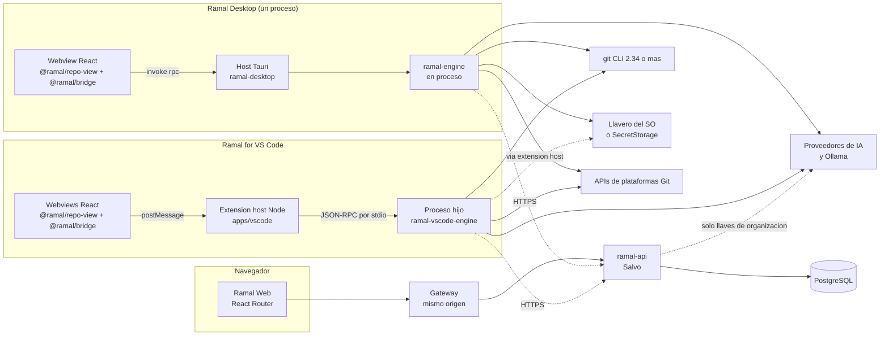
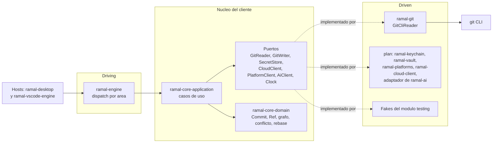
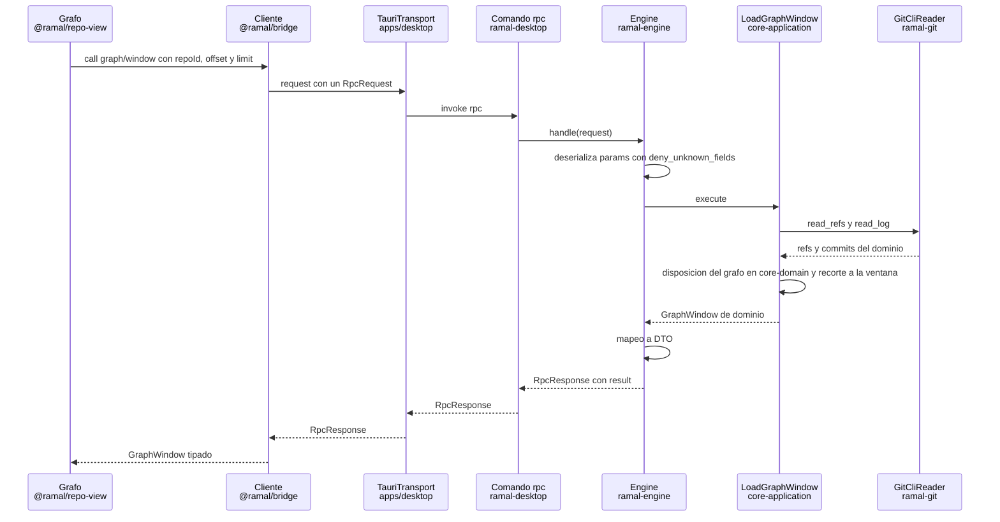
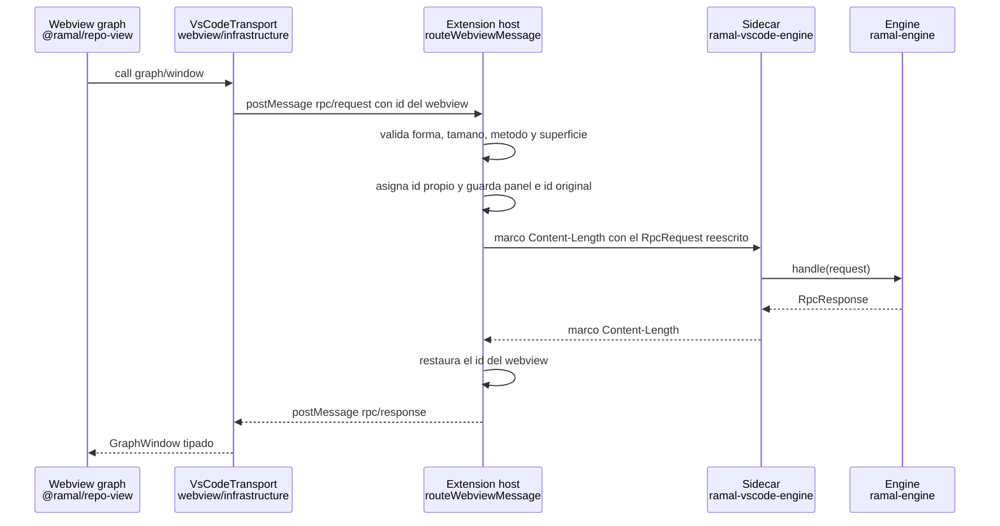
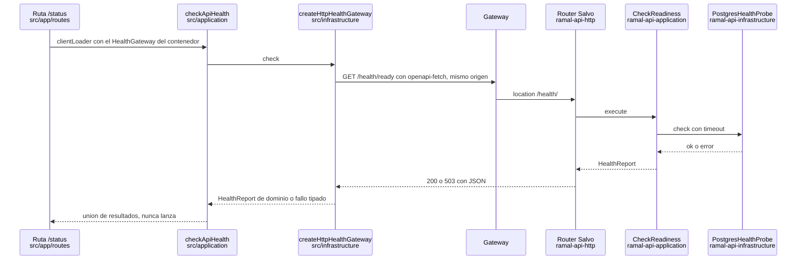
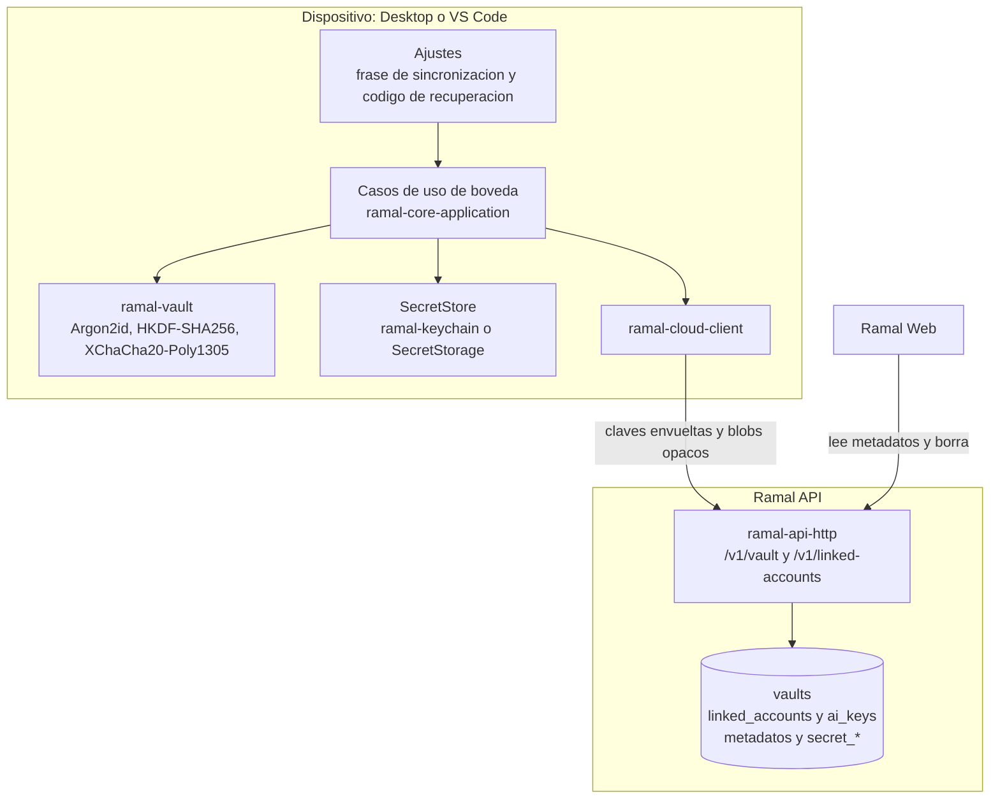

# Arquitectura

Ramal son tres productos que comparten una cuenta: Ramal Desktop, Ramal for VS Code y
Ramal Web. Por debajo hay cinco piezas de codigo con vida propia: la API (Rust, Salvo,
PostgreSQL), el motor Git del cliente (Rust, compartido por escritorio y VS Code), el host
de escritorio (Tauri 2 con React), la extension de VS Code (extension host en TypeScript,
webviews en React y el motor empaquetado como sidecar) y la web (React Router). Este
documento explica la arquitectura hexagonal una vez, dice como se aplica en cada pieza con
los nombres reales de crates, paquetes y carpetas, y fija las reglas de dependencia y los
contratos entre procesos.

Es un documento tecnico y es la especificacion que siguen varios implementadores en
paralelo, asi que es largo a proposito y preciso con los nombres. Quien solo quiera arrancar
el repo tiene el README. El contrato HTTP de la API, endpoint por endpoint, vive en
[api-surface.md](api-surface.md); el porque de cada decision, en [adr/](adr/); el diseno, en
[design/handoff/](design/handoff/), donde los prototipos `*.dc.html` mandan sobre su README.

Si el codigo y este documento dejan de coincidir, se arregla uno de los dos en el mismo PR.
La diferencia no se deja viva.

## Estado

El documento describe a la vez el primer corte y el destino. Todo lo que no existe todavia
se marca como planificado. La lista completa de que construye el primer corte y que queda
fuera esta en la [seccion 10](#10-primer-corte-y-lo-planificado).

## Decisiones de partida

No se reabren aqui: cada una tiene o tendra su ADR. Se listan porque condicionan la forma
de todo lo demas.

| Decision                                                        | Lo que implica para la arquitectura                                                                                                                                                                                                                                                                                                                                      |
| --------------------------------------------------------------- | ------------------------------------------------------------------------------------------------------------------------------------------------------------------------------------------------------------------------------------------------------------------------------------------------------------------------------------------------------------------------ |
| Un solo motor Git en Rust                                       | Desktop lo usa en proceso desde el host de Tauri. VS Code lo lleva como binario sidecar `ramal-vscode-engine` (JSON-RPC por stdio) dentro de VSIX por plataforma, el modelo de rust-analyzer. El extension host se queda fino.                                                                                                                                           |
| Motor hibrido, primero el git CLI                               | Todo va por el git CLI: escrituras, red, hooks, firma, LFS y credenciales. `gix` entra mas tarde y solo en lecturas calientes, detras del mismo puerto y cuando un benchmark lo justifique. Nada de libgit2 ni `git2`. Git minimo 2.34 con deteccion de capacidades.                                                                                                     |
| Secretos de cuentas de plataforma cifrados de extremo a extremo | El servidor nunca puede descifrarlos. No existen cuentas de plataforma compartidas con el equipo. La web no puede "probar conexion": solo ve metadatos y puede quitar una cuenta. Anadir o editar un token se hace en Desktop o en VS Code. Las llaves de IA personales, si el usuario activa su sincronizacion (apagada por defecto), usan la misma boveda.             |
| Llaves de IA de organizacion en el servidor                     | Cifradas en reposo con cifrado de sobre (AES-256-GCM, KEK con identificador para rotar). Nunca salen del servidor: la API hace de proxy de la generacion. Las llaves personales se llaman desde el motor del dispositivo, que es la unica forma de que funcione Ollama.                                                                                                  |
| Funciona sin cuenta de Ramal                                    | Todo lo que es Git local funciona sin iniciar sesion. Sincronizacion, equipos, llaves de IA de organizacion, dispositivos y el panel web piden sesion.                                                                                                                                                                                                                   |
| Monorepo pnpm + un workspace de Cargo + just                    | pnpm 11.18.0 por corepack con versiones exactas, un unico `Cargo.toml` raiz (resolver 3, edicion 2024, Rust 1.98.1 fijado en `rust-toolchain.toml`), `just` como punto de entrada unico, lefthook y commitlint. Sin Turborepo ni Nx. El crate de Tauri es miembro del workspace pero no esta en `default-members`, para que `cargo` funcione en maquinas sin webkit2gtk. |
| Web y API en el mismo origen                                    | Un gateway sirve la web estatica y enruta los prefijos de la API. La API no envia CORS. Desktop y VS Code nunca llaman a la API desde el webview: lo hace el motor en Rust.                                                                                                                                                                                              |

## 1. La idea en un parrafo

El nucleo de cada pieza (dominio mas casos de uso) no sabe nada del mundo exterior. No
conoce HTTP, ni SQL, ni React, ni Tauri, ni la API de VS Code, ni como se lanza un proceso.
Cuando necesita algo de fuera declara una interfaz, que es el puerto. Quien sabe hablar con
el exterior implementa ese puerto, y eso es el adaptador. La direccion de las dependencias
siempre apunta hacia dentro: el nucleo no importa a nadie.

Ramal tiene tres familias de hexagonos, y conviene tenerlas separadas en la cabeza:

- **El hexagono del servidor** (`apps/api`). Su nucleo es `ramal-api-domain` mas
  `ramal-api-application`: cuentas, sesiones, organizaciones, documentos sincronizados,
  boveda opaca, llaves de IA de organizacion.
- **El hexagono del cliente** (`crates/*`). Su nucleo es `ramal-core-domain` mas
  `ramal-core-application`: commits, refs, estado del arbol de trabajo, disposicion del
  grafo, conflictos, rebase, y mas adelante cuentas de plataforma, IA personal y
  sincronizacion. Lo usan dos hosts, el de Tauri y el sidecar de VS Code, y los dos entran
  por la misma funcion de `ramal-engine`. Por eso el protocolo es identico en ambos
  productos.
- **Los hexagonos de TypeScript.** La web sigue el molde de Gastonomo (cinco carpetas). El
  extension host de VS Code tiene nucleo propio porque orquesta cosas de VS Code (webviews,
  proceso del sidecar, idioma). Los frontends de escritorio y los webviews son casi solo
  adaptadores driving: sus casos de uso viven en el motor de Rust, y la logica pura de
  estado de interfaz (resolver de conflictos interactivo, editor de rebase, filtros) vive en
  el paquete `@ramal/domain`.

Los dos nucleos de Rust no se conocen. No hay conceptos de negocio que compartan de verdad:
el servidor nunca ve un commit y el cliente no gestiona organizaciones. Lo unico que cruzara
de un hexagono a otro son bibliotecas neutrales que no dependen de ninguno de los dos (la
unica prevista es `ramal-ai`, planificada), y el contrato HTTP, que cada lado modela con sus
propios tipos.

## 2. Mapa del sistema



| Proceso                   | Que corre dentro                                                                                               | Con quien habla                                                                                                                                 |
| ------------------------- | -------------------------------------------------------------------------------------------------------------- | ----------------------------------------------------------------------------------------------------------------------------------------------- |
| Ramal Desktop             | Un proceso de Tauri: el webview (React) y el host Rust `ramal-desktop`, que contiene `ramal-engine` en proceso | git CLI (procesos hijos), llavero del SO, APIs de plataformas, proveedores de IA, Ramal API                                                     |
| Extension host de VS Code | Node, el bundle `apps/vscode/dist/extension.cjs`                                                               | API de VS Code, sus webviews (postMessage), el sidecar (stdio)                                                                                  |
| Webviews de VS Code       | React, un webview por superficie (grafo, cambios, merge, ajustes)                                              | Solo el extension host: su CSP lleva `connect-src 'none'`                                                                                       |
| Sidecar de VS Code        | `ramal-vscode-engine`, que contiene `ramal-engine`                                                             | git CLI, APIs de plataformas, proveedores de IA, Ramal API; SecretStorage a traves del extension host                                           |
| Navegador                 | Ramal Web: landing prerenderizada mas SPA                                                                      | Gateway del mismo origen                                                                                                                        |
| Servidor                  | Gateway (nginx), `ramal-api`, PostgreSQL                                                                       | Proveedores OAuth de inicio de sesion, correo, proveedores de IA (solo llaves de organizacion), Bitbucket (solo el intercambio de codigo OAuth) |

## 3. El arbol del monorepo

Primeros dos o tres niveles, una linea por entrada. Lo marcado con `(plan)` no existe en el
primer corte pero ya tiene sitio reservado, para que nadie lo invente en otro lugar.

```
Cargo.toml                  Workspace unico: members, default-members (sin ramal-desktop), dependencias y lints comunes
Cargo.lock                  Un solo lockfile de Rust; lo leen los tests de arquitectura
rust-toolchain.toml         Rust 1.98.1 fijado, con clippy, rustfmt y llvm-tools-preview
clippy.toml                 Umbrales comunes: cognitiva 15, 50 lineas, 5 parametros, anidamiento 4
rustfmt.toml                Formato de Rust
deny.toml                   cargo-deny: licencias, avisos y crates vetados (git2, libgit2-sys)
.cargo/config.toml          TS_RS_EXPORT_DIR, la carpeta donde ts-rs escribe los tipos
package.json                packageManager pnpm@11.18.0, scripts de la raiz y tooling compartido
pnpm-workspace.yaml         apps/*, packages/*, tools/*; allowBuilds y reglas de pnpm
pnpm-lock.yaml
tsconfig.json               Solo referencias a cada proyecto TS; lo usa tsc -b
eslint.config.js            Calidad para tools/ (cada app y cada paquete TS tiene su propio config)
justfile                    Punto de entrada unico: setup, check, ci, e2e y recetas por pieza
lefthook.yml                pre-commit rapido, pre-push caro, commit-msg con commitlint
commitlint.config.mjs
.editorconfig  .prettierrc.json  .prettierignore  .gitignore  .gitattributes  .npmrc
.env.example                Variables RAMAL__ de la API con sus valores por defecto
compose.yaml                Pila de desarrollo: postgres, api, web y gateway
docker/                     gateway.dev.conf y gateway.prod.conf: un location por prefijo de la API
.github/workflows/          ci.yml (unica entrada y check all-green) y un workflow por pieza
README.md  CLAUDE.md
docs/
    architecture.md         Este documento
    api-surface.md          Contrato HTTP de la API, endpoint por endpoint
    adr/                    Decisiones, NNNN-slug-en-castellano.md
    design/handoff/         Diseno: prototipos *.dc.html, ramal-data.js y README
apps/
    api/                    Ramal API: Salvo 1.x + PostgreSQL (SQLx)
        crates/domain/          ramal-api-domain: entidades y reglas del servidor
        crates/application/     ramal-api-application: puertos, casos de uso y fakes (feature testing)
        crates/infrastructure/  ramal-api-infrastructure: config, SQLx, cifrado de sobre, correo, OAuth
        crates/http/            ramal-api-http: router, handlers, DTOs, problem+json, OpenAPI
        crates/api/             ramal-api: binario; composition root en src/bootstrap.rs + src/bootstrap/
        migrations/             SQL solo hacia delante, aplicado al arrancar
        openapi.json            Documento OpenAPI versionado; fuente de @ramal/api-client
        Dockerfile
    desktop/                Ramal Desktop (paquete @ramal/desktop)
        src/application/        Solo puertos del host de escritorio (RepositoryPicker, luego actualizador)
        src/infrastructure/     TauriTransport y adaptadores de los plugins de Tauri
        src/ui/                 Pantallas propias: shell y pestanas, inicio, ajustes
        src/app/                Composition root, router y providers
        e2e/                    Playwright contra el build de Vite con mockIPC
        wdio/                   (plan) E2E real con WebdriverIO y @wdio/tauri-service
        src-tauri/              Crate ramal-desktop, el host Tauri
            Cargo.toml              Fuera de default-members
            build.rs                tauri-build con AppManifest (permiso explicito por comando)
            tauri.conf.json         Ventana, CSP, bundle y (plan) updater
            capabilities/           Permisos minimos: rpc, repo_pick_and_open y los plugins usados
            src/                    main.rs, bootstrap.rs, commands.rs, surfaces.rs, event_sink.rs
    vscode/                 Ramal for VS Code (paquete @ramal/vscode, extension ramal.ramal)
        package.json            Manifiesto: contributes, activationEvents, engines.vscode
        package.nls.json  package.nls.es.json   Textos del manifiesto (ingles por defecto, espanol)
        src/shared/             Tipos de los mensajes entre webview y extension host, sin dependencias
        src/extension/          Extension host
            application/            Puertos y casos de uso del host; no importa vscode
            infrastructure/         Adaptadores de la API de VS Code, proceso del sidecar, validacion, HTML de webviews
            app/                    extension.ts (activate, deactivate) y composition-root.ts
        src/webview/            Webviews, build multipagina de Vite en dist/webview
            infrastructure/         VsCodeTransport y el RepoViewHost que habla con el extension host
            ui/                     Pantallas propias de VS Code (vista Cambios, ajustes)
            app/                    Una entrada por superficie: graph (primer corte), changes, merge, settings
        test/integration/       @vscode/test-cli bajo xvfb
        e2e/                    Playwright contra el bundle de webviews con acquireVsCodeApi falso
        dist/                   Artefactos: extension.cjs, webview/, bin/ramal-vscode-engine (ignorado en git)
    vscode-engine/          Crate ramal-vscode-engine: sidecar JSON-RPC 2.0 por stdio
        src/                    main.rs, bootstrap.rs, framing.rs, server.rs
    web/                    Ramal Web (paquete @ramal/web)
        react-router.config.ts  appDirectory src/app, ssr false, prerender de la landing
        src/domain/             Modelos propios de la web; sin imports externos salvo @ramal/domain
        src/application/        Puertos (AuthGateway, HealthGateway, SessionStore...) y casos de uso
        src/infrastructure/     Adaptadores HTTP sobre @ramal/api-client y adaptadores en memoria
        src/ui/                 Componentes y pantallas; reciben los puertos por contexto
        src/app/                root.tsx, routes.ts, routes/, composition-root.ts
        e2e/                    Playwright con red simulada y, aparte, contra la pila Docker
crates/
    core-domain/            ramal-core-domain: dominio puro del cliente (commits, refs, grafo, conflictos, rebase)
    core-application/       ramal-core-application: puertos, casos de uso y fakes en el modulo testing
    protocol/               ramal-protocol: metodos y DTOs del motor (serde + ts-rs), sin logica
    git/                    ramal-git: adaptador del git CLI (GitReader; GitWriter despues)
    engine/                 ramal-engine: dispatch, mapeo dominio-DTO y composition root del cliente
    vault/                  (plan) ramal-vault: criptografia de la boveda E2E
    keychain/               (plan) ramal-keychain: SecretStore sobre keyring-core
    platforms/              (plan) ramal-platforms: GitHub, GitLab, Bitbucket, Gitea, Azure DevOps
    ai/                     (plan) ramal-ai: proveedores, plantillas y filtro de ficheros sensibles
    cloud-client/           (plan) ramal-cloud-client: cliente de la Ramal API para el motor
packages/
    domain/                 @ramal/domain: logica pura de estado de interfaz, cero dependencias
    i18n/                   @ramal/i18n: diccionario ES/EN con claves tipadas, cero dependencias
    ui/                     @ramal/ui: tokens, temas, densidades, primitivas, proveedor de iconos
    repo-view/              @ramal/repo-view: vista de repositorio compartida por escritorio y VS Code
    bridge/                 @ramal/bridge: tipos generados del protocolo y cliente tipado sobre Transport
    api-client/             @ramal/api-client: cliente generado del OpenAPI de la API, solo para la web
    eslint-config/          @ramal/eslint-config: base, calidad, React, tests y boundaries
    tsconfig/               @ramal/tsconfig: base.json, react.json, node.json
tools/
    checks/                 @ramal/checks: tamano de fichero, tests enfocados, TODO con ticket, grafo de paquetes
    scripts/                scan-staged.sh, smoke-stack.sh y generadores (i18n, manifiesto de VS Code)
```

Convenciones que valen en todo el arbol:

- TypeScript: ficheros en kebab-case (`graph-window-query.ts`), tests colocalizados como
  `*.test.ts(x)`, sin enums ni namespaces (`erasableSyntaxOnly`).
- Rust: ficheros en snake_case, modulos al estilo 2018 (`port.rs` mas la carpeta `port/`,
  sin `mod.rs` salvo `tests/support/mod.rs`), docs `//!` y `///` en castellano, mensajes de
  `Display` y de `tracing` en ingles.
- Nombres: paquetes npm `@ramal/*`, crates `ramal-*`, variables de entorno de la API con
  prefijo `RAMAL__`, tickets `RAM-123`.

## 4. Los hexagonos, pieza por pieza

### 4.1 Vocabulario

| Termino           | Que es en Ramal                                                                  | Regla que no se negocia                                                                                        |
| ----------------- | -------------------------------------------------------------------------------- | -------------------------------------------------------------------------------------------------------------- |
| Dominio           | Tipos y reglas puras                                                             | Sin IO, sin reloj, sin aleatoriedad, sin serde                                                                 |
| Puerto            | Un trait de Rust o una interface de TypeScript que declara la capa de aplicacion | Lo consume un caso de uso y lo implementa un adaptador driven                                                  |
| Caso de uso       | Un struct con `execute` (Rust) o una funcion que recibe sus puertos (TypeScript) | Se prueba con fakes, sin runtime asincrono y sin red                                                           |
| Adaptador driven  | Implementa un puerto hablando con el exterior                                    | git CLI, SQLx, llavero, HTTP a plataformas                                                                     |
| Adaptador driving | Invoca casos de uso                                                              | Handler de Salvo, `dispatch` del motor, comando de Tauri, bucle JSON-RPC, componente React, comando de VS Code |
| Composition root  | El unico sitio que construye adaptadores y los cablea                            | Uno por proceso; en el cliente tiene dos niveles (ver 4.2)                                                     |

### 4.2 El motor cliente (`crates/*`)



#### ramal-core-domain

Dominio puro del cliente. Depende solo de `thiserror`. No lleva serde: el dominio no sabe
que existe JSON, y la forma del JSON la decide `ramal-protocol`.

```
src/sha.rs            Sha (40 hex validado) y la forma corta que da git (%h)
src/repo.rs           RepoRoot (ruta de la raiz del repo, newtype sobre PathBuf) y RepoId (opaco)
src/refs.rs           RefName, RefKind (rama local, rama remota, tag), RefSnapshot (refs + HEAD)
src/commit.rs         CommitNode (sha + padres en orden) y CommitRecord (autor, fecha, asunto)
src/time.rs           GitTime: segundos unix mas desplazamiento en minutos, tal como lo da git
src/graph.rs          Punto de entrada de la disposicion del grafo
src/graph/lanes.rs    Asignacion de carriles con puntas fijadas (pinned) y reutilizacion de huecos
src/graph/edges.rs    Aristas con carril de viaje (travel lane) para no cruzar nodos
src/graph/window.rs   Recorte de la disposicion a una ventana [offset, offset + limit)
(plan) status.rs      Estado de ficheros del arbol de trabajo (porcelain v2)
(plan) conflict.rs    Segmentos de conflicto y parse_conflict_markers (incluye |||||||)
(plan) rebase.rs      RebasePlan, validacion autoritativa y render del fichero todo
(plan) journal.rs     Diario de operaciones para deshacer y rehacer (refs y HEAD antes de cada escritura)
(plan) ref_format.rs  Validacion de nombres de rama y tag (reglas de git check-ref-format)
```

El algoritmo de carriles corrige el del ejemplo `DIFF` de `ramal-data.js`, que pierde huecos
y no reproduce el diseno: puntas fijadas al principio (la rama por defecto primero), el primer
padre hereda el hueco, un hueco solo se reutiliza cuando queda libre, los padres extra de un
merge ocupan el primer hueco libre, y se recortan los huecos vacios del final. Ademas cada arista guarda el carril por el
que viaja la reserva, para dibujar un merge en tres tramos (curva, vertical, curva) sin
atravesar nodos ajenos. Exige entrada en orden topologico (hijos antes que padres), que es
responsabilidad del lector de git. Los colores de carril (`carril % 6`) son presentacion y no
estan aqui.

**Por que el grafo se calcula en Rust y no en el webview:** en un repositorio con cientos de
miles de commits, calcular carriles en el webview obliga a mandar todo el historial por IPC
antes del primer pintado. El motor calcula la disposicion y devuelve solo la ventana visible
con carriles y aristas ya resueltos. En VS Code, ademas, es la unica opcion coherente con un
motor unico.

#### ramal-core-application

Puertos, casos de uso y estado del motor. Depende de `ramal-core-domain`, `async-trait` y
`thiserror`. No depende de tokio: los puertos son asincronos con `#[async_trait]` y
`Send + Sync`, y quien los ejecuta es el runtime del host.

```
src/port.rs                           Declaracion de modulos de puertos
src/port/git_reader.rs                GitReader (primer corte)
(plan) src/port/git_writer.rs         GitWriter: todo lo que escribe o toca la red
(plan) src/port/secret_store.rs       SecretStore: llavero o SecretStorage
(plan) src/port/cloud_client.rs       CloudClient: Ramal API
(plan) src/port/platform_client.rs    PlatformClient: PRs, checks, reviews, OAuth de dispositivo
(plan) src/port/ai_client.rs          AiClient: generacion con llave personal
(plan) src/port/vault_cipher.rs       VaultCipher: derivar, envolver, sellar y abrir
(plan) src/port/clock.rs              Clock
(plan) src/port/repo_watcher.rs       RepoWatcher: cambios en .git y en el arbol de trabajo
(plan) src/port/progress_sink.rs      ProgressSink: progreso de operaciones largas
src/use_case.rs                       Declaracion de modulos de casos de uso
src/use_case/engine/describe_engine.rs     DescribeEngine: version del motor y de git
src/use_case/repo/open_repository.rs       OpenRepository: descubre la raiz y emite un RepoId
src/use_case/graph/load_graph_window.rs    LoadGraphWindow: log + refs + disposicion + ventana
src/state/open_repositories.rs        Registro RepoId -> RepoRoot (varias pestanas, varios repos)
src/error.rs                          EngineError, el unico error que sale de un caso de uso
src/testing.rs                        Solo con #[cfg(any(test, feature = "testing"))]
src/testing/fake_git_reader.rs        FakeGitReader: responde lo que le digas y cuenta llamadas
src/testing/block_on.rs               Ejecutor sin runtime (Waker::noop) para tests sin tokio
```

Cada puerto nace con su primer caso de uso; no se declaran puertos que nadie usa. La lista de
arriba marca los que ya tienen sitio.

El puerto del primer corte:

```rust
#[async_trait]
pub trait GitReader: Send + Sync {
    async fn version(&self) -> Result<GitVersionInfo, GitReadError>;
    async fn discover(&self, path: &Path) -> Result<RepoRoot, GitReadError>;
    async fn read_refs(&self, repo: &RepoRoot) -> Result<RefSnapshot, GitReadError>;
    async fn read_log(&self, repo: &RepoRoot, query: &LogQuery) -> Result<Vec<CommitRecord>, GitReadError>;
}
```

`EngineError` tiene variantes cerradas (`RepositoryNotOpen`, `NotARepository`,
`GitUnavailable`, `GitVersionUnsupported { found, minimum }`, `InvalidWindow`,
`GitFailed { detail }`, y mas adelante `Cancelled` y `NotSignedIn`). El `detail` de un
fallo de git solo va al log; al cliente llega un tipo de error estable (ver 6.5).

#### ramal-protocol

El contrato entre la interfaz y el motor: nombres de metodo, DTOs de parametros y
resultados, y el sobre JSON-RPC. Depende de `serde`, `serde_json` y `ts-rs`. No depende de
ningun otro crate de Ramal, a proposito: si importara el dominio, cambiar un tipo interno
cambiaria el contrato sin que nadie lo viera. El mapeo entre dominio y DTO vive en
`ramal-engine`.

```
src/envelope.rs      RpcRequest, RpcResponse, RpcError, ErrorKind, RpcNotification, codigos JSON-RPC
src/methods.rs       PROTOCOL_VERSION y la tabla de metodos (macro define_methods!)
src/engine.rs        EngineInfo, GitInfo
src/repo.rs          OpenRepoParams, RepoHandle
src/graph.rs         GraphWindowParams, GraphWindow, GraphRow, GraphEdge, RefLabel
tests/export_bindings.rs   Escribe methods.ts e index.ts en packages/bridge/src/generated
```

Los tipos no llevan sufijo `Dto`: son exactamente los nombres que vera TypeScript. En
`ramal-engine` se importan con alias (`use ramal_protocol::graph as dto;`).

#### ramal-git

Adaptador driven del git CLI. Implementa `GitReader` en el primer corte y `GitWriter`
despues. Depende de `ramal-core-domain`, `ramal-core-application`, `tokio` (process,
io-util, time), `thiserror` y `tracing`.

```
src/cli.rs              Descubrimiento del binario y construccion de comandos
src/cli/runner.rs       Lanza git, aplica entorno y limites, mata el grupo de procesos al cancelar
src/cli/version.rs      Parsea git --version, rechaza < 2.34, calcula GitCapabilities
src/reader.rs           GitCliReader: implementa GitReader
src/parse.rs            Declaracion de parsers
src/parse/log.rs        Parser del log con separadores NUL y 0x1f
src/parse/refs.rs       Parser de for-each-ref
(plan) src/writer.rs    GitCliWriter
(plan) src/askpass.rs   Helper de credenciales por repo y de GIT_SSH (varias cuentas por plataforma)
(plan) src/trust.rs     Lectura de la configuracion local que puede ejecutar codigo (confianza)
(plan) src/sequence.rs  Helpers de GIT_SEQUENCE_EDITOR y GIT_EDITOR para el rebase interactivo
tests/support/mod.rs    Constructor de repos de prueba con el propio git en un tempdir
tests/log_reader.rs     Lecturas contra repos reales de prueba
```

Reglas del adaptador que evitan los errores clasicos:

- Siempre formatos de maquina: `-z`, `--porcelain=v2`, `--format` explicito con `%x00` y
  `%x1f`. Siempre `--no-pager`, `--no-color` y `-c core.quotepath=off`.
- Entorno fijo en cada llamada: `LC_ALL=C`, `GIT_TERMINAL_PROMPT=0`. Las lecturas en
  segundo plano anaden `GIT_OPTIONAL_LOCKS=0`, para que refrescar el estado nunca tome
  `index.lock` mientras el usuario trabaja en una terminal.
- Las refs se leen con `git for-each-ref`, nunca con la decoracion `%D` del log: un nombre
  de ref puede contener comas y `%D` las usa como separador.
- El log del grafo es `git log --topo-order --exclude=refs/stash --exclude=refs/notes/* --all
-z --format=%H%x1f%h%x1f%P%x1f%an%x1f%ae%x1f%aI%x1f%s --max-count=<offset+limit+1>`. Los
  stashes y las notas no son historia del proyecto (los stashes se ensenan en su propia
  seccion) y el commit sobrante solo dice si hay mas.
- Binario: el ajuste explicito si existe (en VS Code llega el `git.path` que expone la API
  `vscode.git`), si no el del `PATH`, y solo en Desktop para Windows un MinGit empaquetado como
  respaldo ([ADR 0009](adr/0009-motor-git-hibrido.md)).
- Ningun valor externo llega a argv como opcion: `--end-of-options` antes de refs, revisiones y
  URL, `--` antes de rutas, y nombres de rama validados con `git check-ref-format --branch` y sin
  `-` inicial. Clonar y hacer fetch llevan `-c protocol.allow=never -c protocol.https.allow=always
-c protocol.ssh.allow=always`; `file` solo para una carpeta elegida en el dialogo nativo.
- SSH por cuenta con `GIT_SSH` apuntando al helper, que recibe argv y lanza ssh sin shell, nunca
  con `core.sshCommand`. El helper de credenciales solo entrega un token si el protocolo es
  `https` y el host coincide exactamente (tras IDNA) con el de la cuenta ligada.
- **Confianza.** Antes del primer comando en un repositorio que Ramal no clono, el motor lee
  `git config --local --list --show-origin` (no ejecuta nada) y mira `.git/hooks`. Si hay claves
  que lanzan comandos (`core.fsmonitor`, `core.hooksPath`, `core.sshCommand`, `core.pager`,
  `core.editor`, `sequence.editor`, `diff.external`, `diff.*.textconv`, `diff.*.command`,
  `filter.*`, `merge.*.driver`, `credential.helper`, `gpg*.program`, `uploadpack.*`, `include*`) o
  hooks que no son `.sample`, el caso de uso devuelve `untrusted_repository` y la interfaz pregunta
  "Confiar en este repositorio". Sin confianza solo se lee, con
  `-c core.fsmonitor=false --no-ext-diff --no-textconv`. La confianza se guarda en el dispositivo
  por repositorio (puerto `TrustStore`).
- Capacidades por deteccion, no por suposicion: `GitCapabilities` dice si hay
  `merge-tree --write-tree` o `rebase --update-refs` (2.38).

`gix` entrara, si entra, como otro adaptador de `GitReader` metodo a metodo, con el del CLI
como respaldo. Por eso `GitReader` y `GitWriter` son dos puertos: las escrituras no se
tocaran nunca.

#### ramal-engine

Adaptador driving y composition root compartido del cliente. Es lo unico que los hosts ven.

```
src/builder.rs          EngineBuilder y EngineConfig: construye los adaptadores compartidos
src/engine.rs           Engine: handle(RpcRequest) y dispatch(method, params, ctx)
src/dispatch.rs         Tabla metodo -> handler
src/dispatch/engine.rs  engine/info
src/dispatch/repo.rs    repo/open
src/dispatch/graph.rs   graph/window
src/mapping.rs          Funciones de mapeo dominio -> DTO y EngineError -> RpcError
src/mapping/graph.rs
src/mapping/error.rs
(plan) src/host_ports.rs     Reexporta los puertos que implementan los hosts (SecretStore) y EventSink
(plan) src/adapters/ai.rs    Envoltorio fino que implementa AiClient sobre ramal-ai
tests/architecture.rs   Reglas de dependencia del hexagono del cliente (lee Cargo.lock)
tests/graph_window.rs   dispatch de punta a punta contra un repo real de prueba
```

La interfaz publica:

```rust
impl Engine {
    /// Punto de entrada de los dos hosts. None para notificaciones (sin id).
    pub async fn handle(&self, request: RpcRequest) -> Option<RpcResponse>;

    /// Lo que usa handle por dentro; tambien lo usan los tests.
    pub async fn dispatch(&self, method: &str, params: serde_json::Value, ctx: CallContext)
        -> Result<serde_json::Value, RpcError>;
}
```

Detalles que conviene saber antes de escribir un handler:

- Cada handler hace tres cosas y nada mas: deserializa los parametros con serde
  (`deny_unknown_fields`), llama al caso de uso y serializa el resultado. Si hay una regla
  de negocio dentro de un handler, esta en el sitio equivocado.
- El mapeo son funciones libres (`mapping::graph::window_to_dto(&GraphWindow) -> dto::GraphWindow`),
  no `impl From`: ni el tipo de dominio ni el DTO son de este crate, y la regla de huerfanos
  de Rust no deja implementar `From` entre dos tipos ajenos.
- **La composicion tiene dos niveles.** `EngineBuilder` construye los adaptadores que son
  iguales en los dos productos (git CLI y, mas adelante, plataformas, IA y Ramal API). Cada
  host es la raiz de fuera: lee su configuracion (rutas, binario de git) y aporta los
  adaptadores que solo el sabe construir, como el `SecretStore` (llavero en escritorio,
  SecretStorage a traves del extension host en VS Code) o el `EventSink` para las
  notificaciones. Nadie mas construye adaptadores.

### 4.3 El host de escritorio (`apps/desktop`)

Tiene dos mitades en dos lenguajes, y cada una es una capa concreta del hexagono.

**Lado Rust: `apps/desktop/src-tauri`, crate `ramal-desktop`.** Es un adaptador driving mas
la raiz de composicion exterior del cliente de escritorio.

```
src/main.rs          Arranque: tracing, runtime de Tauri y bootstrap
src/bootstrap.rs     Composition root: rutas de la app, EngineBuilder, plugins, estado gestionado
src/commands.rs      Comandos de Tauri: rpc, repo_pick_and_open y (plan) rpc_subscribe. Delegan en Engine
src/surfaces.rs      Lista de metodos del motor permitidos por ventana, generada como surfaces.ts de VS Code
src/event_sink.rs    (plan) EventSink sobre tauri::ipc::Channel para las notificaciones del motor
```

- Un comando de negocio, `rpc`, que recibe un `RpcRequest` y devuelve un
  `Option<RpcResponse>`. No hay un comando de Tauri por metodo: el protocolo es el mismo que
  el del sidecar y la lista de metodos vive en `ramal-protocol`, no en `commands.rs`.
- **El webview es un cliente que puede estar comprometido**: pinta mensajes de commit, nombres
  de rama y ficheros que no son de fiar. Por eso `rpc` no deja pasar todo al motor: rechaza los
  metodos marcados como del host en `define_methods!` (como `repo/open`) y comprueba la lista de
  la ventana que llama (`surfaces.rs`). Abrir un repositorio es otro comando,
  `repo_pick_and_open`, que ensena el dialogo nativo desde Rust y devuelve el `RepoHandle`: el
  webview nunca manda una ruta. Las acciones sobre ficheros ("Mostrar en carpeta", "Copiar
  ruta") van por `repoId` y ruta relativa al motor, que las valida (6.5).
- `rpc_subscribe` recibe un `Channel<RpcNotification>` al arrancar el frontend; por ahi
  salen progreso, cambios del repo y tokens de IA (planificado; el primer corte no emite
  notificaciones).
- El `Engine` se guarda como estado gestionado (`app.manage(Arc<Engine>)`).
- Plugins de Tauri solo donde el SO manda: dialogo (elegir carpeta, usado solo desde Rust),
  opener (abrir URL `https:` desde el webview, sin `open-path`; revelar en el explorador lo hace
  el host con un `repoId`), y mas adelante updater, deep-link y single-instance. Tauri no lanza
  git ni hace HTTP de negocio: eso es trabajo del motor.
- `build.rs` declara los comandos con
  `tauri_build::AppManifest::commands(&["rpc", "repo_pick_and_open"])` (y `rpc_subscribe` cuando
  exista), asi cada comando necesita un permiso explicito en `capabilities/default.json` y
  ninguna ventana puede invocar algo que no se le haya concedido.

**Lado TypeScript: `apps/desktop/src`.** No tiene `domain` propio: el dominio del cliente
esta en Rust y la logica pura de interfaz en `@ramal/domain`.

```
src/application/ports/     Puertos propios del host de escritorio: RepositoryPicker (elegir y abrir
                           un repositorio), luego UpdateChecker. Solo interfaces.
src/infrastructure/        tauri-transport.ts (Transport de @ramal/bridge sobre invoke y Channel),
                           tauri-repository-picker.ts (invoke de repo_pick_and_open),
                           (plan) adaptadores de RepoViewHost
src/ui/                    Shell con pestanas, inicio (repos y workspaces), ajustes. La vista de
                           repositorio es la de @ramal/repo-view
src/app/                   composition-root.ts (createContainer), app.tsx (router y providers), main.tsx
```

Hay carpeta `application` aunque el escritorio no tenga casos de uso de negocio, y es a
proposito: la interfaz no puede importar infraestructura, asi que las
capacidades del host que usa una pantalla propia (elegir y abrir un repositorio) necesitan un
tipo que viva en una capa que la interfaz si pueda importar. Solo lleva puertos y, si hace
falta, casos de uso de orquestacion de pantalla (abrir repo, abrir pestana). Es una carpeta que
el brief inicial no tenia (`src/{infrastructure,ui,app}`); se mantiene por ese motivo y
[ADR 0002](adr/0002-arquitectura-hexagonal.md) la recoge.

### 4.4 La extension de VS Code (`apps/vscode`) y el sidecar (`apps/vscode-engine`)

**Extension host, `apps/vscode/src/extension`.** Tiene nucleo propio porque orquesta cosas
que no son Git: arrancar y vigilar el sidecar, enrutar y validar mensajes de webviews,
decidir el idioma, y mas adelante el inicio de sesion con `AuthenticationProvider`.

```
application/ports/          EngineConnection (request, notify, onNotification), WebviewSurface,
                            Dialogs, Notifications, WorkspaceRepositories, Configuration, Timer, Logger
application/use-cases/      routeWebviewMessage, superviseEngine (reintentos con espera creciente),
                            openGraph (elige repo, abre en el motor, crea o revela el panel),
                            startup (arranca el sidecar, compara PROTOCOL_VERSION, fija el idioma)
application/surfaces.ts     Lista de metodos del motor permitidos por superficie
infrastructure/vscode/      Adaptadores de la API de VS Code: comandos, paneles, vistas, dialogos, configuracion
infrastructure/engine/      sidecar-engine-connection.ts (child_process.spawn y marcos Content-Length)
infrastructure/webview/     webview-message-schema.ts (zod), webview-html.ts (CSP, nonce, manifiesto de Vite)
app/extension.ts            activate y deactivate
app/composition-root.ts     Construye adaptadores y casos de uso
```

`application` no importa `vscode` ni nada de `node:`. Por eso se prueba con Vitest sin
arrancar VS Code; solo `infrastructure` y `app` tocan la API real, y eso lo cubren los tests
de integracion bajo xvfb.

**Webviews, `apps/vscode/src/webview`.** Mismo papel que el frontend de escritorio:
adaptadores driving que montan `@ramal/repo-view` con otra densidad, otro tema y otro
transporte.

```
infrastructure/     vscode-transport.ts (Transport sobre acquireVsCodeApi y el evento message),
                    vscode-repo-view-host.ts (RepoViewHost que pide al extension host dialogos nativos)
ui/                 Pantallas propias de VS Code: la caja de commit de la vista Cambios, los ajustes
app/entries/        graph.tsx (primer corte); changes.tsx, merge.tsx, settings.tsx (plan)
```

Si un webview necesita un puerto propio, aparece `src/webview/application/ports`, igual que en
escritorio.

**Mensajes compartidos, `apps/vscode/src/shared`.** Tipos de los mensajes entre webview y
extension host, sin dependencias salvo los tipos de `@ramal/bridge`. Los dos lados los
importan; nadie mas. Del webview al host: `webview/ready { surface }`,
`rpc/request { request }` y `host/request { id, method, params }`. Del host al webview:
`init { locale, surface, repoId, protocolVersion }`, `rpc/response { response }`,
`rpc/notification { notification }` y `host/response { id, result | error }`. `request`,
`response` y `notification` son los tipos del sobre generados desde `ramal-protocol`.

**Superficies nativas, no clones.** La paleta de comandos, los dialogos (`showInputBox`,
`showQuickPick`, avisos modales), las notificaciones, la barra de estado, las vistas de
arbol (ramas, remotos, PRs, stashes, tags), el diff (`vscode.diff`) y los ajustes escalares
(`contributes.configuration`) son de VS Code. Se implementan con su API desde el extension
host. En React solo hay lo que VS Code no puede dibujar: grafo, caja de commit, resolver de
merge (editor personalizado), formulario de PR y la parte de listas de los ajustes.

**Sidecar, `apps/vscode-engine`, crate `ramal-vscode-engine`.** Adaptador driving (bucle
JSON-RPC) y raiz de composicion exterior del cliente de VS Code.

```
src/main.rs        Argumentos (--git-path, --log-level), runtime de tokio, arranque
src/bootstrap.rs   Composition root: EngineBuilder con la configuracion recibida y los adaptadores del host
src/framing.rs     Lectura y escritura de marcos Content-Length sobre stdin y stdout
src/server.rs      Bucle: una tarea por peticion, una unica tarea escritora en stdout
(plan) src/reverse.rs   Peticiones del motor al extension host (secretos de SecretStorage)
```

- **stdout es solo protocolo.** Todo el log va a stderr con `tracing-subscriber`, y el
  extension host lo vuelca en el canal de salida "Ramal Engine". Un `println!` rompe el
  protocolo, y por eso `print_stdout` esta denegado en clippy en todo el workspace.
- El sidecar termina cuando se cierra su stdin. El extension host lo arranca la primera
  vez que hace falta y, si muere, lo reinicia tras 1, 2, 4, 8 y 16 segundos; con cinco
  caidas en tres minutos deja de intentarlo y muestra una notificacion con "Reintentar".
  Las peticiones pendientes fallan con el tipo `engine_unavailable`, que genera el host.
- Ruta del binario: en produccion siempre `dist/bin/ramal-vscode-engine` (con `.exe` en
  Windows) dentro de la VSIX de su plataforma. Solo en modo desarrollo
  (`ExtensionMode.Development`) se acepta el ajuste `ramal.engine.path`, de ambito
  aplicacion, para apuntar a `target/debug`. Un ajuste de workspace nunca puede elegir que
  binario se ejecuta: seria ejecucion de codigo con abrir una carpeta.
- Manifiesto: `extensionKind: ["workspace"]` (git corre donde esta el repo, tambien en
  Remote SSH, WSL y contenedores), `capabilities.virtualWorkspaces: false` y
  `capabilities.untrustedWorkspaces.supported: false`, porque ejecutar git en una carpeta
  no confiable puede ejecutar hooks y configuracion del repo. Un repositorio que se abre fuera
  de las carpetas de confianza del workspace pasa por la misma comprobacion de confianza que en
  escritorio (ver `ramal-git`).

### 4.5 La API (`apps/api`)

Cinco crates, uno por capa, con el mismo molde que Gastonomo.

```
crates/domain          ramal-api-domain. Entidades y value objects. thiserror, uuid, chrono. Sin serde.
crates/application     ramal-api-application. Puertos y casos de uso, AppError, fakes en testing.
crates/infrastructure  ramal-api-infrastructure. Config (figment, RAMAL__), SQLx, cifrado de sobre,
                       hash de contrasenas, correo, clientes OAuth, (plan) adaptador de ramal-ai.
crates/http            ramal-api-http. Router, handlers, DTOs, problem+json, catcher, OpenAPI,
                       middlewares de request id, limite de ritmo e idempotencia.
crates/api             ramal-api. Binario y composition root: src/bootstrap.rs + src/bootstrap/<contexto>.rs.
```

- **Contextos.** Primer corte: `health`. Planificados, cada uno con su modulo en las cinco
  capas: `auth` (identidades, contrasena, OAuth de inicio de sesion, sesiones y refresh
  rotatorio), `devices`, `organizations` (miembros, invitaciones, asientos), `workspaces` y
  `repositories` (metadatos, nunca rutas locales de otros dispositivos), `settings`
  (documentos sincronizados con version), `vault` (blobs opacos, ver 8.2),
  `linked_accounts` (metadatos de cuentas de plataforma), `org_ai` (llaves de organizacion y
  proxy de generacion, ver 8.3), `platform_oauth` (intercambio de codigo con secreto de
  cliente, solo donde el proveedor lo exige) y `releases` (manifiesto del updater y datos de
  descarga).
- **Adaptadores driving.** El router de Salvo es el obvio. Tambien lo son el catcher de
  problem+json (traduce 404 y 405 antes de que llegue ningun handler), los trabajos
  periodicos (reenvolver DEK tras rotar la KEK, limpiar refresh tokens caducados), que son
  bucles de tokio que llaman a casos de uso, y el middleware de idempotencia, que repite la
  respuesta de un reintento: vive en `http` porque repetir una respuesta es transporte, pero
  su almacen es un puerto de `application`.
- **Convenciones del contrato.** Todo bajo `/v1`; listas envueltas en `items` con
  paginacion por cursor; errores `application/problem+json` (RFC 9457) con `title`,
  `detail` y `errors[].message` en castellano y ademas un `code` estable en el problema y en
  cada `errors[]`, que es lo que traducen los clientes con `@ramal/i18n` cuando la interfaz
  esta en ingles; un recurso de otra cuenta responde 404, nunca 403 (lo decide el caso de
  uso con `AppError::NotFound`); `Idempotency-Key` donde un reintento podria duplicar algo;
  concurrencia optimista (`ETag` e `If-Match`) en los documentos sincronizados; limite de
  ritmo; `x-request-id` en cada respuesta; salud en `/health/live` y `/health/ready`;
  OpenAPI en `/openapi.json`, publico, y Swagger UI en `/swagger-ui` solo en desarrollo: el
  gateway de produccion no lo enruta ([ADR 0007](adr/0007-docker-desarrollo-y-produccion.md)).
- **OpenAPI.** Se genera con la feature `oapi` de Salvo (salvo-oapi 1.0) desde el propio
  router, en lugar de construirlo a mano con utoipa como en Gastonomo: con Salvo 1.0 es
  nativo y el documento no puede desincronizarse de las rutas. Un test de `ramal-api-http`
  compara el documento con `apps/api/openapi.json` y falla si difieren
  (`just api-openapi` lo reescribe, como dice [ADR 0003](adr/0003-rust-con-salvo.md)). Ese fichero
  es la fuente de `@ramal/api-client`.
- **Migraciones.** `apps/api/migrations/<YYYYMMDDHHMMSS>_<nombre>.sql`, solo hacia delante,
  embebidas con `sqlx::migrate!` y aplicadas al arrancar. Si fallan, el proceso sigue vivo y
  `/health/ready` responde 503. Consultas en tiempo de ejecucion (`sqlx::query`), sin
  macros `query!`, para no necesitar base de datos al compilar.

### 4.6 La web (`apps/web`)

Cinco carpetas dentro de `src`, una por capa, como en Gastonomo. La diferencia es React
Router 8 en modo framework: `react-router.config.ts` fija `appDirectory: "src/app"`,
`ssr: false` y `prerender` para las rutas de la landing; el panel es SPA.

```
src/domain           Modelos propios de la web (resumen de dispositivo, fila de repositorio del panel).
                     Sin imports externos salvo @ramal/domain.
src/application      Puertos (HealthGateway, AuthGateway, SessionStore, Clock...) y casos de uso
                     como funciones que reciben sus puertos y devuelven una union de resultados.
src/infrastructure   Adaptadores HTTP sobre @ramal/api-client (createHttpHealthGateway...),
                     adaptadores en memoria para tests y almacenamiento de sesion.
src/ui               Componentes y pantallas. Reciben los puertos por contexto; nunca construyen adaptadores.
src/app              root.tsx, routes.ts, routes/<ruta>.tsx, composition-root.ts.
```

- Los modulos de ruta (`src/app/routes/*.tsx`) son finos: su `clientLoader` llama a un caso
  de uso con los puertos del contenedor y su componente pinta una pantalla de `src/ui`. El
  contenedor lo crea `composition-root.ts` una vez por carga y `root.tsx` lo entrega a la
  interfaz con providers.
- En el prerender los `loader` corren en Node al construir: solo pueden leer datos publicos
  (textos, datos de descarga). Nada de sesion en el prerender.
- La landing se prerenderiza en los dos idiomas (`/` en castellano, `/en/` en ingles) para
  que los buscadores y las previsualizaciones vean contenido real. Auth y panel son rutas SPA
  y su idioma sale de la preferencia guardada.
- La web habla solo con la API del mismo origen. La sesion va en cookies HttpOnly con
  proteccion CSRF; el detalle esta en el ADR de autenticacion.

### 4.7 Los paquetes TypeScript compartidos (`packages/*`)

Todos se consumen como codigo fuente (`exports` apunta a `.ts`), asi que no hay paso de
build que orquestar: los transpila Vite o Vitest y los comprueba `tsc -b`.

| Paquete             | Papel en el hexagono                                   | Contenido                                                                                                                                                                                                                                                                                                                                                                                                                                                                                                                                        |
| ------------------- | ------------------------------------------------------ | ------------------------------------------------------------------------------------------------------------------------------------------------------------------------------------------------------------------------------------------------------------------------------------------------------------------------------------------------------------------------------------------------------------------------------------------------------------------------------------------------------------------------------------------------ |
| `@ramal/domain`     | Dominio puro de interfaz, compartido por las tres apps | Modelo interactivo del resolver de conflictos (elecciones por linea, tomar bloque, todo A o todo B, salida, edicion manual, regla de resuelto), modelo del editor de rebase (reordenar, cambiar accion, reword, resumen, validacion inmediata), filtros y agrupacion de repos, agregacion de PRs, tiempo relativo, enmascarado de llaves, reglas del mensaje de commit (72 caracteres, Conventional Commits), validacion de nombres de rama para prompts, validacion de formularios de auth, deteccion del SO para descargas. Cero dependencias. |
| `@ramal/i18n`       | Biblioteca pura                                        | Diccionario ES/EN por espacios de nombres con claves tipadas, traductor, plurales con `Intl.PluralRules`, formatos de fecha y tiempo relativo, `resolveLocale`. Cero dependencias (ver seccion 7).                                                                                                                                                                                                                                                                                                                                               |
| `@ramal/bridge`     | Puerto de transporte y cliente del motor               | `Transport` (el puerto), `createBridgeClient(transport)`, `BridgeError`, y en `src/generated/` los tipos de `ramal-protocol` generados con ts-rs mas el mapa de metodos. Cero dependencias en tiempo de ejecucion. Los transportes concretos viven en cada app.                                                                                                                                                                                                                                                                                  |
| `@ramal/ui`         | Primitivas de interfaz, sin puertos                    | Tokens semanticos, `themes/ramal.css`, `themes/vscode.css`, densidades, primitivas (boton, menu contextual con submenus, modal, toast, toggle, segmentado, tabla), proveedor de iconos y el enlace React de `@ramal/i18n` (`I18nProvider`, `useT`).                                                                                                                                                                                                                                                                                              |
| `@ramal/repo-view`  | Adaptador driving compartido                           | Grafo (filas virtualizadas y SVG a partir de la ventana del motor), fila WIP, detalle de commit, diff, resolver de conflictos, editor de rebase. Habla con el motor por el cliente de `@ramal/bridge` y con el host por el puerto `RepoViewHost`, que declara el propio paquete.                                                                                                                                                                                                                                                                 |
| `@ramal/api-client` | Ayuda para adaptadores driven de la web                | Tipos generados de `apps/api/openapi.json` con openapi-typescript y un cliente openapi-fetch. Solo lo importa `apps/web/src/infrastructure`.                                                                                                                                                                                                                                                                                                                                                                                                     |

**`RepoViewHost` (planificado, el grafo del primer corte no lo necesita)** es el puerto de las
capacidades que dependen del host: confirmar, pedir un texto, elegir de una lista, avisar,
copiar, abrir un fichero en el editor, abrir un diff, abrir una URL. En escritorio lo
implementan modales y toasts de `@ramal/ui` mas plugins de Tauri; en VS Code, mensajes al
extension host que llama a la API nativa. Una restriccion sale de ahi: una peticion de texto
no puede llevar una funcion de validacion, porque no cruza `postMessage`. Lleva un valor
declarativo (`validation: "branch-name" | "tag-name" | "non-empty" | "none"`) y cada host
aplica el validador correspondiente de `@ramal/domain`.

**Duplicacion aceptada con el motor.** El editor de rebase valida el plan en TypeScript para
responder al instante, y el motor lo vuelve a validar antes de ejecutarlo. La validacion de
Rust es la que manda; la de TypeScript es comodidad. Lo mismo con el resolver: el motor
entrega los segmentos ya parseados, TypeScript gestiona las elecciones y construye el texto,
y el motor comprueba que no quedan marcadores antes de completar el merge.

### 4.8 Donde vive cada test

| Capa                                         | Herramienta                                                                                            | Donde                                                                  |
| -------------------------------------------- | ------------------------------------------------------------------------------------------------------ | ---------------------------------------------------------------------- |
| Dominio y aplicacion de Rust (cliente y API) | `cargo test` con fakes y `block_on`, sin tokio                                                         | `#[cfg(test)] mod tests` o `tests/` de cada crate                      |
| `ramal-git`                                  | `cargo test` contra repos reales creados con git en un tempdir                                         | `crates/git/tests/`                                                    |
| Motor de punta a punta                       | `cargo test` de `dispatch` contra repos de prueba                                                      | `crates/engine/tests/`                                                 |
| Framing y ciclo de vida del sidecar          | `cargo test`                                                                                           | `apps/vscode-engine/tests/`                                            |
| Host de Tauri                                | `tauri::test` (feature `test`): comandos registrados y serializan                                      | `apps/desktop/src-tauri/tests/`                                        |
| API contra PostgreSQL                        | `cargo test` con `RAMAL_TEST_DATABASE_URL`; `RAMAL_TEST_REQUIRE_DATABASE=1` impide que se salten solos | `apps/api/crates/infrastructure/tests/`, `apps/api/crates/http/tests/` |
| Paquetes TS y capas puras de las apps        | Vitest                                                                                                 | Colocalizados, `*.test.ts(x)`                                          |
| Flujos de interfaz                           | Playwright contra builds de Vite con hosts simulados (mockIPC, acquireVsCodeApi falso, red simulada)   | `apps/*/e2e/`                                                          |
| E2E real, pocos                              | WebdriverIO + @wdio/tauri-service, @vscode/test-cli bajo xvfb, Playwright contra la pila Docker        | `apps/desktop/wdio/`, `apps/vscode/test/integration/`, `apps/web/e2e/` |

El detalle de la piramide y de que corre en cada momento esta en el ADR de testing.

## 5. Reglas de dependencia

La direccion de las dependencias es estructural (un crate por capa en Rust, una carpeta por
capa en TypeScript) y ademas la vigila una herramienta. Una regla que solo vive en este
documento se rompe sola en tres semanas.

### 5.1 Crates de Rust

En los crates de nucleo la regla es de lista blanca: sus dependencias directas deben ser un
subconjunto exacto de la columna "externos permitidos". En los adaptadores la regla es de
lista negra sobre el cierre transitivo.

| Crate                       | Papel                                  | Workspace permitido                                                                                                                                     | Externos permitidos (directos)                                                                                                                                                                                                                                                       | Prohibido                                                                                                                                                                                                                                                                               |
| --------------------------- | -------------------------------------- | ------------------------------------------------------------------------------------------------------------------------------------------------------- | ------------------------------------------------------------------------------------------------------------------------------------------------------------------------------------------------------------------------------------------------------------------------------------ | --------------------------------------------------------------------------------------------------------------------------------------------------------------------------------------------------------------------------------------------------------------------------------------- |
| `ramal-core-domain`         | Dominio del cliente                    | ninguno                                                                                                                                                 | `thiserror`                                                                                                                                                                                                                                                                          | En el cierre transitivo: `serde`, `serde_json`, `ts-rs`, `tokio`, `async-trait`, `reqwest`, `hyper`, `sqlx`, `salvo`, `tauri`, `gix`, `git2`, `libgit2-sys`, `keyring-core`, cualquier `ramal-*`. En el codigo: lanzar procesos, sistema de ficheros, red, variables de entorno, reloj. |
| `ramal-core-application`    | Puertos y casos de uso del cliente     | `ramal-core-domain`                                                                                                                                     | `async-trait`, `thiserror`                                                                                                                                                                                                                                                           | Lo mismo que el dominio, salvo `async-trait` y `ramal-core-domain`.                                                                                                                                                                                                                     |
| `ramal-protocol`            | Contrato del motor                     | ninguno                                                                                                                                                 | `serde`, `serde_json`, `ts-rs`                                                                                                                                                                                                                                                       | Cualquier `ramal-*`, `tokio`, `tauri`, `salvo`, `sqlx`.                                                                                                                                                                                                                                 |
| `ramal-git`                 | Driven                                 | `ramal-core-domain`, `ramal-core-application`                                                                                                           | `tokio`, `thiserror`, `tracing`; dev: `tempfile`, `rstest`, `insta`                                                                                                                                                                                                                  | `ramal-protocol`, `ramal-engine`, hosts, `tauri`, `salvo`, `sqlx`, `git2`, `libgit2-sys`.                                                                                                                                                                                               |
| `ramal-engine`              | Driving y composition root del cliente | `ramal-core-domain`, `ramal-core-application`, `ramal-protocol`, `ramal-git`; (plan) `ramal-vault`, `ramal-platforms`, `ramal-ai`, `ramal-cloud-client` | `serde`, `serde_json`, `thiserror`, `tracing`, `tokio`                                                                                                                                                                                                                               | En el cierre: `tauri`, `tauri-*`, `salvo`, `sqlx`, `git2`, `libgit2-sys`, cualquier `ramal-api-*`.                                                                                                                                                                                      |
| `ramal-desktop`             | Host de escritorio                     | Solo `ramal-engine` y `ramal-protocol`; (plan) `ramal-keychain`                                                                                         | `tauri`, `tauri-build`, `tauri-plugin-*`, `serde`, `serde_json`, `tokio`, `tracing`, `tracing-subscriber`                                                                                                                                                                            | Dependencia directa de `ramal-core-*` o `ramal-git`: el host habla con el motor, no con sus piezas. `salvo`, `sqlx`, `ramal-api-*`.                                                                                                                                                     |
| `ramal-vscode-engine`       | Host de VS Code                        | Solo `ramal-engine` y `ramal-protocol`                                                                                                                  | `tokio`, `serde`, `serde_json`, `thiserror`, `tracing`, `tracing-subscriber`                                                                                                                                                                                                         | Dependencia directa de `ramal-core-*` o `ramal-git`. En el cierre: `tauri`, `tauri-*`, `salvo`, `sqlx`.                                                                                                                                                                                 |
| `ramal-api-domain`          | Dominio del servidor                   | ninguno                                                                                                                                                 | `thiserror`, `uuid`, `chrono`                                                                                                                                                                                                                                                        | Directos: `serde`. En el cierre: `tokio`, `sqlx`, `salvo`, `salvo-oapi`, `reqwest`, `hyper`, `figment`, `argon2`, `jsonwebtoken`, `lettre`, `aes-gcm`, cualquier crate del cliente. En el codigo: procesos, ficheros, red, entorno, reloj.                                              |
| `ramal-api-application`     | Puertos y casos de uso del servidor    | `ramal-api-domain`                                                                                                                                      | `async-trait`, `thiserror`, `uuid`, `chrono`                                                                                                                                                                                                                                         | Lo mismo que `ramal-api-domain`.                                                                                                                                                                                                                                                        |
| `ramal-api-infrastructure`  | Driven                                 | `ramal-api-domain`, `ramal-api-application`; (plan) `ramal-ai`                                                                                          | `sqlx`, `figment`, `serde`, `serde_json`, `argon2`, `jsonwebtoken`, `ed25519-dalek` (proveedor EdDSA de ADR 0008), `hmac`, `sha2`, `aes-gcm`, `secrecy`, `zeroize`, `rand`, `base64`, `reqwest`, `lettre`, (plan) `image` (foto de perfil), `tokio`, `tracing`, `tracing-subscriber` | `salvo`, `ramal-api-http`, cualquier crate del cliente salvo `ramal-ai`.                                                                                                                                                                                                                |
| `ramal-api-http`            | Driving                                | `ramal-api-domain`, `ramal-api-application`                                                                                                             | `salvo` (con `oapi`), `serde`, `serde_json`, `url` (validar redirecciones de loopback y `returnTo`), `tracing`                                                                                                                                                                       | `sqlx`, `ramal-api-infrastructure`, cualquier crate del cliente.                                                                                                                                                                                                                        |
| `ramal-api`                 | Composition root del servidor          | Todos los `ramal-api-*`                                                                                                                                 | `tokio`, `tracing`, `tracing-subscriber`                                                                                                                                                                                                                                             | Cualquier crate del cliente.                                                                                                                                                                                                                                                            |
| `ramal-vault` (plan)        | Driven del cliente                     | `ramal-core-domain`, `ramal-core-application`                                                                                                           | `argon2`, `chacha20poly1305`, `hkdf`, `hmac`, `sha2`, `rand`, `zeroize`, `thiserror`                                                                                                                                                                                                 | Red, `tokio`, cualquier `ramal-api-*`.                                                                                                                                                                                                                                                  |
| `ramal-keychain` (plan)     | Driven del cliente                     | `ramal-core-application`                                                                                                                                | `keyring-core` y sus almacenes por SO, `thiserror`                                                                                                                                                                                                                                   | `tauri`, cualquier `ramal-api-*`.                                                                                                                                                                                                                                                       |
| `ramal-platforms` (plan)    | Driven del cliente                     | `ramal-core-domain`, `ramal-core-application`                                                                                                           | `reqwest`, `serde`, `serde_json`, `tokio`, `thiserror`, `tracing`                                                                                                                                                                                                                    | Cualquier `ramal-api-*`.                                                                                                                                                                                                                                                                |
| `ramal-cloud-client` (plan) | Driven del cliente                     | `ramal-core-domain`, `ramal-core-application`                                                                                                           | `reqwest`, `serde`, `serde_json`, `tokio`, `thiserror`, `tracing`                                                                                                                                                                                                                    | Cualquier `ramal-api-*`: modela el contrato HTTP con sus propios tipos y lo protege con tests de contrato contra `apps/api/openapi.json`.                                                                                                                                               |
| `ramal-ai` (plan)           | Biblioteca neutral                     | ninguno                                                                                                                                                 | `reqwest`, `serde`, `serde_json`, `tokio`, `thiserror`, `tracing`                                                                                                                                                                                                                    | Cualquier `ramal-*`. Es la unica pieza que usan los dos hexagonos, y solo puede serlo si no depende de ninguno.                                                                                                                                                                         |

Reglas transversales:

- Ningun crate `ramal-api-*` alcanza un crate del cliente (`ramal-core-*`, `ramal-protocol`,
  `ramal-git`, `ramal-engine`, hosts), y ningun crate del cliente alcanza un `ramal-api-*`.
  La unica arista permitida entre familias es hacia `ramal-ai`, desde
  `ramal-api-infrastructure` y `ramal-engine`.
- `git2` y `libgit2-sys` estan vetados en todo el workspace (`deny.toml`).
- `unsafe_code = "forbid"` en todo el workspace.

### 5.2 Paquetes y carpetas de TypeScript

| Paquete o carpeta                          | Puede importar del workspace                                                                                           | Puede importar de npm                                                                                                                                                                                                                                            | Prohibido que conviene recordar                                                     |
| ------------------------------------------ | ---------------------------------------------------------------------------------------------------------------------- | ---------------------------------------------------------------------------------------------------------------------------------------------------------------------------------------------------------------------------------------------------------------- | ----------------------------------------------------------------------------------- |
| `@ramal/domain`                            | nada                                                                                                                   | nada, ni `node:*`                                                                                                                                                                                                                                                | Todo                                                                                |
| `@ramal/i18n`                              | nada                                                                                                                   | nada                                                                                                                                                                                                                                                             | `react`: el enlace React vive en `@ramal/ui`                                        |
| `@ramal/bridge`                            | nada                                                                                                                   | nada                                                                                                                                                                                                                                                             | `@tauri-apps/*`, `vscode`, `acquireVsCodeApi`: los transportes viven en las apps    |
| `@ramal/ui`                                | `@ramal/i18n`                                                                                                          | `react` y `react-dom` (peer), `react-aria-components` ([ADR 0011](adr/0011-ui-compartida-y-puente-tipado.md)), `lucide-react` (solo en `icons/lucide`), `@vscode/codicons` (solo en `icons/codicons`), `@fontsource/ibm-plex-sans` y `-mono` (solo en `themes/`) | `@ramal/bridge`, `@ramal/repo-view`, `@ramal/api-client`, `@tauri-apps/*`, `vscode` |
| `@ramal/repo-view`                         | `@ramal/ui`, `@ramal/domain`, `@ramal/i18n`, `@ramal/bridge`                                                           | `react`, `@tanstack/react-query`, `@tanstack/react-virtual`                                                                                                                                                                                                      | `@tauri-apps/*`, `vscode`, `@ramal/api-client`, `fetch` o cualquier red             |
| `@ramal/api-client`                        | nada                                                                                                                   | `openapi-fetch`                                                                                                                                                                                                                                                  | Todo lo demas                                                                       |
| `apps/web/src/domain`                      | `src/domain`, `@ramal/domain`                                                                                          | nada                                                                                                                                                                                                                                                             |                                                                                     |
| `apps/web/src/application`                 | `src/domain`, `src/application`, `@ramal/domain`                                                                       | nada: ni `react` ni `zod`                                                                                                                                                                                                                                        |                                                                                     |
| `apps/web/src/infrastructure`              | `src/domain`, `src/application`, `src/infrastructure`, `@ramal/api-client`, `@ramal/domain`                            | `zod`                                                                                                                                                                                                                                                            | `src/ui`, `src/app`, `react`                                                        |
| `apps/web/src/ui`                          | `src/domain`, `src/application`, `src/ui`, `@ramal/ui`, `@ramal/i18n`, `@ramal/domain`                                 | `react`, `react-router`                                                                                                                                                                                                                                          | `src/infrastructure`, `src/app`, `@ramal/api-client`, `zod`                         |
| `apps/web/src/app`                         | Todas las capas y paquetes de arriba                                                                                   | `react`, `react-dom`, `react-router`                                                                                                                                                                                                                             |                                                                                     |
| `apps/desktop/src/application`             | `src/application`, `@ramal/domain`, tipos de `@ramal/bridge`                                                           | nada                                                                                                                                                                                                                                                             |                                                                                     |
| `apps/desktop/src/infrastructure`          | `src/application`, `src/infrastructure`, `@ramal/bridge`, `@ramal/domain`                                              | `@tauri-apps/api`, `@tauri-apps/plugin-*`                                                                                                                                                                                                                        | `src/ui`, `src/app`, `react`                                                        |
| `apps/desktop/src/ui`                      | `src/application`, `src/ui`, `@ramal/ui`, `@ramal/repo-view`, `@ramal/i18n`, `@ramal/domain`, tipos de `@ramal/bridge` | `react`                                                                                                                                                                                                                                                          | `src/infrastructure`, `src/app`, `@tauri-apps/*`                                    |
| `apps/desktop/src/app`                     | Todo lo anterior                                                                                                       | `react`, `react-dom`, `@tanstack/react-query`                                                                                                                                                                                                                    |                                                                                     |
| `apps/vscode/src/shared`                   | tipos de `@ramal/bridge`                                                                                               | nada                                                                                                                                                                                                                                                             |                                                                                     |
| `apps/vscode/src/extension/application`    | `src/shared`, `@ramal/i18n`, `@ramal/bridge` (tipos y la lista generada de metodos)                                    | nada                                                                                                                                                                                                                                                             | `vscode`, `node:*`, `src/webview`                                                   |
| `apps/vscode/src/extension/infrastructure` | `extension/application`, `extension/infrastructure`, `src/shared`, `@ramal/bridge`                                     | `vscode`, `node:*`, `zod`                                                                                                                                                                                                                                        | `react`, `src/webview`                                                              |
| `apps/vscode/src/extension/app`            | `src/extension/*`, `src/shared`                                                                                        | `vscode`                                                                                                                                                                                                                                                         | `src/webview`                                                                       |
| `apps/vscode/src/webview/infrastructure`   | `src/shared`, `@ramal/bridge`, `@ramal/domain`                                                                         | nada (usa el global `acquireVsCodeApi`)                                                                                                                                                                                                                          | `vscode`, `node:*`, `@tauri-apps/*`                                                 |
| `apps/vscode/src/webview/ui`               | `webview/ui`, `@ramal/ui`, `@ramal/repo-view`, `@ramal/i18n`, `@ramal/domain`, tipos de `@ramal/bridge`                | `react`                                                                                                                                                                                                                                                          | `webview/infrastructure`, `webview/app`, `src/extension`                            |
| `apps/vscode/src/webview/app`              | `src/webview/*`, `src/shared`                                                                                          | `react`, `react-dom`, `@tanstack/react-query`                                                                                                                                                                                                                    | `src/extension`                                                                     |

Reglas entre paquetes: un paquete nunca depende de una app, una app nunca depende de otra
app, y todo `@ramal/*` se declara con `workspace:*`. La web no importa `@ramal/bridge` ni
`@ramal/repo-view` mientras no exista la vista previa del producto en la landing
(planificada, con un transporte en memoria y datos de demostracion); cuando llegue, se amplia
la lista blanca del guardian en el mismo PR.

### 5.3 Como se fuerza, no solo se documenta

| Regla                                                  | Rust                                                                                       | TypeScript                                                                                                |
| ------------------------------------------------------ | ------------------------------------------------------------------------------------------ | --------------------------------------------------------------------------------------------------------- |
| Capas dentro de una pieza                              | Un crate por capa. Tests de arquitectura que leen `Cargo.lock`, uno por hexagono           | `eslint-plugin-boundaries` con `default: "disallow"` y `checkAllOrigins`, un config por app y por paquete |
| Dependencias externas por capa                         | Lista blanca directa en los nucleos y lista negra transitiva en todos                      | Politicas de `boundaries` por origen `external` y `core`                                                  |
| Dependencias entre piezas                              | Tests de cruce de hexagonos en los dos tests de arquitectura                               | `tools/checks/package-graph.mjs` sobre los `package.json`, mas las project references de TypeScript       |
| APIs de la biblioteca estandar prohibidas en el nucleo | `clippy.toml` propio en cada crate de nucleo con `disallowed-methods` y `disallowed-types` | `node:*` prohibido en `domain` y `application` por `boundaries`                                           |
| Crates vetados en todo el repo                         | `cargo deny check bans`                                                                    | no aplica                                                                                                 |

**Los tests de arquitectura de Rust.** Hay dos, uno por hexagono, en el crate que hace de
composition root de cada uno:

- `apps/api/crates/api/tests/architecture.rs` para el servidor.
- `crates/engine/tests/architecture.rs` para el cliente.

Los dos leen el `Cargo.lock` de la raiz linea a linea, sin crate de TOML, como en Gastonomo,
construyen el grafo de dependencias y comprueban tres cosas: las dependencias directas de los
crates de nucleo son un subconjunto de su lista blanca; el cierre transitivo de cada crate no
contiene nada de su lista negra; y ningun crate de una familia alcanza a la otra salvo
`ramal-ai`. El del cliente comprueba tambien las dependencias directas de `ramal-desktop`, y
puede hacerlo sin compilar Tauri porque `Cargo.lock` describe a todos los miembros del
workspace, esten o no en `default-members`. Un test de cordura verifica que el parser ve
aristas reales (que `ramal-git` alcanza `tokio`, que `ramal-api-http` alcanza `salvo`). El
mensaje de fallo dice que crate alcanza que y termina con "the hexagon leaks: move that code
to an adapter".

En el nucleo del cliente `serde` si esta en la lista negra transitiva, porque su cierre es
diminuto (`thiserror`, `async-trait` y sus macros) y ningun crate permitido lo trae. En el
nucleo de la API no se puede: `Cargo.lock` lista la dependencia opcional de `chrono` con
`serde` en cuanto otro crate del workspace activa esa feature, asi que alli `serde` se
controla con la lista blanca directa, igual que en Gastonomo.

**Sin procesos ni IO en el nucleo.** Prohibir `tokio` no basta, porque `std::process::Command`
esta en la biblioteca estandar. Cada crate de nucleo (`ramal-core-domain`,
`ramal-core-application`, `ramal-api-domain`, `ramal-api-application`) tiene su propio
`clippy.toml` con `disallowed-types` (`std::process::Command`, `std::fs::File`,
`std::net::TcpStream`, `std::net::TcpListener`, `std::net::UdpSocket`) y `disallowed-methods`
(`std::process::Command::new`, `std::fs::read`, `std::fs::read_to_string`, `std::fs::write`,
`std::env::var`, `std::env::var_os`, `std::time::SystemTime::now`, `std::thread::spawn`,
`std::thread::sleep`). La hora de pared llega siempre por el puerto `Clock`; `Instant::now` si
se permite, porque medir una latencia (la sonda de salud lo hace) no es leer la hora. Clippy
usa el `clippy.toml` mas cercano sin fusionarlo con el de la raiz, asi que estos ficheros
repiten los umbrales comunes, y el test de arquitectura comprueba que coinciden con los de la
raiz.

**El guardian del grafo de paquetes.** `tools/checks/package-graph.mjs` (Node, sin
dependencias, como el resto de `tools/checks`) recorre `apps/*`, `packages/*` y `tools/*`,
lee cada `package.json` y compara sus `dependencies`, `devDependencies` y `peerDependencies`
sobre `@ramal/*` con la tabla de 5.2, que vive como constante en el propio script. Falla si
aparece un paquete del workspace que no esta en la tabla, si `@ramal/domain`, `@ramal/i18n`
o `@ramal/bridge` declaran cualquier dependencia de npm, si una app depende de otra app o si
un `@ramal/*` no usa `workspace:*`. Corre en `just check`, en pre-commit cuando cambia un
`package.json` y en CI.

**Project references de TypeScript.** Cada paquete y cada app es un proyecto `composite` y
solo referencia en su `tsconfig.json` los paquetes que 5.2 le permite. Los paquetes
compartidos emiten solo declaraciones (`noEmit: false`, `emitDeclarationOnly: true`,
`outDir: "./node_modules/.tmp/tsc"`) para que las referencias funcionen; las apps son hojas.
Importar codigo de un paquete no referenciado hace fallar `tsc -b` con TS6307 (fichero fuera
de la lista del proyecto). Es una segunda red, mas tosca que `boundaries`, que no depende de
que alguien haya configurado bien ESLint.

**Limites de calidad.** Los mismos que Gastonomo y bloqueantes: fichero de codigo de 300
lineas y de test de 400, cognitiva 15, ciclomatica 10 (solo TypeScript; clippy no tiene lint
de ciclomatica y se documenta en el ADR de enforcement), funcion de 50 lineas, 5 parametros,
anidamiento 4, nada de codigo muerto, TODO solo con ticket (`TODO(RAM-123)` o `TODO(#123)`),
nada de tests enfocados, cobertura del 80% en los nucleos (`ramal-core-*`, `ramal-api-domain`,
`ramal-api-application`, `@ramal/domain`, `@ramal/i18n`, `domain` y `application` de la web y
del extension host) y del 60% global. Los avisos son errores (`-D warnings`,
`--max-warnings 0`). Se aplican en local (`just check`), en cada commit (lefthook) y en cada
PR (`all-green`). Condicionan el diseno: por eso los modulos de este documento estan partidos
en ficheros pequenos desde el principio.

## 6. Caminos de una peticion y contratos entre procesos

### 6.1 Desktop



`TauriTransport` es `invoke<RpcResponse | null>("rpc", { request })` de
`@tauri-apps/api/core`. `invoke` solo rechaza por fallos de transporte; un error del motor
llega como `RpcResponse` con `error` y el cliente del bridge lo convierte en `BridgeError`.
Las notificaciones (planificadas) llegan por un `Channel<RpcNotification>` creado al arrancar
y registrado con `invoke("rpc_subscribe", { channel })`.

### 6.2 VS Code



Antes de todo eso, cuando el usuario ejecuta "Ramal: Open Graph", el extension host elige el
repositorio (la carpeta del workspace, o un QuickPick si hay varias), llama el mismo a
`repo/open` y pasa el `repoId` al webview en el mensaje `init`. El webview nunca envia rutas
del sistema de ficheros.

Las peticiones nativas (dialogos, abrir fichero, copiar) viajan como `host/request` y las
resuelve el extension host con la API de VS Code, sin pasar por el sidecar. Las
notificaciones del motor llegan al extension host y este las reenvia a los webviews
suscritos como `rpc/notification`.

### 6.3 Web



El gateway tiene un `location` por prefijo de la API (`/v1/`, `/health/`, `= /openapi.json`
y, solo en desarrollo, `/swagger-ui`) antes del `location /` de la web. Las rutas son las mismas
dentro y fuera del gateway: no hay prefijo `/api` que se quite por el camino
([ADR 0007](adr/0007-docker-desarrollo-y-produccion.md)). Cada prefijo nuevo necesita su `location` en
los dos ficheros del gateway y una sonda en `tools/scripts/smoke-stack.sh`: en Gastonomo un
prefijo olvidado mando 25 rutas a la SPA con todos los tests en verde.

### 6.4 Del motor a la Ramal API y a las plataformas (planificado)

El motor es el unico que habla con el exterior en Desktop y en VS Code:

- Ramal API: `ramal-cloud-client` implementa `CloudClient` con `reqwest`. El token de acceso
  vive en memoria del motor y el refresh token en el `SecretStore`. La API no necesita CORS
  porque ningun navegador hace estas peticiones.
- Plataformas Git: `ramal-platforms` implementa `PlatformClient` y llama directamente a
  GitHub, GitLab, Bitbucket, Gitea y Azure DevOps con el token de la cuenta ligada al repo.
- IA personal: el adaptador de `ramal-ai` en `ramal-engine` llama al proveedor con la llave
  del `SecretStore`.

El webview no ve nunca un token. En escritorio lo asegura que la CSP solo permite IPC; en
VS Code, `connect-src 'none'`.

### 6.5 El protocolo del motor

Es JSON-RPC 2.0, el mismo en los dos productos. Cambia solo el transporte: `invoke` en
escritorio, marcos `Content-Length` por stdio en VS Code (con `postMessage` de por medio entre
webview y extension host).

**Sobre.** Los tipos viven en `ramal-protocol/src/envelope.rs`:

```jsonc
// Peticion
{ "jsonrpc": "2.0", "id": 7, "method": "graph/window",
  "params": { "repoId": "repo-1", "offset": 0, "limit": 200 } }

// Respuesta correcta
{ "jsonrpc": "2.0", "id": 7, "result": { "...": "..." } }

// Respuesta con error
{ "jsonrpc": "2.0", "id": 7,
  "error": { "code": -32000, "message": "repository repo-9 is not open",
             "data": { "kind": "repo_not_open" } } }

// Notificacion (sin id); planificadas
{ "jsonrpc": "2.0", "method": "repo/changed", "params": { "repoId": "repo-1" } }
```

- `id` es un entero no negativo menor que 2^31, para que sea un `number` seguro en
  TypeScript. No se admiten ids de texto.
- `params` es siempre un objeto; los metodos sin parametros reciben `{}`.
- Nombres de metodo `<area>/<verbo>` en camelCase (`graph/window`, `repo/open`,
  `engine/info`). Notificaciones de control con prefijo `$/` (`$/cancel`, `$/progress`,
  planificadas).
- Campos en camelCase (`#[serde(rename_all = "camelCase")]`). Los parametros llevan
  `deny_unknown_fields`. Un campo opcional se declara con
  `#[serde(default, skip_serializing_if = "Option::is_none")]` y `#[ts(optional)]`.
- Nada de enteros de 64 bits en los DTOs: ts-rs los traduce a `bigint` y romperian el JSON
  normal. Los instantes viajan como texto ISO 8601 con desplazamiento (lo que da `%aI`).
- Codigos: los estandar de JSON-RPC (-32700 parseo, -32600 peticion invalida, -32601 metodo
  inexistente, -32602 parametros invalidos, -32603 interno), -32800 cancelada (el de LSP) y
  -32000 para cualquier error del motor. Lo que la interfaz usa para decidir es
  `error.data.kind`, un enum cerrado (`ErrorKind`) que ts-rs exporta como union de literales:
  `invalid_params`, `repo_not_open`, `not_a_repository`, `git_not_found`,
  `git_version_unsupported`, `git_failed`, `internal`, y mas adelante `cancelled`,
  `not_signed_in`. `message` esta en ingles y es para el log; la interfaz traduce el `kind`
  con `@ramal/i18n`. El extension host y el bridge anaden tres tipos que no vienen del motor:
  `transport`, `timeout` y `engine_unavailable`.
- Version: `PROTOCOL_VERSION` es una constante de `ramal-protocol`. `engine/info` la devuelve
  y el extension host la compara al arrancar el sidecar con la que trae generada; como viajan
  en la misma VSIX, una diferencia es un fallo de empaquetado y se muestra como tal. En
  escritorio no puede haber diferencia: se compila todo junto.
- Marcos del sidecar: `Content-Length: <bytes>\r\n\r\n` seguido de exactamente esos bytes de
  JSON en UTF-8. Se ignoran otras cabeceras. Un marco de mas de 32 MiB se rechaza y se cierra
  la conexion. El sidecar atiende peticiones en paralelo (una tarea por peticion) y una unica
  tarea escribe en stdout, para que dos respuestas no se mezclen.
- Cliente del bridge: `client.call(method, params, { signal, timeoutMs })` con 30 segundos por
  defecto. Rechaza con `BridgeError { kind, message, data }`. Las operaciones largas
  (planificadas: fetch, push, clonado) informan por `$/progress` y no usan timeout.
- **Metodos del host.** `define_methods!` marca los metodos que solo puede llamar un host
  (`repo/open`, y los que se anadan con rutas absolutas o secretos). Los dos hosts los rechazan
  cuando la peticion viene de un webview, y cada ventana o superficie tiene su lista generada.
- **Rutas en los parametros.** Ningun parametro que venga de un webview lleva una ruta absoluta.
  Las rutas relativas al repositorio (preparar, descartar, resolver con contenido) se rechazan si
  contienen `..` o NUL, o si despues de seguir enlaces simbolicos salen del arbol de trabajo.
- **Nada secreto hacia un webview.** Ningun metodo devuelve tokens, llaves, la VK ni la frase. Los
  resultados pueden traer rutas para ensenarlas (`root` de `RepoHandle`), nunca al reves.

**Metodos del primer corte.**

| Metodo         | Parametros                                          | Resultado                                                                                  | Quien lo llama                                                                                               |
| -------------- | --------------------------------------------------- | ------------------------------------------------------------------------------------------ | ------------------------------------------------------------------------------------------------------------ |
| `engine/info`  | `{}`                                                | `EngineInfo { engineVersion, protocolVersion, git: GitInfo { path, version, supported } }` | Host de escritorio y extension host, al arrancar                                                             |
| `repo/open`    | `{ path }`                                          | `RepoHandle { repoId, root, headRef, headSha, isDetached, isEmpty }`                       | Solo los hosts: el comando `repo_pick_and_open` en escritorio y el extension host en VS Code. Ningun webview |
| `graph/window` | `{ repoId, offset, limit }`, `limit` entre 1 y 1000 | `GraphWindow { repoId, offset, rows, hasMore, laneCount }`                                 | `@ramal/repo-view`                                                                                           |

```
GraphRow  { sha, shortSha, parents: string[], lane, edges: GraphEdge[], summary,
            authorName, authorEmail, authoredAt (ISO 8601), refs: RefLabel[], isHead }
GraphEdge { parentSha, parentRow: number | null, fromLane, travelLane, toLane,
            kind: "firstParent" | "merge" }
RefLabel  { name, fullName, kind: "localBranch" | "remoteBranch" | "tag", isHead }
```

`parentRow` es la fila absoluta del padre o `null` si queda fuera de lo cargado; la interfaz
dibuja entonces la arista hasta el borde inferior en lugar de omitirla (el prototipo la
omitia). Las puntas fijadas del algoritmo son, por orden, la rama por defecto (la que apunta
`refs/remotes/origin/HEAD`, si no `main`, si no `master`) y nada mas en el primer corte. La
fila WIP no la da `graph/window`: llegara con el estado del arbol de trabajo.

### 6.6 Tipos de TypeScript generados con ts-rs

- Cada DTO de `ramal-protocol` deriva `Serialize`, `Deserialize` y `TS` con `#[ts(export)]`.
  ts-rs 12 respeta los atributos de serde, asi que el TypeScript coincide con el JSON real. El
  campo `params` del sobre es un `serde_json::Value`, que ts-rs traduce con su feature
  `serde-json-impl`.
- `.cargo/config.toml` fija `TS_RS_EXPORT_DIR` (relativo a la raiz) en
  `packages/bridge/src/generated`. ts-rs escribe un fichero por tipo al correr
  `cargo test -p ramal-protocol`.
- ts-rs no genera valores ni el mapa de metodos, asi que la macro `define_methods!` de
  `src/methods.rs` declara cada metodo una vez (`"graph/window" => GraphWindowParams -> GraphWindow`)
  y el test `tests/export_bindings.rs` escribe dos ficheros mas: `methods.ts`, con el tipo
  `EngineMethods` (metodo -> `{ params, result }`), la constante `ENGINE_METHODS` (la lista
  que usa el extension host como lista blanca) y `PROTOCOL_VERSION`; e `index.ts`, que
  reexporta todo con `export type *`. Los nombres de los tipos salen del trait `TS` de ts-rs,
  no de texto escrito a mano.
- Lo generado se commitea: el TypeScript compila sin cargo. `generated/` esta fuera de ESLint,
  knip y del control de tamano.
- `just protocol-gen` regenera y `just protocol-check` regenera y falla si
  `git diff --exit-code -- packages/bridge/src/generated` no esta limpio o hay ficheros sin
  seguimiento en esa carpeta. La CI corre `just protocol-check`. Si alguien cambia un DTO y no regenera, la CI falla con el diff
  a la vista.
- `@ramal/api-client` sigue el mismo patron con otra fuente: `just api-client` genera
  `packages/api-client/src/generated/schema.ts` desde `apps/api/openapi.json` con
  openapi-typescript, y CI comprueba que no hay diff.

### 6.7 Como valida el extension host los mensajes de un webview

Un webview pinta contenido no confiable (mensajes de commit, nombres de rama, contenido de
ficheros), asi que se trata como un cliente hostil. El extension host es la frontera:

1. **Origen.** Solo escucha `onDidReceiveMessage` de webviews que ha creado el mismo; cada
   panel tiene su propio canal y su superficie conocida (`graph`, `changes`, `merge`,
   `settings`).
2. **Tamano.** Descarta mensajes de mas de 1 MiB serializados; las peticiones de un webview
   son pequenas.
3. **Forma.** `webview-message-schema.ts` valida con zod la union de mensajes de
   `src/shared`: `webview/ready`, `rpc/request` (con un `RpcRequest` bien formado: id
   entero en rango, `method` texto, `params` objeto) y `host/request` (con `params` validado
   por un esquema zod por metodo del host). Lo que no encaja se descarta y se registra.
4. **Metodo y superficie.** Un `rpc/request` solo pasa si el metodo esta en `ENGINE_METHODS`
   (generado) y en la lista de su superficie (`application/surfaces.ts`). `repo/open` y
   `engine/info` no estan en ninguna: solo los llama el host. En el primer corte la
   superficie `graph` solo puede llamar a `graph/window`.
5. **Ids propios.** El host reescribe el id hacia el sidecar con un contador propio y guarda
   `(panel, id original)`. Un webview no puede chocar con otro ni cancelar peticiones ajenas.
6. **El motor vuelve a validar.** Los parametros se deserializan con `deny_unknown_fields` y
   los `repoId` se buscan en el registro del motor: un id inventado da `repo_not_open`. El
   motor es la autoridad; el host es la primera red.

### 6.8 CSP

**Webviews de VS Code.** `webview-html.ts` genera el HTML a partir del manifiesto de Vite con
un nonce nuevo en cada carga:

```
default-src 'none';
script-src 'nonce-${nonce}';
style-src ${webview.cspSource};
font-src ${webview.cspSource};
img-src ${webview.cspSource} data:;
connect-src 'none';
frame-src 'none';
base-uri 'none';
form-action 'none';
```

Las URLs de recursos pasan por `webview.asWebviewUri` y `localResourceRoots` se limita a
`dist/webview`. No hace falta `'unsafe-inline'` en estilos porque ninguna pieza inyecta
etiquetas `<style>` en tiempo de ejecucion (no hay CSS-in-JS) y las props `style` de React se
aplican por CSSOM, que la CSP no bloquea. Si un avatar llega a mostrarse algun dia, lo
descarga el motor y viaja como `data:`. En desarrollo, una CSP distinta permite el servidor
de Vite en `http://localhost:<puerto>` y `ws:` para HMR, y solo se usa en
`ExtensionMode.Development`.

**Tauri.** En `tauri.conf.json`, `app.security`:

```
csp:
  default-src 'none';
  script-src 'self';
  style-src 'self';
  font-src 'self';
  img-src 'self' data:;
  connect-src ipc: http://ipc.localhost;
  frame-src 'none';
  object-src 'none';
  base-uri 'none';
  form-action 'none'
devCsp: lo mismo mas el servidor de Vite y ws: para HMR
freezePrototype: true
```

Y en `app`: `withGlobalTauri: false`. Tauri anade por su cuenta los hashes de sus scripts de
inicializacion. El permiso del plugin opener se limita a URL `https:` y no incluye `open-path`. `connect-src` sin `https:` es lo que garantiza que el webview de escritorio
no puede hablar con la red aunque alguien lo intente: toda salida pasa por el comando `rpc`.
Las fuentes van empaquetadas (`@fontsource/ibm-plex-*`), nunca desde Google Fonts.

**Web.** La CSP la pone el gateway como cabecera. React Router incrusta scripts de
hidratacion en el HTML prerenderizado, asi que la politica de `script-src` exacta (hashes
generados al construir) se fija en el documento de despliegue de la web; lo que no se acepta
es `'unsafe-inline'` en `script-src`. Ademas:

- `frame-ancestors 'none'` y `X-Frame-Options: DENY` en toda respuesta de la web y de la API. Las
  paginas de autorizar una app (`/authorize/app`), activar un codigo (`/activate`), reiniciar la
  boveda y eliminar la cuenta no se pueden cargar dentro de un marco ajeno.
- `require-trusted-types-for 'script'` con una politica que no crea HTML a partir de texto. Si
  una dependencia lo impide, la excepcion se documenta en el despliegue.
- Un XSS en `ramal.dev` es la puerta para aprobar sesiones nativas, asi que en las tres
  interfaces React esta prohibido `dangerouslySetInnerHTML` (regla `react/no-danger` de ESLint) y
  el Markdown (notas de version, descripciones de PR) se pinta sin HTML crudo.

## 7. Tema, UI compartida e idioma

### 7.1 Tokens semanticos y dos ficheros de tema

Los componentes solo leen tokens semanticos, nunca un color literal:

| Grupo              | Tokens                                                                                                          |
| ------------------ | --------------------------------------------------------------------------------------------------------------- |
| Superficies        | `--r-bg`, `--r-panel`, `--r-surface`, `--r-surface-hover`, `--r-border`                                         |
| Texto              | `--r-text`, `--r-muted`, `--r-faint`                                                                            |
| Acento y estados   | `--r-accent`, `--r-accent-ink`, `--r-accent-soft`, `--r-ok`, `--r-warn`, `--r-danger`, `--r-info`, `--r-merged` |
| Diff               | `--r-add-bg`, `--r-del-bg`                                                                                      |
| Estado de fichero  | `--r-status-m`, `--r-status-a`, `--r-status-d`, `--r-status-r`, `--r-status-c`                                  |
| Carriles del grafo | `--r-lane-0` a `--r-lane-5`                                                                                     |
| Tipografia         | `--r-font-ui`, `--r-font-code`, `--r-font-size-base`                                                            |
| Forma              | `--r-radius-sm`, `--r-radius-md`, `--r-radius-lg`, `--r-radius-xl`, `--r-shadow-overlay`                        |
| Densidad           | `--r-row-h`, `--r-menu-item-h`, `--r-sidebar-item-h`, `--r-toolbar-h`                                           |

- `packages/ui/src/themes/ramal.css`: los valores oklch del handoff para
  `[data-theme="dark"]` y `[data-theme="light"]` sobre `<html>`. Lo usan escritorio y web.
  La web sube `--r-font-size-base` de 13 a 14 px en su propia hoja.
- `packages/ui/src/themes/vscode.css`: cada token apunta a una variable de VS Code
  (`--r-bg: var(--vscode-editor-background)`, `--r-panel: var(--vscode-sideBar-background)`,
  `--r-border: var(--vscode-panel-border)`, `--r-text: var(--vscode-foreground)`,
  `--r-accent: var(--vscode-button-background)`,
  `--r-status-m: var(--vscode-gitDecoration-modifiedResourceForeground)`,
  `--r-font-ui: var(--vscode-font-family)`, `--r-font-code: var(--vscode-editor-font-family)`,
  y asi con el resto). El alto contraste (`body.vscode-high-contrast` y
  `body.vscode-high-contrast-light`) se trata aparte, con bordes de
  `--vscode-contrastBorder`. El tema cambia solo cuando cambia el de VS Code, sin codigo.
- Los colores de carril son los mismos en todos los temas y en VS Code: el diseno lo pide.
- La hoja de estilos de cada componente es un CSS Module (`*.module.css`) que solo usa
  tokens. Es CSS de coste cero en ejecucion, lo entiende Vite en los tres hosts y no choca
  con ninguna CSP.

### 7.2 Dos densidades

`[data-density="comfortable"]` (escritorio y web) y `[data-density="compact"]` (VS Code):

| Token                        | comfortable | compact |
| ---------------------------- | ----------- | ------- |
| `--r-row-h` (fila del grafo) | 40px        | 28px    |
| `--r-menu-item-h`            | 32px        | 24px    |
| `--r-sidebar-item-h`         | 30px        | 22px    |
| `--r-toolbar-h`              | 62px        | 34px    |

El SVG del grafo necesita numeros en JavaScript (alto de fila, origen X, radio de nodo,
puntos de control de las curvas). `@ramal/ui` exporta `DENSITIES` con esos valores por
densidad y `@ramal/repo-view` los lee segun la densidad que le pasa el host; un test de
Vitest en `@ramal/ui` parsea el CSS y falla si un valor del CSS y de `DENSITIES` difieren. Las
diferencias entre escritorio y VS Code son tokens y densidad, no ramas `if (vscode)` en los
componentes.

### 7.3 Proveedor de iconos

`<Icon name="branch" />` con `IconName` como union cerrada de nombres semanticos (`branch`,
`remote`, `tag`, `stash`, `fetch`, `pull`, `push`, `ai`, `settings`, `conflict`, `pr-open`,
`pr-draft`, `pr-merged`, `check`, `more`, `close`...). El host elige el juego en su
composition root con `<IconProvider icons={...}>`:

- `@ramal/ui/icons/lucide`: `Record<IconName, componente de lucide-react>`, para escritorio y web.
- `@ramal/ui/icons/codicons`: `Record<IconName, clase de @vscode/codicons>`, para los webviews.

Al ser `Record<IconName, ...>`, un icono nuevo sin equivalente en uno de los dos juegos no
compila. Y al ser subrutas distintas, Lucide nunca entra en el bundle de VS Code ni Codicons
en el de escritorio. Los glifos Unicode del prototipo no se usan.

### 7.4 Quien pone tema, densidad e iconos

| Host                | Tema                                                    | Densidad    | Iconos   | Fuente                      |
| ------------------- | ------------------------------------------------------- | ----------- | -------- | --------------------------- |
| Escritorio          | `ramal.css`, `data-theme` desde el ajuste de apariencia | comfortable | Lucide   | IBM Plex empaquetada, 13 px |
| Web                 | `ramal.css`, `data-theme` desde el conmutador           | comfortable | Lucide   | IBM Plex empaquetada, 14 px |
| Webviews de VS Code | `vscode.css`, sigue el tema del editor                  | compact     | Codicons | La de VS Code               |

### 7.5 i18n

`@ramal/i18n` es la unica fuente de textos de interfaz de las tres apps.

```
src/locales/es/<espacio>.ts   Fuente de verdad: common, repos, graph, staging, diff, conflict,
                              rebase, menu, dialog, toast, settings, ai, team, errors, vscode, web
src/locales/en/<espacio>.ts   Tipado contra es: una clave que falta en ingles no compila
src/translator.ts             createTranslator(locale): t(clave, params) con parametros tipados
src/plural.ts                 Sufijos _one y _other resueltos con Intl.PluralRules
src/format.ts                 formatRelativeTime, formatDate, formatShortcut
src/locale.ts                 Locale ("es" | "en") y resolveLocale
scripts/migrate-from-prototype.ts   Conversion unica de D y W del prototipo a espacios de nombres
test/parity.test.ts           Paridad de claves, de parametros y de plurales entre es y en
```

- Semilla: el diccionario `D` de `ramal-data.js` (466 claves) y el `W` de la web (148) pasan
  a espacios de nombres; `W` va entero a `web.*` porque 8 de sus claves chocan en texto con
  `D`. Los parametros de una letra se renombran a nombres descriptivos (`{count}`,
  `{branch}`, `{sha}`...), los recuentos pasan a plurales y los glifos y atajos salen de los
  textos.
- `t("toast.pushed", { branch: "main" })` compila; sin `branch`, o con otro nombre, no.
- El enlace con React (`I18nProvider`, `useT`) vive en `@ramal/ui` para que `@ramal/i18n`
  siga sin dependencias; el extension host usa el traductor directamente.
- **Rust no devuelve textos traducidos.** El motor devuelve `ErrorKind` y la interfaz lo
  traduce con `errors.engine.<kind>`; la correspondencia es un `Record<ErrorKind, clave>` en
  `@ramal/repo-view`, asi que un `kind` nuevo sin traduccion no compila. La API devuelve
  problem+json con mensajes en castellano y un `code` estable; la web traduce el `code` con
  `errors.api.<code>` y usa el mensaje en castellano solo si no conoce el codigo.

**La regla de idioma.** `resolveLocale(tag)` devuelve `"es"` si la subetiqueta principal del
idioma es `es` (`es`, `es-ES`, `es-419`) y `"en"` en cualquier otro caso.

- VS Code: el extension host aplica `resolveLocale(vscode.env.language)` y manda el
  resultado a cada webview en `init`. No hay selector de idioma: sigue a VS Code, y cambiar
  el idioma de VS Code exige reiniciarlo de todos modos. El ajuste de IA "igual que VS Code"
  usa la misma funcion. Los textos del manifiesto van en `package.nls.json` (ingles, el de
  reserva de VS Code) y `package.nls.es.json`, generados desde el espacio `vscode.manifest`
  de `@ramal/i18n` (planificado; en el primer corte se escriben a mano).
- Escritorio: el ajuste de apariencia (espanol o ingles); en el primer arranque,
  `resolveLocale` sobre el idioma del SO.
- Web: el conmutador ES/EN; la landing prerenderizada ya viene en su idioma por URL.

## 8. Secretos, IA de organizacion y uso sin cuenta

### 8.1 Funciona sin cuenta

La regla: nada de Git local mira si hay sesion. El motor arranca sin red y sin cuenta, y solo
los casos de uso que necesitan la nube preguntan por ella.

| Funcion                                                                                            | Sin cuenta                                   | Quien comprueba la sesion                                                                                                           |
| -------------------------------------------------------------------------------------------------- | -------------------------------------------- | ----------------------------------------------------------------------------------------------------------------------------------- |
| Abrir repos, grafo, staging, commit, ramas, merge, rebase, stash, tags, fetch, pull, push, clonado | Si                                           | Nadie                                                                                                                               |
| Cuentas de plataforma con PAT, device flow o PKCE de cliente publico, guardadas en el llavero      | Si                                           | Nadie                                                                                                                               |
| OAuth de Bitbucket (necesita secreto de cliente, lo intercambia la API)                            | Si                                           | La API no pide sesion: el `state` lo emite ella, es de un solo uso, caduca en 10 minutos y el endpoint tiene limite de ritmo por IP |
| PRs, checks y reviews desde la API de la plataforma                                                | Si                                           | Nadie                                                                                                                               |
| IA con llave personal, incluido Ollama                                                             | Si                                           | Nadie                                                                                                                               |
| Manifiesto del updater y datos de descarga                                                         | Si                                           | Nadie (endpoint publico)                                                                                                            |
| Sincronizar ajustes, workspaces y metadatos de repos                                               | No                                           | Motor (`CloudClient` sin sesion devuelve `not_signed_in`) y API (401)                                                               |
| Sincronizar tokens y llaves personales (boveda)                                                    | No, y ademas pide la frase de sincronizacion | Motor y API                                                                                                                         |
| Equipos, miembros, invitaciones                                                                    | No                                           | API                                                                                                                                 |
| Llaves de IA de organizacion                                                                       | No, y ademas hay que ser miembro             | Motor y API (404 si no es miembro)                                                                                                  |
| Dispositivos y sesiones activas                                                                    | No                                           | API                                                                                                                                 |
| Panel web                                                                                          | No                                           | Guardia de rutas de la web y API                                                                                                    |

Cuando un caso de uso devuelve `not_signed_in`, la interfaz ensena la llamada a iniciar
sesion en ese punto concreto. Nunca bloquea el resto de la app.

### 8.2 Boveda de extremo a extremo (planificada)

El objetivo: el servidor guarda los secretos de las cuentas de plataforma (y las llaves de IA
personales si el usuario lo activa) sin poder leerlos jamas.



**Claves.** El esquema completo, con sus cadenas exactas, es un contrato entre clientes y vive en
[ADR 0012](adr/0012-boveda-de-extremo-a-extremo.md); api-surface.md y data-model.md lo citan con
los mismos nombres. Este resumen no lo sustituye:

- **VK:** 256 bits aleatorios por usuario, generados en el primer dispositivo que activa la
  boveda. No se usa directamente: de ella salen con HKDF-SHA256 `K_seal`
  (`"ramal:vault:v1:seal"`), que sella los secretos, y `K_check` (`"ramal:vault:v1:check"`), que
  calcula el comprobante.
- **Envoltura por frase:** `KEK_p = Argon2id(frase en NFKC, sal de 16 bytes)` con 64 MiB, 3 pasadas
  y 4 carriles por defecto. Los parametros se guardan junto a la envoltura; el cliente nunca
  envuelve por debajo del minimo que lleva compilado en `ramal-vault`, diga lo que diga el
  servidor.
- **Envoltura por codigo de recuperacion:** 160 bits aleatorios, ensenados una vez como 32
  caracteres de base32 de Crockford en grupos de cuatro. `KEK_r = HKDF-SHA256(codigo, sal,
"ramal:vault:v1:recovery")`: con entropia completa, Argon2id no anade nada.
- **Envolver la VK:** XChaCha20-Poly1305 con nonce aleatorio de 24 bytes y datos asociados
  `ramal:vault:v1:wrap:{userId}:{tipo}:{keyVersion}`, con tipo `passphrase` o `recovery`.
- **Sellar un secreto:** XChaCha20-Poly1305 con `K_seal`, nonce aleatorio de 24 bytes y datos
  asociados `ramal:vault:v1:{userId}:{kind}:{recordId}:{keyVersion}`, con `kind`
  `platform_credential` o `ai_key`. El `recordId` es el id de la cuenta o de la llave, generado por
  el cliente antes de hablar con la API. El contenido sellado es un JSON versionado que lleva,
  ademas del secreto, los metadatos que deciden a donde se envia (plataforma, host, usuario y
  metodo de una cuenta; proveedor y URL base de una llave). El motor los compara con la fila al
  abrir y no usa el secreto si no coinciden.
- **Comprobante:** `keyCheck = HMAC-SHA256(K_check, "ramal:vault:key-check:v1:{userId}:{keyVersion}")`.
  El servidor guarda su SHA-256 y lo compara antes de aceptar un cambio de envoltura o una
  rotacion.
- **En el cable**, cada secreto viaja como campos separados (`keyVersion`, `alg`, `nonce`,
  `ciphertext`), no como un blob con cabecera propia; la API comprueba tamanos y la version de la
  llave, nunca el contenido.
- Se elige XChaCha20-Poly1305 en lugar de AES-256-GCM porque los nonces aleatorios los generan
  muchos dispositivos bajo la misma llave, y 192 bits de nonce eliminan cualquier preocupacion
  por colisiones. En el servidor, donde cada secreto tiene su propia DEK, AES-256-GCM es
  suficiente (8.3).

**Que hace cada pieza.**

| Pieza                            | Responsabilidad                                                                                                                                                                                                                                                                                                                                                                                                                                                                                                                                                                                                                             |
| -------------------------------- | ------------------------------------------------------------------------------------------------------------------------------------------------------------------------------------------------------------------------------------------------------------------------------------------------------------------------------------------------------------------------------------------------------------------------------------------------------------------------------------------------------------------------------------------------------------------------------------------------------------------------------------------- |
| `ramal-vault`                    | Implementa el puerto `VaultCipher`: derivar KEK y subllaves, envolver y desenvolver la VK, sellar y abrir secretos, calcular el comprobante. Limpia de memoria las claves (`zeroize`). No conoce la red ni el llavero.                                                                                                                                                                                                                                                                                                                                                                                                                      |
| `ramal-core-application`         | Casos de uso: `SetupVault` (genera VK y codigo de recuperacion, ensena el codigo y exige confirmarlo antes de subir), `UnlockVault` (baja la cabecera, deriva, desenvuelve y guarda la VK en el `SecretStore`), `UnlockWithRecoveryCode`, `ChangeSyncPassphrase` (solo reenvuelve), `RegenerateRecoveryCode`, `RotateVaultKey` (pide la frase, genera VK y codigo nuevos, ensena el codigo, vuelve a sellar todos los secretos y lo sube en una peticion), `PushSecret`, `PullSecrets`, `LockVault`. No hay reinicio en el dispositivo: reiniciar es `DELETE /v1/vault`, solo desde la web, porque es el camino de quien ya no tiene la VK. |
| `ramal-keychain` y SecretStorage | Guardan en el dispositivo la VK desenvuelta (entrada `ramal/vault-key/<user_id>`), el refresh token de Ramal, el secreto del dispositivo y la copia local de cada token y llave. Cerrar sesion, o recibir un 401 definitivo al refrescar, borra la VK y las copias de secretos creados en otros equipos. En VS Code, el sidecar pide los secretos al extension host por peticion inversa y este usa `context.secrets`.                                                                                                                                                                                                                      |
| `ramal-cloud-client`             | Sube y baja envolturas y secretos sellados. Nunca ve una clave en claro.                                                                                                                                                                                                                                                                                                                                                                                                                                                                                                                                                                    |
| API, contexto `vault`            | Guarda y sirve bytes que no entiende, con concurrencia optimista por `version` en la cabecera y `FOR SHARE`/`FOR UPDATE` sobre la fila de la boveda para que una escritura de secreto no se cruce con una rotacion. Borra el secreto al borrar su cuenta o su llave, y no deja reutilizar su id.                                                                                                                                                                                                                                                                                                                                            |
| Web                              | Lista metadatos de cuentas ligadas y puede quitarlas (borra metadatos y secreto). Ve la mascara de las llaves personales, que esta en claro porque la calcula el dispositivo antes de subirla. No puede anadir, editar ni probar un token. Es el unico sitio con el reinicio de la boveda.                                                                                                                                                                                                                                                                                                                                                  |

**Que guarda el servidor.** Las tablas exactas estan en [data-model.md](data-model.md):

```
vaults           user_id (pk), key_version, key_check_hash, kdf_alg, kdf_salt, kdf_memory_kib,
                 kdf_iterations, kdf_parallelism, passphrase_wrap_*, recovery_kdf_alg,
                 recovery_salt, recovery_wrap_*, rotation_recommended_at, version, fechas
linked_accounts  id (del cliente), user_id, platform, host, username, label, method, scopes,
                 is_default, status, last_verified_at, token_expires_at,
                 secret_alg, secret_key_version, secret_nonce, secret_ciphertext (nulos sin secreto)
ai_keys          id (del cliente), user_id, provider, label, model, base_url, masked, is_default,
                 secret_alg, secret_key_version, secret_nonce, secret_ciphertext
```

El servidor nunca recibe la frase, ninguna KEK, la VK ni el codigo de recuperacion. `key_version`
sube con cada rotacion, y en una boveda sana coincide con el `secret_key_version` de cada secreto.
Reiniciar la boveda (desde la web) borra la fila de `vaults` y anula las columnas `secret_*` de las
dos tablas: los metadatos se quedan y cada dispositivo vuelve a subir los tokens que tenga cuando
alguien cree una boveda nueva. Limites asumidos, escritos en el ADR: quien robe la base de datos,
o cualquier sesion nativa, tiene las envolturas y puede intentar adivinar frases debiles fuera de
linea, de ahi Argon2id y un minimo de longitud en la frase; y un servidor malicioso podria servir
una version antigua de un secreto, que el cliente no detecta.

**Obtener el token sin que toque el servidor.** El motor usa device flow o PKCE de cliente
publico cuando el proveedor lo permite, asi que el token va de la plataforma al dispositivo.
Solo donde el proveedor exige secreto de cliente (Bitbucket) la API hace el intercambio del
codigo y devuelve el token en la respuesta sin guardarlo ni registrarlo. En los dos casos el
token entra al `SecretStore` y, si la sincronizacion de cuentas esta activa, se sella y se
sube.

### 8.3 Llaves de IA de organizacion (planificado)

Estas no son E2E: el servidor las necesita en claro para llamar al proveedor, y por eso
nunca salen de el.

- **Almacenamiento:** cifrado de sobre en `ramal-api-infrastructure`
  ([ADR 0013](adr/0013-proxy-de-ia-de-organizacion.md)). Por llave, una DEK de 256 bits aleatoria
  cifra el secreto con AES-256-GCM y nonce aleatorio de 96 bits, con datos asociados
  `ramal:org-ai-key:v1:{orgId}:{keyId}`. La DEK se envuelve con la KEK activa (AES-256-GCM) con
  datos asociados `ramal:org-ai-dek:v1:{orgId}:{keyId}:{kekId}`: el `kekId` va en la envoltura y
  no en el secreto, para que rotar la KEK no deje los secretos sin poder descifrarse. Se guardan
  `ciphertext`, `nonce`, `wrapped_dek`, `dek_nonce`, `kek_id` y `alg`, ademas de los metadatos
  (proveedor, etiqueta, modelo, URL base, enmascarado). Las KEK llegan por configuracion
  (`RAMAL__SECRETS__KEKS`, mapa de id a clave en base64, y `RAMAL__SECRETS__ACTIVE_KEK`), nunca
  desde la base de datos. Rotar es cambiar la KEK activa; un trabajo periodico reenvuelve las DEK
  de la anterior y esa KEK se retira cuando ninguna fila la usa. Un test rota y vuelve a
  descifrar.
- **Salida a los proveedores:** los proveedores conocidos tienen el host fijo y solo `custom` (si
  el despliegue lo permite) elige URL base. El cliente HTTP comprueba en cada conexion, con un
  resolvedor propio, que la direccion no es privada, de loopback ni de enlace local, sin seguir
  redirecciones ni usar el proxy del entorno.
- **Piezas:** `ramal-api-domain` (llave de organizacion como metadatos, funciones de IA,
  reglas de cuota), `ramal-api-application` (puertos `OrgAiKeyRepository`, `KeyEnvelope`,
  `AiGenerator`, `UsageMeter`; caso de uso `GenerateWithOrgKey`: comprueba pertenencia y
  politica, cuota, abre la DEK, construye el prompt y llama al proveedor),
  `ramal-api-infrastructure` (`AesGcmKeyEnvelope`, repositorio en PostgreSQL y
  `ProviderAiGenerator` sobre `ramal-ai`), `ramal-api-http` (el endpoint de generacion, que
  responde con SSE; su ruta exacta la fija api-surface.md).
- **Camino:** el boton de IA de `@ramal/repo-view` llama a `ai/generateCommitMessage`. El caso
  de uso del motor arma una entrada estructurada (diff preparado ya filtrado de ficheros
  sensibles por `ramal-ai`, truncado, rama, opciones), nunca un prompt libre. Si la llave
  elegida es personal, el adaptador de `ramal-ai` llama al proveedor desde el dispositivo. Si
  es de organizacion, `CloudClient` llama a la API, que vuelve a filtrar (defensa en
  profundidad), reserva la cuota en la base antes de llamar (fila de contadores de la
  organizacion con `FOR UPDATE`), genera con un tope de tokens de salida por funcion y devuelve
  el resultado en streaming; el motor lo reenvia a la interfaz como notificaciones. La API no
  guarda diffs ni resultados: solo metadatos de uso (funcion, organizacion, usuario, tokens,
  latencia).
- **Por que entrada estructurada:** las plantillas son las mismas en el motor y en la API, y un
  prompt libre haria aun mas facil usar la llave como chat. No lo impide del todo (las
  instrucciones extra y los parches son texto libre); lo que acota el abuso son el tope de salida,
  las cuotas reservadas y la concurrencia por usuario.

### 8.4 Sesion de Ramal en los clientes (planificado)

El motor guarda el refresh token y el secreto del dispositivo en el `SecretStore` y el token de
acceso en memoria. El inicio de sesion es Authorization Code con PKCE contra la pagina web: en
escritorio, el motor abre un receptor en `127.0.0.1` con puerto aleatorio y el host abre el
navegador; en VS Code, la vuelta llega al `UriHandler` del extension host (con la URL construida
por `env.asExternalUri`) y este se la pasa al motor. Device flow queda como alternativa en los
dos. La sesion nativa nunca cuenta como reautenticacion reciente: para cambiar el correo o la
contrasena, eliminar la cuenta o transferir una organizacion, el cliente abre la pagina de la
web. Si un refresco recibe un 401 definitivo, el motor hace la misma limpieza que al cerrar
sesion. El detalle esta en [ADR 0008](adr/0008-autenticacion-con-tokens.md).

## 9. Para anadir algo nuevo

El orden es siempre el mismo, en todas las piezas:

1. Modela el concepto en el dominio, con sus reglas y sus tests.
2. Si el caso de uso necesita algo de fuera, declara un puerto en la capa de aplicacion.
3. Escribe el caso de uso contra el puerto y pruebalo con un fake.
4. Implementa el adaptador driven.
5. Conecta el adaptador driving.
6. Cablealo en el composition root. Es el unico fichero que conoce a todos.

Si en el paso 3 te hace falta importar algo del paso 4, el diseno esta mal y la herramienta
te lo va a decir antes que el reviewer. Recetas concretas por pieza:

### 9.1 Una operacion Git nueva (por ejemplo, listar stashes)

1. `crates/core-domain/src/stash.rs`: `Stash` y sus reglas. Tests en el mismo modulo o en
   `crates/core-domain/tests/`.
2. Si es lectura, un metodo nuevo en `GitReader`; si escribe o toca la red, en `GitWriter`.
   Anade el metodo al fake de `testing/`.
3. `crates/core-application/src/use_case/stash/list_stashes.rs` con su test sobre el fake.
4. `crates/git`: el comando en `reader.rs` o `writer.rs` y su parser en `parse/`, con un test
   contra un repo real de prueba en `crates/git/tests/`.
5. `crates/protocol/src/stash.rs`: DTOs y la linea en `define_methods!`. `just protocol-gen`
   regenera el TypeScript; commitea lo generado.
6. `crates/engine`: el handler en `dispatch/stash.rs`, el mapeo en `mapping/stash.rs` y el
   caso de uso cableado en `builder.rs`. Test de dispatch en `crates/engine/tests/`.
7. Si un webview debe llamarlo, anade el metodo a la superficie correspondiente en
   `apps/vscode/src/extension/application/surfaces.ts` y a la lista de la ventana en
   `apps/desktop/src-tauri/src/surfaces.rs`. Si lleva rutas absolutas o devuelve algo secreto, se
   marca como del host y no entra en ninguna lista.
8. Interfaz: un hook en `@ramal/repo-view` sobre `client.call("stash/list", ...)` con
   TanStack Query, y la clave de i18n de cualquier `kind` de error nuevo.

### 9.2 Un endpoint nuevo de la API

1. `ramal-api-domain`: entidad o value object con sus reglas.
2. `ramal-api-application`: puerto (por ejemplo un repositorio) y fake en `testing/`.
3. Caso de uso en `use_case/<contexto>/<verbo_nombre>.rs`, probado con el fake y `block_on`.
4. `ramal-api-infrastructure`: adaptador de PostgreSQL con su migracion nueva y su test contra
   base de datos real.
5. `ramal-api-http`: DTO, handler, ruta en `router/<contexto>.rs` y su test de endpoint.
   Regenera `apps/api/openapi.json` (`just api-openapi`) y `@ramal/api-client` (`just api-client`).
6. `ramal-api`: `bootstrap/<contexto>.rs` construye las dependencias del contexto.
7. Si es un prefijo nuevo: `location` en los dos ficheros del gateway y sonda en
   `tools/scripts/smoke-stack.sh`. Y el endpoint documentado en api-surface.md.

### 9.3 Una pantalla o funcion nueva en la web

1. `src/domain` (o `@ramal/domain` si otra app la necesita).
2. Puerto en `src/application/ports/`.
3. Caso de uso en `src/application/use-cases/`, que devuelve una union de resultados y nunca
   lanza, con test sobre un puerto escrito a mano.
4. Adaptador en `src/infrastructure/http/` sobre `@ramal/api-client`, y su version en memoria
   en `src/infrastructure/memory/`.
5. Pantalla en `src/ui/<funcion>/` que recibe el puerto por contexto; test de componente con el
   adaptador en memoria.
6. Adaptador en `src/app/composition-root.ts` y modulo de ruta en `src/app/routes/`.

### 9.4 Una pantalla propia de escritorio

La logica de negocio va al motor (receta 9.1). En `apps/desktop`: si la pantalla necesita una
capacidad del SO, su puerto en `src/application/ports/` y su adaptador de Tauri en
`src/infrastructure/` (si el plugin es nuevo, su permiso en `src-tauri/capabilities/`). Si esa
capacidad toca rutas o abre algo del sistema, se resuelve con un comando de Rust que recibe un
`repoId`, no con un plugin llamado desde el webview. La pantalla en `src/ui/`; el cableado en
`src/app/composition-root.ts`.

### 9.5 Un comando o superficie nativa de VS Code

1. Si hay logica (a que repo aplica, que pedir), un caso de uso en
   `src/extension/application/use-cases/` contra puertos, probado con Vitest.
2. Si hace falta una API de VS Code nueva, un puerto en `src/extension/application/ports/` y su
   adaptador en `src/extension/infrastructure/vscode/`.
3. El registro del comando en `src/extension/infrastructure/vscode/` y el cableado en
   `src/extension/app/composition-root.ts`.
4. `contributes` en `package.json` y los textos en `package.nls.json` y `package.nls.es.json`.

### 9.6 Una pieza de interfaz compartida

- Primitiva sin conocimiento de Git (un selector, un menu): `@ramal/ui`, solo con tokens.
- Pieza de la vista de repositorio: `@ramal/repo-view`. Si necesita algo del host, se anade al
  puerto `RepoViewHost` y se implementa en los dos hosts en el mismo PR.
- Logica pura que la pieza necesita: `@ramal/domain`, con sus tests.

### 9.7 Un texto nuevo

La clave en `packages/i18n/src/locales/es/<espacio>.ts` y su traduccion en `en/`. El test de
paridad y el tipado impiden que falte una de las dos o que no coincidan los parametros. Nunca
un texto literal en un componente.

### 9.8 Un paquete, una app o un crate nuevo

- Crate: miembro del `Cargo.toml` raiz (y de `default-members` salvo que dependa de
  webkit2gtk), su fila en las listas del test de arquitectura de su hexagono, su fila en 5.1
  y, si es de nucleo, su `clippy.toml`.
- Paquete o app TS: su fila en la tabla de `tools/checks/package-graph.mjs` y en 5.2, su
  `eslint.config.js` con boundaries y su `tsconfig.json` con referencias; su referencia en el
  `tsconfig.json` raiz.
- En los dos casos: recetas en el `justfile`, filtro de rutas en `.github/workflows/ci.yml` y
  entrada en `needs` de `all-green`.

## 10. Primer corte y lo planificado

El primer corte monta el esqueleto de todas las piezas con un unico caso real de extremo a
extremo en el cliente, el grafo, y el minimo de la API para arrancar. No hay entidades
inventadas: cuando llegue el dominio real, los huecos estan a la vista y ya tienen sitio.

| Pieza      | Primer corte                                                                                                                                                                                                                                                                                                                                                                                                           | Planificado                                                                                                                                                                                                                                                                                |
| ---------- | ---------------------------------------------------------------------------------------------------------------------------------------------------------------------------------------------------------------------------------------------------------------------------------------------------------------------------------------------------------------------------------------------------------------------- | ------------------------------------------------------------------------------------------------------------------------------------------------------------------------------------------------------------------------------------------------------------------------------------------ |
| Monorepo   | Workspace de Cargo, pnpm, `justfile`, lefthook, commitlint, `tools/checks` (tamano, tests enfocados, TODO con ticket, grafo de paquetes), `scan-staged.sh`, `smoke-stack.sh`, `ci.yml` con filtros por pieza y `all-green`                                                                                                                                                                                             | Workflow de release (Tauri, VSIX por plataforma, imagen de la API)                                                                                                                                                                                                                         |
| API        | `/health/live`, `/health/ready` con sonda de PostgreSQL, `/openapi.json`, `/swagger-ui` (solo en desarrollo), problem+json con catcher, request id, configuracion `RAMAL__`, arranque de migraciones con la primera (`schema_metadata`), apagado ordenado, test de arquitectura, `openapi.json` versionado                                                                                                             | Auth, sesiones y dispositivos, organizaciones, workspaces y repositorios, documentos de ajustes, boveda, cuentas ligadas, llaves de IA de organizacion y proxy, broker OAuth de Bitbucket, releases y manifiesto del updater, limite de ritmo, idempotencia                                |
| Motor      | `ramal-core-domain` (sha, repo, refs, commit, time, graph), `ramal-core-application` (`GitReader`, `DescribeEngine`, `OpenRepository`, `LoadGraphWindow`, registro de repos abiertos, fakes), `ramal-git` (version y capacidades, descubrimiento, refs, log), `ramal-protocol` (sobre, `engine/info`, `repo/open`, `graph/window`, exportacion ts-rs), `ramal-engine` (builder, dispatch, mapeo, test de arquitectura) | `GitWriter` y todas las escrituras, estado y staging, diff, conflictos, rebase, diario de deshacer, vigilancia de cambios, cancelacion y progreso, cache de disposicion por HEAD, `gix` en lecturas si un benchmark lo pide, crates `vault`, `keychain`, `platforms`, `ai`, `cloud-client` |
| Escritorio | `ramal-desktop` con `rpc`, `repo_pick_and_open`, la lista de metodos por ventana y la CSP de 6.8; frontend con `TauriTransport`, `RepositoryPicker`, una ventana que abre una carpeta y pinta su grafo con `@ramal/repo-view`; Playwright con mockIPC                                                                                                                                                                  | Shell con pestanas, inicio, ajustes, `rpc_subscribe` y notificaciones, confianza de repositorios, updater, deep links, E2E real con WebdriverIO                                                                                                                                            |
| VS Code    | Extension host con el comando "Ramal: Open Graph", supervision del sidecar, validacion de mensajes, panel `ramal.graph` con la CSP de 6.8; `ramal-vscode-engine` con framing y servidor; Playwright con acquireVsCodeApi falso; test de integracion de activacion                                                                                                                                                      | Vistas de arbol, vista Cambios, merge como editor personalizado, ajustes, barra de estado, `AuthenticationProvider`, peticiones inversas de secretos, VSIX por plataforma                                                                                                                  |
| Web        | Landing prerenderizada en ES y EN, pantallas de login y registro con la validacion de `@ramal/domain`, ruta `/status` con `checkApiHealth`; el envio de login y registro va a un `AuthGateway` cuyo unico adaptador por ahora responde "no disponible todavia"                                                                                                                                                         | Auth real, panel (resumen, workspaces, repositorios, cuentas ligadas, equipo, ajustes en la nube), vista previa del producto en la landing, datos de descarga desde la API                                                                                                                 |
| Paquetes   | `@ramal/ui` con tokens, los dos temas, las dos densidades, `DENSITIES` y los iconos que usa el corte; `@ramal/i18n` con la semilla de `D` y `W`; `@ramal/bridge` con cliente y tipos generados; `@ramal/repo-view` con el grafo; `@ramal/domain` con la validacion de auth y la deteccion de SO; `@ramal/api-client` generado; `@ramal/eslint-config`, `@ramal/tsconfig`                                               | El resto de `@ramal/domain` (resolver, rebase, filtros, PRs, tiempo relativo, llaves, commits) y de `@ramal/repo-view` (WIP, detalle, diff, resolver, rebase), `RepoViewHost`                                                                                                              |

**Hecho significa:**

- `just check` y `just ci` pasan en limpio, con los dos tests de arquitectura en verde y
  `git diff --exit-code` limpio tras regenerar `packages/bridge/src/generated` y
  `packages/api-client/src/generated`.
- En escritorio, elegir una carpeta con un repo real muestra su grafo con carriles calculados
  por el motor. En VS Code, "Ramal: Open Graph" muestra el grafo del repo del workspace. Las
  dos vistas salen del mismo componente y de la misma llamada `graph/window`.
- La web sirve la landing prerenderizada y su ruta de estado muestra lo que responde
  `/health/ready` a traves del gateway, verificado por `smoke-stack.sh`.

## 11. Indice de decisiones

El porque de cada decision de partida y de cada eleccion tecnica de este documento esta en un ADR
de [adr/](adr/). Un ADR aceptado no se edita para cambiar de opinion: se escribe otro que lo
sustituye y se enlaza desde el viejo.

| ADR                                                   | Decision                                                                                                                                     |
| ----------------------------------------------------- | -------------------------------------------------------------------------------------------------------------------------------------------- |
| [0001](adr/0001-monorepo-poliglota.md)                | Monorepo con pnpm, un solo workspace de Cargo y just, sin orquestador; el crate de Tauri fuera de `default-members`                          |
| [0002](adr/0002-arquitectura-hexagonal.md)            | Arquitectura hexagonal en la API, el motor, los hosts, la web y los paquetes TS, forzada con tests de arquitectura y boundaries              |
| [0003](adr/0003-rust-con-salvo.md)                    | API en Rust con Salvo 1.0 y el documento OpenAPI generado con salvo-oapi desde el router                                                     |
| [0004](adr/0004-postgresql-con-sqlx.md)               | PostgreSQL 18 con SQLx sin macros de consulta, migraciones solo hacia delante y tests contra una base real                                   |
| [0005](adr/0005-enforcement-automatizado.md)          | Limites de calidad bloqueantes en local, en cada commit y en la CI; avisos como errores y toolchain de Rust fijado                           |
| [0006](adr/0006-estrategia-de-testing.md)             | Piramide de tests por app, repositorios de prueba dorados, Playwright con hosts simulados y una capa fina de E2E reales                      |
| [0007](adr/0007-docker-desarrollo-y-produccion.md)    | Docker para desarrollo y produccion, gateway del mismo origen por prefijos y la pila probada entrando por la puerta                          |
| [0008](adr/0008-autenticacion-con-tokens.md)          | JWT Ed25519 de 15 minutos, refresh opaco rotatorio, cookies con CSRF en la web y PKCE o device flow en las apps nativas                      |
| [0009](adr/0009-motor-git-hibrido.md)                 | Motor Git hibrido: la CLI de git para todo, gix mas tarde solo en lecturas, sin libgit2, git 2.34 como minimo y credenciales por repositorio |
| [0010](adr/0010-un-motor-para-escritorio-y-vscode.md) | Un solo motor en Rust: en proceso en escritorio y como sidecar JSON-RPC en VSIX por plataforma en VS Code                                    |
| [0011](adr/0011-ui-compartida-y-puente-tipado.md)     | Interfaz compartida por tokens semanticos, dos temas y dos densidades, React Aria, puente tipado con transportes y tipos de ts-rs            |
| [0012](adr/0012-boveda-de-extremo-a-extremo.md)       | Boveda de secretos de extremo a extremo: frase de sincronizacion, codigo de recuperacion y nada que el servidor pueda abrir                  |
| [0013](adr/0013-proxy-de-ia-de-organizacion.md)       | Llaves de IA de organizacion con cifrado de sobre y proxy en la API; llaves personales usadas desde el dispositivo                           |
| [0014](adr/0014-usar-ramal-sin-cuenta.md)             | Todo lo que es Git local funciona sin cuenta de Ramal; la nube pide sesion en el punto concreto                                              |
| [0015](adr/0015-framework-web-con-prerender.md)       | React Router 8 en modo framework sin SSR, con la landing prerenderizada en dos idiomas y el panel como SPA                                   |
| [0016](adr/0016-actualizaciones-y-descargas.md)       | Actualizador de Tauri con artefactos en GitHub Releases y manifiesto servido por la API, con canales, despliegue gradual y retirada          |
| [0017](adr/0017-internacionalizacion-compartida.md)   | Un solo paquete de textos con claves tipadas y plurales; regla de idioma comun y manifiesto de VS Code con `package.nls`                     |
| [0018](adr/0018-cuentas-de-plataformas-git.md)        | Cuentas de plataformas con clientes OAuth publicos primero, broker solo para Bitbucket, PAT donde no hay OAuth y PRs pedidos desde el motor  |

Pendientes de escribir, con su issue en el backlog (epica E02):

| ADR  | Decision                                                                                                                                                                                                                                |
| ---- | --------------------------------------------------------------------------------------------------------------------------------------------------------------------------------------------------------------------------------------- |
| 0019 | Sincronizacion: identidad de repositorio por remoto normalizado, feed de cambios con cursor opaco por ambito y concurrencia optimista en los documentos de ajustes. Hoy vive en api-surface.md y data-model.md                          |
| 0020 | Confianza de repositorios en escritorio y frontera del webview: que configuracion obliga a preguntar, que hace una lectura sin confianza y que metodos acepta cada ventana. Hoy vive en ADR 0009, ADR 0011 y en las secciones 4.3 y 6.5 |
