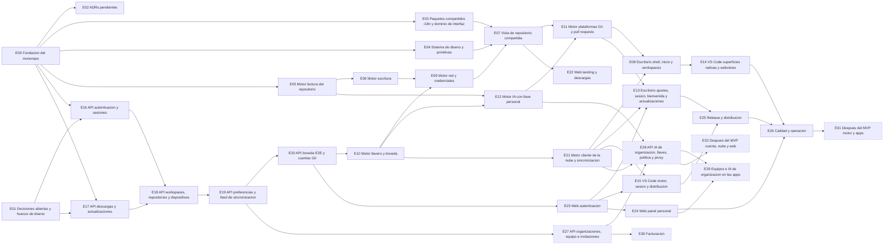

# Backlog

Este documento es el backlog del producto: todo lo que hay que construir en Ramal Desktop,
Ramal for VS Code, Ramal Web, la API y el motor compartido, agrupado en epicas, en el orden
recomendado y con sus dependencias. Se carga tal cual en el GitHub Project "Ramal" del repo
`eabl0306/ramal`: cada epica es un issue con la etiqueta `epic` y cada issue cuelga de una
epica.

Sale de los documentos que ya existen y no los repite. El que, el porque y el como de cada
pieza viven en [architecture.md](architecture.md), [api-surface.md](api-surface.md),
[data-model.md](data-model.md) y [design/gaps.md](design/gaps.md). Aqui solo queda en que orden
se hace, que depende de que y que significa "terminado". Si algo planificado en esos documentos
no tiene issue, es un fallo de este backlog y se corrige aqui.

## Estado

- Fecha: 2026-09-30.
- 33 epicas y 482 issues: 27 epicas y 410 issues en el hito MVP, y
  72 issues en Post-MVP.
- La epica E00 describe el scaffold que se esta construyendo ahora. Sus issues son los primeros
  del proyecto y se cierran cuando el scaffold aterrice.
- Cada fila de gaps.md (C, K, D, V, W, X, B y Q) esta en al menos un issue. El
  [apendice](#apendice-de-gapsmd-al-backlog) dice en cual.

## Como leerlo

- **Claves.** `E05` es una epica y `E05-03` un issue de esa epica. Las claves son estables
  mientras el backlog viva en este documento; al cargarlo en GitHub se sustituyen por numeros de
  issue. El orden de las claves es el orden recomendado.
- **Titulos.** Estilo de commit convencional con ambito (`feat(api): ...`,
  `docs(engine): ...`), igual que los mensajes de commit del repo. El ambito dice que pieza se
  toca; la etiqueta de area dice a que tablero va.
- **Etiquetas.** Cada issue lleva una de area y una de tipo; cada epica lleva `epic` y su area
  principal. La lista completa esta en [Etiquetas](#etiquetas).
- **Hitos.** Solo dos: `MVP` y `Post-MVP`. El hito es de la epica entera; si una parte de un
  tema es para despues, esa parte vive en una epica Post-MVP.
- **Dependencias.** Un issue depende de otro cuando no se puede terminar sin el. Una epica
  depende de otra cuando al menos uno de sus issues depende de un issue de la otra. Eso no
  impide empezar la epica: solo esos issues esperan.
- **Cuerpo de cada issue.** Que, por que y "hecho cuando" con casillas comprobables, mas las
  referencias a los documentos del repo. Los identificadores de gaps.md (por ejemplo `D-35` o
  `B-17`) van en las referencias para poder seguir cada fila hasta su issue.

## Que es el MVP

El MVP es la primera version publica y usable: alguien puede dejar su cliente Git actual y usar
Ramal a diario, en escritorio o en VS Code, con o sin cuenta. En terminos de la API son las fases
F0, F1 y F2 de api-surface.md, mas todo el cliente local.

**Hecho significa:**

- Ramal Desktop se instala firmado en macOS, Windows y Linux con los formatos de X-09, se
  actualiza solo donde el formato lo permite, y la URL del actualizador apunta a la API desde el
  primer build publico.
- Ramal for VS Code esta publicado en VS Code Marketplace y Open VSX, con una VSIX por plataforma
  que lleva su motor.
- Sin cuenta de Ramal funciona todo lo local: abrir, iniciar y clonar; grafo fluido en repos de
  100 000 commits; staging por archivo, hunk y linea; commit y amend; ramas, tags, stash, reset,
  merge, cherry-pick, revert y rebase interactivo; conflictos de cualquier operacion; deshacer y
  rehacer; fetch, pull y push con varias cuentas por plataforma.
- Pull requests de GitHub, GitLab, Bitbucket, Gitea y Azure DevOps: lista con checks y
  revisiones, detalle, creacion y agregado por workspace.
- IA con llave personal, incluido Ollama, para mensajes de commit, textos de PR y resumenes.
- Con cuenta: registro e inicio de sesion en la web con correo u OAuth, inicio de sesion de las
  apps por PKCE o device flow, sesiones y dispositivos, y sincronizacion personal de workspaces,
  repositorios, preferencias y cuentas de plataforma con la boveda de extremo a extremo (las
  llaves de IA personales, solo si el usuario lo activa).
- La web tiene landing con descargas reales, toda la autenticacion, el panel personal y las
  paginas legales y de error.
- La API esta desplegada con copias de seguridad, observabilidad y alertas, y las suites E2E de
  escritorio, VS Code y pila completa pasan en CI.
- Todas las filas P0 y P1 de gaps.md tienen su issue cerrado, salvo las de equipos y
  facturacion, y ningun bug B-xx del prototipo se ha copiado.

**Queda fuera del MVP (hito Post-MVP):**

- Organizaciones, equipo, invitaciones y asientos (E27 y E29), y llaves de IA de organizacion con
  su proxy (E28). Si la decision Q-01 (E01-01) dice que entran, esas tres epicas pasan enteras a
  MVP.
- Facturacion (E30), que ademas espera a Q-02 y Q-03.
- Las filas P2 de gaps.md y lo que api-surface.md lista en "Lo que no existe todavia" (E31 y
  E32).

## Orden recomendado

Tres carriles que avanzan en paralelo:

1. **Transversal, desde el primer dia.** E00 (se cierra con el scaffold), E01 (decisiones y
   diseno: varias bloquean el release y la forma del producto) y E02 (los ADRs que faltan).
2. **Cliente local:** E03, E04, E05, E06, E07, E08, E09, E10, E11, E12, E13, E14 y E15. Va
   primero porque Ramal tiene que funcionar sin cuenta (decision 4) y porque es lo que el usuario
   usa a diario. La vista de repositorio (E07) se construye a la vez que el motor de lectura y
   escritura (E05 y E06), issue a issue.
3. **Nube:** E16, E17, E18, E19, E20, E21, E22, E23 y E24. E17 (descargas y actualizaciones)
   tiene que estar antes del primer build publico, porque la URL del actualizador queda grabada
   en cada instalacion y no se puede cambiar despues.

Al final llegan E25 (release y distribucion) y E26 (calidad y operacion). Los pasos lentos de E25
(reservar nombres, certificados de Apple y de Windows) conviene empezarlos pronto: tardan semanas
y bloquean la beta publica.

Los puntos donde el carril local espera al de la nube:

- Inicio de sesion de las apps: E13-03 y E15-03 esperan a E21-02 y E23-07.
- Workspaces y repos de la nube en escritorio: E08-11 y E08-12 esperan a E21.
- Boveda: E10-04 y los siguientes esperan a E20.
- Bitbucket: E11-04 espera al broker E20-08.
- Actualizador: E13-14 espera a E17-05.

Despues del MVP: E27 y E28 (API de equipos y de IA de organizacion), E29 (sus pantallas), E30
(facturacion) y E31 y E32 (mejoras).

## Dependencias entre epicas

| Epica                                                         | Hito     | Issues | Depende de                                                 |
| ------------------------------------------------------------- | -------- | ------ | ---------------------------------------------------------- |
| E00 Fundacion del monorepo                                    | MVP      | 15     | nada                                                       |
| E01 Decisiones abiertas y huecos de diseno                    | MVP      | 23     | nada                                                       |
| E02 ADRs pendientes                                           | MVP      | 3      | E00                                                        |
| E03 Paquetes compartidos: i18n y dominio de interfaz          | MVP      | 19     | E00                                                        |
| E04 Sistema de diseno y primitivas                            | MVP      | 18     | E00                                                        |
| E05 Motor: lectura del repositorio                            | MVP      | 23     | E00                                                        |
| E06 Motor: escritura                                          | MVP      | 23     | E00, E05                                                   |
| E07 Vista de repositorio compartida                           | MVP      | 24     | E00, E03, E04, E05, E06, E09                               |
| E08 Escritorio: shell, inicio y workspaces                    | MVP      | 19     | E00, E03, E05, E06, E07, E09, E11, E21                     |
| E09 Motor: red y credenciales                                 | MVP      | 14     | E00, E05, E06, E10                                         |
| E10 Motor: llavero y boveda                                   | MVP      | 10     | E00, E01, E20                                              |
| E11 Motor: plataformas Git y pull requests                    | MVP      | 20     | E00, E06, E07, E09, E10, E12, E20                          |
| E12 Motor: IA con llave personal                              | MVP      | 13     | E00, E01, E05, E10                                         |
| E13 Escritorio: ajustes, sesion, bienvenida y actualizaciones | MVP      | 16     | E00, E01, E04, E05, E06, E10, E11, E12, E16, E17, E21, E23 |
| E14 VS Code: superficies nativas y webviews                   | MVP      | 21     | E00, E05, E06, E07, E08, E09, E11, E12                     |
| E15 VS Code: motor, sesion y distribucion                     | MVP      | 12     | E00, E01, E10, E21, E23                                    |
| E16 API: autenticacion y sesiones                             | MVP      | 21     | E00, E01                                                   |
| E17 API: descargas y actualizaciones                          | MVP      | 8      | E00, E01                                                   |
| E18 API: workspaces, repositorios y dispositivos              | MVP      | 11     | E00, E16, E17                                              |
| E19 API: preferencias y feed de sincronizacion                | MVP      | 7      | E00, E18                                                   |
| E20 API: boveda E2E y cuentas Git                             | MVP      | 10     | E00, E16, E19                                              |
| E21 Motor: cliente de la nube y sincronizacion                | MVP      | 12     | E00, E01, E10, E16, E18, E19, E20                          |
| E22 Web: landing y descargas                                  | MVP      | 12     | E00, E01, E03, E04, E07, E17                               |
| E23 Web: autenticacion                                        | MVP      | 12     | E00, E16, E20                                              |
| E24 Web: panel personal                                       | MVP      | 14     | E00, E16, E18, E19, E20, E23                               |
| E25 Release y distribucion                                    | MVP      | 15     | E00, E01, E13, E15, E17                                    |
| E26 Calidad y operacion                                       | MVP      | 15     | E00, E01, E05, E08, E14, E15, E23, E24, E25                |
| E27 API: organizaciones, equipo e invitaciones                | Post-MVP | 12     | E00, E01, E16, E18, E19                                    |
| E28 API: IA de organizacion, llaves, politica y proxy         | Post-MVP | 10     | E00, E12, E21, E27                                         |
| E29 Equipos e IA de organizacion en las apps                  | Post-MVP | 13     | E00, E24, E27, E28                                         |
| E30 Facturacion                                               | Post-MVP | 9      | E00, E01, E27                                              |
| E31 Despues del MVP: motor y apps                             | Post-MVP | 15     | E00, E26                                                   |
| E32 Despues del MVP: cuenta, nube y web                       | Post-MVP | 13     | E00, E20, E27, E28                                         |

El mismo grafo, sin las aristas que ya se deducen de otras. Las epicas Post-MVP van con borde
discontinuo.

## Etiquetas

| Etiqueta              | Color    | Para que                                                      |
| --------------------- | -------- | ------------------------------------------------------------- |
| `epic`                | `3E4B9E` | Epica que agrupa issues del backlog                           |
| `area:api`            | `1D76DB` | Ramal API (Salvo, PostgreSQL)                                 |
| `area:engine`         | `5319E7` | Motor Git de Rust compartido (crates/*, sidecar)              |
| `area:desktop`        | `0E8A16` | Ramal Desktop (Tauri y frontend)                              |
| `area:vscode`         | `007ACC` | Ramal for VS Code (extension host y webviews)                 |
| `area:web`            | `FBCA04` | Ramal Web (landing, autenticacion y panel)                    |
| `area:ui`             | `D876E3` | Paquetes de interfaz compartidos: ui, repo-view, i18n, domain |
| `area:infra`          | `6E7781` | Monorepo, CI, despliegue y operacion                          |
| `area:docs`           | `0075CA` | Documentacion y ADRs                                          |
| `area:release`        | `B60205` | Firma, empaquetado y publicacion                              |
| `area:design`         | `F28BB4` | Diseno de producto y decisiones que lo bloquean               |
| `type:feature`        | `A2EEEF` | Funcionalidad nueva                                           |
| `type:chore`          | `EDEDED` | Tarea de mantenimiento, configuracion o infraestructura       |
| `type:bug-prevention` | `D93F0B` | Evita copiar un bug o atajo del prototipo                     |
| `type:decision`       | `C5DEF5` | Decision que hay que tomar o dejar escrita (ADR)              |
| `type:test`           | `BFD4F2` | Pruebas y suites de verificacion                              |

## Epicas

### E00 Fundacion del monorepo

Hito: MVP. Area principal: `area:infra`. Depende de: nada.

Esqueleto de todas las piezas con un solo caso real de punta a punta: abrir un repo y ver su grafo en escritorio y en VS Code. Estos issues son los primeros del proyecto y se cierran cuando aterrice el scaffold.

| Clave  | Issue                                                             | Etiquetas        | Depende de             |
| ------ | ----------------------------------------------------------------- | ---------------- | ---------------------- |
| E00-01 | chore(infra): workspace de pnpm y Cargo con versiones fijadas     | infra, chore     | -                      |
| E00-02 | chore(infra): justfile, lefthook y commitlint                     | infra, chore     | E00-01                 |
| E00-03 | chore(infra): limites de calidad automaticos                      | infra, chore     | E00-01                 |
| E00-04 | ci(ci): workflow unico con filtros por pieza y all-green          | infra, chore     | E00-02, E00-03         |
| E00-05 | feat(api): esqueleto de la API con salud y OpenAPI                | api, feature     | E00-01                 |
| E00-06 | feat(engine): primer corte del motor con el grafo                 | engine, feature  | E00-01                 |
| E00-07 | feat(engine): sidecar ramal-vscode-engine por stdio               | engine, feature  | E00-06                 |
| E00-08 | feat(engine): tipos del protocolo generados en @ramal/bridge      | engine, feature  | E00-06                 |
| E00-09 | feat(desktop): abrir una carpeta y ver su grafo                   | desktop, feature | E00-08, E00-12         |
| E00-10 | feat(vscode): comando "Ramal: Open Graph"                         | vscode, feature  | E00-07, E00-08, E00-12 |
| E00-11 | feat(web): landing, maqueta de login y registro, y ruta de estado | web, feature     | E00-05, E00-12         |
| E00-12 | feat(ui): primer corte de los paquetes compartidos                | ui, feature      | E00-01                 |
| E00-13 | chore(infra): pila Docker de desarrollo y smoke test              | infra, chore     | E00-05                 |
| E00-14 | chore(api): cliente @ramal/api-client generado                    | api, chore       | E00-05                 |
| E00-15 | docs(docs): README, CLAUDE.md y documentos base                   | docs, chore      | -                      |

### E01 Decisiones abiertas y huecos de diseno

Hito: MVP. Area principal: `area:design`. Depende de: nada.

Cierra lo que bloquea diseno o backlog y encarga al diseno los cambios que obligan las decisiones de arquitectura. Conviene resolverlo en paralelo desde el primer dia.

| Clave  | Issue                                                                   | Etiquetas              | Depende de |
| ------ | ----------------------------------------------------------------------- | ---------------------- | ---------- |
| E01-01 | docs(docs): decidir si equipos entran en la primera version             | design, decision       | -          |
| E01-02 | docs(api): decidir el proveedor de pagos                                | api, decision          | -          |
| E01-03 | docs(docs): decidir que es gratis, que es Ramal Pro y el precio         | design, decision       | -          |
| E01-04 | docs(release): ratificar las plataformas de ADR 0016 y ADR 0010         | release, decision      | -          |
| E01-05 | docs(api): decidir si las sesiones muestran la ciudad                   | api, decision          | -          |
| E01-06 | docs(engine): decidir los modelos de IA recomendados                    | engine, decision       | -          |
| E01-07 | docs(release): ratificar que Windows Portable se quita (ADR 0016)       | release, decision      | -          |
| E01-08 | docs(release): ratificar el repo publico de publicaciones (ADR 0016)    | release, decision      | -          |
| E01-09 | docs(engine): ratificar el cierre de sesion de ADR 0012                 | engine, decision       | -          |
| E01-10 | docs(vscode): decidir que manda entre Settings Sync y la nube de Ramal  | vscode, decision       | -          |
| E01-11 | docs(engine): ratificar MinGit como respaldo en Windows (ADR 0009)      | engine, decision       | -          |
| E01-12 | docs(infra): decidir donde se despliegan la API y la web                | infra, decision        | -          |
| E01-13 | docs(api): decidir el proveedor de correo transaccional                 | api, decision          | -          |
| E01-14 | docs(ui): disenar los estados comunes                                   | design, feature        | -          |
| E01-15 | docs(ui): disenar las pantallas de la boveda                            | design, feature        | -          |
| E01-16 | docs(desktop): disenar la entrada y el ciclo de vida del repo           | design, feature        | -          |
| E01-17 | docs(desktop): disenar credenciales y operaciones de Git                | design, feature        | -          |
| E01-18 | docs(desktop): disenar las vistas que los menus prometen y el diff real | design, feature        | -          |
| E01-19 | docs(desktop): disenar ventana, ajustes que faltan y equipo             | design, feature        | -          |
| E01-20 | docs(vscode): especificar las contribuciones nativas de VS Code         | design, feature        | -          |
| E01-21 | docs(web): disenar las vistas de autenticacion que faltan               | design, feature        | -          |
| E01-22 | docs(web): disenar el panel, el sitio publico y el equipo               | design, feature        | -          |
| E01-23 | docs(ui): revisar el diseno contra los bugs del prototipo               | design, bug-prevention | -          |

### E02 ADRs pendientes

Hito: MVP. Area principal: `area:docs`. Depende de: E00.

Los ADRs de las decisiones de partida (0001 a 0018) ya estan escritos y aceptados; architecture.md los indexa en su seccion 11. Esta epica escribe los que todavia faltan y anade un check que falla si un documento enlaza a una ancla o a un ADR que no existe.

| Clave  | Issue                                                                | Etiquetas      | Depende de |
| ------ | -------------------------------------------------------------------- | -------------- | ---------- |
| E02-01 | docs(api): ADR 0019 de la sincronizacion                             | docs, decision | -          |
| E02-02 | docs(engine): ADR 0020 de la confianza de repositorios en escritorio | docs, decision | -          |
| E02-03 | chore(docs): comprobar enlaces y anclas entre documentos             | docs, chore    | E00-03     |

### E03 Paquetes compartidos: i18n y dominio de interfaz

Hito: MVP. Area principal: `area:ui`. Depende de: E00.

Textos ES/EN y logica pura de interfaz que comparten escritorio, VS Code y web, sin dependencias externas. Aqui se corrigen los errores de textos y de reglas del prototipo.

| Clave  | Issue                                                                    | Etiquetas          | Depende de |
| ------ | ------------------------------------------------------------------------ | ------------------ | ---------- |
| E03-01 | feat(i18n): espacios de nombres para los tres productos                  | ui, feature        | E00-12     |
| E03-02 | feat(i18n): plurales con Intl.PluralRules                                | ui, bug-prevention | E03-01     |
| E03-03 | feat(i18n): marcadores con nombre y sin glifos dentro de los textos      | ui, bug-prevention | E03-01     |
| E03-04 | feat(i18n): claves propias y sin datos fijos en los textos               | ui, bug-prevention | E03-01     |
| E03-05 | feat(i18n): idioma inicial del sistema con ingles de respaldo            | ui, feature        | E03-01     |
| E03-06 | feat(i18n): textos de errores del motor y de la API                      | ui, feature        | E03-01     |
| E03-07 | feat(i18n): textos sobre cifrado que dicen la verdad                     | ui, feature        | E03-01     |
| E03-08 | feat(domain): tiempo relativo con Intl.RelativeTimeFormat                | ui, bug-prevention | -          |
| E03-09 | feat(domain): reglas del mensaje de commit                               | ui, bug-prevention | -          |
| E03-10 | feat(domain): modelo interactivo del resolvedor de conflictos            | ui, feature        | -          |
| E03-11 | feat(domain): modelo del editor de rebase interactivo                    | ui, feature        | -          |
| E03-12 | feat(domain): filtros, busqueda y agrupado de repositorios               | ui, feature        | -          |
| E03-13 | feat(domain): agregado de pull requests por workspace                    | ui, feature        | -          |
| E03-14 | feat(domain): tabla unica de plataformas Git                             | ui, feature        | -          |
| E03-15 | feat(domain): validacion de contrasena, frase de sincronizacion y correo | ui, feature        | -          |
| E03-16 | feat(domain): deteccion de sistema con movil y desconocido               | ui, feature        | -          |
| E03-17 | feat(domain): nombres de rama y tag con las reglas de git                | ui, bug-prevention | -          |
| E03-18 | feat(domain): analisis de URLs remotas                                   | ui, bug-prevention | -          |
| E03-19 | feat(domain): iniciales, colores de avatar y mascara de llaves           | ui, feature        | -          |

### E04 Sistema de diseno y primitivas

Hito: MVP. Area principal: `area:ui`. Depende de: E00.

Tokens, temas, densidades y componentes base de @ramal/ui, mas los estados comunes que el prototipo no tiene. Se hacen una vez y sirven a los tres productos.

| Clave  | Issue                                                             | Etiquetas   | Depende de     |
| ------ | ----------------------------------------------------------------- | ----------- | -------------- |
| E04-01 | feat(ui): temas Ramal claro, oscuro y del sistema                 | ui, feature | E00-12         |
| E04-02 | feat(ui): tema de VS Code mapeado a --vscode-*                    | ui, feature | E04-01         |
| E04-03 | feat(ui): densidades de escritorio y de VS Code                   | ui, feature | E04-01         |
| E04-04 | feat(ui): proveedor de iconos Lucide y Codicons                   | ui, feature | E04-01         |
| E04-05 | feat(ui): botones, chips, badges, pills y avatares                | ui, feature | E04-01, E04-04 |
| E04-06 | feat(ui): menus contextuales y desplegables accesibles            | ui, feature | E04-05         |
| E04-07 | feat(ui): modal con validacion en linea y confirmacion de peligro | ui, feature | E04-05, E04-09 |
| E04-08 | feat(ui): toasts y dialogo de error con detalle                   | ui, feature | E04-05         |
| E04-09 | feat(ui): campos de formulario y campo secreto                    | ui, feature | E04-01         |
| E04-10 | feat(ui): tablas, listas y tarjetas de ajustes                    | ui, feature | E04-01         |
| E04-11 | feat(ui): esqueletos de carga                                     | ui, feature | E04-05         |
| E04-12 | feat(ui): estados vacios                                          | ui, feature | E04-05         |
| E04-13 | feat(ui): estado sin conexion y nube degradada                    | ui, feature | E04-05         |
| E04-14 | feat(ui): indicador de sincronizacion                             | ui, feature | E04-05         |
| E04-15 | feat(ui): aviso de sesion caducada o revocada                     | ui, feature | E04-05         |
| E04-16 | feat(ui): foco visible y navegacion con teclado                   | ui, feature | E04-05         |
| E04-17 | feat(ui): progreso de operaciones con cancelar                    | ui, feature | E04-05         |
| E04-18 | test(ui): catalogo visual y pruebas de accesibilidad              | ui, test    | E04-05         |

### E05 Motor: lectura del repositorio

Hito: MVP. Area principal: `area:engine`. Depende de: E00.

Todo lo que el motor lee de un repositorio con el git CLI, en formato de maquina y sin tomar bloqueos. Alimenta el grafo, el estado, el diff y las vistas de historial.

| Clave  | Issue                                                 | Etiquetas       | Depende de     |
| ------ | ----------------------------------------------------- | --------------- | -------------- |
| E05-01 | feat(engine): estado del arbol de trabajo             | engine, feature | E00-06         |
| E05-02 | feat(engine): grafo por ventanas en repos grandes     | engine, feature | E00-06         |
| E05-03 | feat(engine): busqueda en todo el historial           | engine, feature | E05-02         |
| E05-04 | feat(engine): filtros del grafo                       | engine, feature | E05-02         |
| E05-05 | feat(engine): detalle de commit                       | engine, feature | -              |
| E05-06 | feat(engine): diff de archivos como git               | engine, feature | -              |
| E05-07 | feat(engine): opciones de diff por palabra y espacios | engine, feature | E05-06         |
| E05-08 | feat(engine): ramas, remotos y tags                   | engine, feature | -              |
| E05-09 | feat(engine): stashes con vista previa                | engine, feature | E05-06         |
| E05-10 | feat(engine): submodulos                              | engine, feature | -              |
| E05-11 | feat(engine): historial de un archivo                 | engine, feature | E05-06         |
| E05-12 | feat(engine): blame por linea                         | engine, feature | -              |
| E05-13 | feat(engine): comparar ramas                          | engine, feature | E05-06, E05-08 |
| E05-14 | feat(engine): operacion en curso                      | engine, feature | E05-01         |
| E05-15 | feat(engine): lectura de conflictos                   | engine, feature | E05-01, E05-14 |
| E05-16 | feat(engine): repositorio vacio y HEAD separado       | engine, feature | E05-01         |
| E05-17 | feat(engine): vigilar cambios del repo                | engine, feature | E05-01, E05-18 |
| E05-18 | feat(engine): notificaciones del motor por EventSink  | engine, feature | -              |
| E05-19 | feat(engine): estado de fondo de muchos repos         | engine, feature | E05-01, E05-08 |
| E05-20 | feat(engine): buscar repositorios en carpetas         | engine, feature | -              |
| E05-21 | feat(engine): ruta y version de git configurables     | engine, feature | -              |
| E05-22 | test(engine): repos de prueba dorados para lecturas   | engine, test    | -              |
| E05-23 | feat(engine): confianza de repositorios               | engine, feature | E05-01         |

### E06 Motor: escritura

Hito: MVP. Area principal: `area:engine`. Depende de: E00, E05.

Todas las operaciones que cambian el repositorio. Siempre con el git CLI, para respetar hooks, firma y configuracion del usuario.

| Clave  | Issue                                                      | Etiquetas       | Depende de                     |
| ------ | ---------------------------------------------------------- | --------------- | ------------------------------ |
| E06-01 | feat(engine): puerto GitWriter y errores clasificados      | engine, feature | E05-01                         |
| E06-02 | feat(engine): preparar, quitar y descartar archivos        | engine, feature | E06-01                         |
| E06-03 | feat(engine): preparar y descartar por hunk y por linea    | engine, feature | E06-02, E05-06                 |
| E06-04 | feat(engine): commit y amend                               | engine, feature | E06-01                         |
| E06-05 | feat(engine): crear, renombrar y borrar ramas              | engine, feature | E06-01                         |
| E06-06 | feat(engine): checkout                                     | engine, feature | E06-01                         |
| E06-07 | feat(engine): tags                                         | engine, feature | E06-01                         |
| E06-08 | feat(engine): reset soft, mixed y hard                     | engine, feature | E06-01                         |
| E06-09 | feat(engine): stash                                        | engine, feature | E06-01                         |
| E06-10 | feat(engine): merge con estrategia y mensaje               | engine, feature | E06-01                         |
| E06-11 | feat(engine): completar y abortar merge                    | engine, feature | E06-10, E05-15                 |
| E06-12 | feat(engine): cherry-pick                                  | engine, feature | E06-01                         |
| E06-13 | feat(engine): revertir un commit                           | engine, feature | E06-01                         |
| E06-14 | feat(engine): rebase y rebase interactivo reales           | engine, feature | E06-01                         |
| E06-15 | feat(engine): continuar, omitir y abortar operaciones      | engine, feature | E06-10, E06-12, E06-13, E06-14 |
| E06-16 | feat(engine): mensajes durante el rebase                   | engine, feature | E06-14                         |
| E06-17 | feat(engine): deshacer y rehacer con diario de operaciones | engine, feature | E06-04, E06-08, E06-14         |
| E06-18 | feat(engine): iniciar repositorio                          | engine, feature | -                              |
| E06-19 | feat(engine): anadir a .gitignore                          | engine, feature | -                              |
| E06-20 | feat(engine): gestionar remotos                            | engine, feature | -                              |
| E06-21 | feat(engine): configurar upstream                          | engine, feature | -                              |
| E06-22 | feat(engine): configuracion global de git                  | engine, feature | -                              |
| E06-23 | test(engine): escenarios de escritura y conflictos         | engine, test    | E05-22                         |

### E07 Vista de repositorio compartida

Hito: MVP. Area principal: `area:ui`. Depende de: E00, E03, E04, E05, E06, E09.

La vista de repositorio de @ramal/repo-view que usan escritorio y VS Code: grafo, WIP, detalle, diff, resolvedor de conflictos y rebase. Solo habla con el motor por @ramal/bridge.

| Clave  | Issue                                                           | Etiquetas          | Depende de                     |
| ------ | --------------------------------------------------------------- | ------------------ | ------------------------------ |
| E07-01 | feat(repo-view): puerto RepoViewHost                            | ui, feature        | E00-12                         |
| E07-02 | feat(repo-view): estado por repositorio                         | ui, feature        | E07-01                         |
| E07-03 | feat(repo-view): grafo virtualizado con carga por ventanas      | ui, feature        | E05-02                         |
| E07-04 | feat(repo-view): dibujo del grafo sin los errores del prototipo | ui, bug-prevention | E07-03                         |
| E07-05 | feat(repo-view): fila WIP, pildoras de refs y multiseleccion    | ui, feature        | E07-03, E05-01                 |
| E07-06 | feat(repo-view): busqueda y filtros del grafo                   | ui, feature        | E07-03, E05-03, E05-04         |
| E07-07 | feat(repo-view): barra de herramientas del repo                 | ui, feature        | E07-02                         |
| E07-08 | feat(repo-view): barra lateral de refs                          | ui, feature        | E05-08, E05-09, E05-10         |
| E07-09 | feat(repo-view): menus contextuales de Git                      | ui, bug-prevention | E04-06                         |
| E07-10 | feat(repo-view): panel de staging y caja de commit              | ui, feature        | E05-01, E06-02, E06-04, E03-09 |
| E07-11 | feat(repo-view): detalle de commit                              | ui, feature        | E05-05                         |
| E07-12 | feat(repo-view): visor de diff                                  | ui, feature        | E05-06, E05-07                 |
| E07-13 | feat(repo-view): staging por hunk y por linea                   | ui, feature        | E07-12, E06-03                 |
| E07-14 | feat(repo-view): resolvedor de conflictos                       | ui, feature        | E03-10, E05-15                 |
| E07-15 | feat(repo-view): operaciones con conflicto en curso             | ui, feature        | E07-14, E06-15                 |
| E07-16 | feat(repo-view): conflictos a nivel de archivo                  | ui, feature        | E07-14, E06-11                 |
| E07-17 | feat(repo-view): editor de rebase y rebase detenido             | ui, feature        | E03-11, E06-14, E06-16         |
| E07-18 | feat(repo-view): formularios de Git                             | ui, feature        | E04-07, E03-17                 |
| E07-19 | feat(repo-view): HEAD separado y repositorio vacio              | ui, feature        | E05-16                         |
| E07-20 | feat(repo-view): historial de archivo, blame y comparar ramas   | ui, feature        | E05-11, E05-12, E05-13         |
| E07-21 | feat(repo-view): vista previa de stash                          | ui, feature        | E05-09                         |
| E07-22 | feat(repo-view): progreso y errores de operaciones              | ui, feature        | E04-17, E04-08, E09-01         |
| E07-23 | feat(repo-view): deshacer y rehacer                             | ui, feature        | E06-17                         |
| E07-24 | test(repo-view): pruebas de la vista con motor falso            | ui, test           | E07-02                         |

### E08 Escritorio: shell, inicio y workspaces

Hito: MVP. Area principal: `area:desktop`. Depende de: E00, E03, E05, E06, E07, E09, E11, E21.

La ventana de Ramal Desktop: pestanas, inicio con la lista de repos y paginas de workspace. Todo lo local funciona sin cuenta; la nube solo anade sincronizacion.

| Clave  | Issue                                                       | Etiquetas        | Depende de                             |
| ------ | ----------------------------------------------------------- | ---------------- | -------------------------------------- |
| E08-01 | feat(desktop): barra de titulo propia                       | desktop, feature | E00-09                                 |
| E08-02 | feat(desktop): pestanas con restauracion de sesion          | desktop, feature | E08-01, E07-02                         |
| E08-03 | feat(desktop): notificaciones del motor en el frontend      | desktop, feature | E05-18                                 |
| E08-04 | feat(desktop): registro local de repositorios               | desktop, feature | -                                      |
| E08-05 | feat(desktop): inicio con busqueda, filtros y agrupado      | desktop, feature | E08-04, E03-12                         |
| E08-06 | feat(desktop): tarjetas de repo con estado en segundo plano | desktop, feature | E08-05, E05-19                         |
| E08-07 | feat(desktop): abrir, iniciar y clonar                      | desktop, feature | E08-04, E06-18, E09-02, E03-18, E11-20 |
| E08-08 | feat(desktop): menu de repositorio                          | desktop, feature | E08-04                                 |
| E08-09 | feat(desktop): primer arranque sin repos                    | desktop, feature | E08-05, E05-20                         |
| E08-10 | feat(desktop): ruta desaparecida                            | desktop, feature | E08-04                                 |
| E08-11 | feat(desktop): repos de la nube no clonados aqui            | desktop, feature | E21-07, E09-02                         |
| E08-12 | feat(desktop): workspaces en la barra lateral               | desktop, feature | E21-08                                 |
| E08-13 | feat(desktop): pagina de workspace                          | desktop, feature | E08-12, E09-03                         |
| E08-14 | feat(desktop): pull requests agregados del workspace        | desktop, feature | E08-13, E11-11, E11-17                 |
| E08-15 | feat(desktop): herramientas externas                        | desktop, feature | -                                      |
| E08-16 | feat(desktop): atajos de teclado y paleta de comandos       | desktop, feature | -                                      |
| E08-17 | feat(desktop): enlaces profundos y una sola instancia       | desktop, feature | -                                      |
| E08-18 | feat(desktop): recordar el estado local                     | desktop, feature | E08-02                                 |
| E08-19 | feat(desktop): publicar un repo nuevo al iniciarlo          | desktop, feature | E11-15, E09-05                         |

### E09 Motor: red y credenciales

Hito: MVP. Area principal: `area:engine`. Depende de: E00, E05, E06, E10.

Clonar, fetch, pull y push con el git del sistema y con las credenciales de la cuenta correcta en cada repo. Con progreso, cancelacion y errores que la interfaz pueda explicar.

| Clave  | Issue                                                         | Etiquetas       | Depende de     |
| ------ | ------------------------------------------------------------- | --------------- | -------------- |
| E09-01 | feat(engine): progreso y cancelacion                          | engine, feature | E05-18         |
| E09-02 | feat(engine): clonar                                          | engine, feature | E09-01         |
| E09-03 | feat(engine): fetch                                           | engine, feature | E09-01         |
| E09-04 | feat(engine): pull                                            | engine, feature | E09-03, E06-15 |
| E09-05 | feat(engine): push                                            | engine, feature | E09-01, E06-21 |
| E09-06 | feat(engine): publicar y borrar tags y ramas remotas          | engine, feature | E09-05         |
| E09-07 | feat(engine): errores de red clasificados                     | engine, feature | E09-02         |
| E09-08 | feat(engine): askpass propio con varias cuentas               | engine, feature | E10-01         |
| E09-09 | feat(engine): pedir credenciales cuando ninguna cuenta encaja | engine, feature | E09-08         |
| E09-10 | feat(engine): SSH por cuenta                                  | engine, feature | E09-08         |
| E09-11 | feat(engine): fetch automatico                                | engine, feature | E09-03         |
| E09-12 | feat(engine): actualizar submodulos                           | engine, feature | E09-02         |
| E09-13 | test(engine): servidor git de prueba                          | engine, test    | -              |
| E09-14 | feat(engine): argumentos y protocolos seguros en git          | engine, feature | E09-02         |

### E10 Motor: llavero y boveda

Hito: MVP. Area principal: `area:engine`. Depende de: E00, E01, E20.

Donde guarda cada dispositivo sus secretos (llavero del sistema o SecretStorage) y la criptografia de la boveda de extremo a extremo. El servidor nunca puede leer un secreto.

| Clave  | Issue                                                           | Etiquetas       | Depende de             |
| ------ | --------------------------------------------------------------- | --------------- | ---------------------- |
| E10-01 | feat(engine): crate ramal-keychain sobre keyring-core           | engine, feature | -                      |
| E10-02 | feat(engine): SecretStore de VS Code por peticion inversa       | engine, feature | E00-07                 |
| E10-03 | feat(engine): crate ramal-vault                                 | engine, feature | -                      |
| E10-04 | feat(engine): crear la boveda y el codigo de recuperacion       | engine, feature | E10-01, E10-03, E20-01 |
| E10-05 | feat(engine): desbloquear en un dispositivo nuevo               | engine, feature | E10-04                 |
| E10-06 | feat(engine): cambiar frase, regenerar codigo y rotar la llave  | engine, feature | E10-05, E20-02         |
| E10-07 | feat(engine): sellar, subir, bajar y abrir secretos             | engine, feature | E10-05, E20-03         |
| E10-08 | feat(engine): boveda bloqueada, restablecida y cierre de sesion | engine, feature | E10-05, E01-09         |
| E10-09 | feat(engine): secretos solo en este equipo                      | engine, feature | E10-01                 |
| E10-10 | test(engine): vectores de prueba de la boveda                   | engine, test    | E10-03                 |

### E11 Motor: plataformas Git y pull requests

Hito: MVP. Area principal: `area:engine`. Depende de: E00, E06, E07, E09, E10, E12, E20.

Conectar cuentas de GitHub, GitLab, Bitbucket, Gitea y Azure DevOps, y leer o crear pull requests desde el dispositivo. La API nunca ve un token ni un PR.

| Clave  | Issue                                                            | Etiquetas       | Depende de     |
| ------ | ---------------------------------------------------------------- | --------------- | -------------- |
| E11-01 | feat(engine): crate ramal-platforms                              | engine, feature | -              |
| E11-02 | feat(engine): conectar GitHub                                    | engine, feature | E11-01, E10-01 |
| E11-03 | feat(engine): conectar GitLab                                    | engine, feature | E11-01, E10-01 |
| E11-04 | feat(engine): conectar Bitbucket                                 | engine, feature | E11-01, E20-08 |
| E11-05 | feat(engine): conectar Azure DevOps                              | engine, feature | E11-01         |
| E11-06 | feat(engine): conectar Gitea, Forgejo y GitHub Enterprise Server | engine, feature | E11-01         |
| E11-07 | feat(engine): probar conexion y estado de la cuenta              | engine, feature | E11-02         |
| E11-08 | feat(engine): refrescar tokens OAuth                             | engine, feature | E11-02         |
| E11-09 | feat(engine): cuenta de cada repositorio                         | engine, feature | E11-01         |
| E11-10 | feat(engine): PRs del repositorio con checks y revisiones        | engine, feature | E11-09         |
| E11-11 | feat(engine): PRs agregados por workspace                        | engine, feature | E11-10         |
| E11-12 | feat(engine): crear pull request                                 | engine, feature | E11-10, E09-05 |
| E11-13 | feat(engine): detalle y acciones de un PR                        | engine, feature | E11-10         |
| E11-14 | feat(engine): checkout de la rama de un PR                       | engine, feature | E11-10, E06-06 |
| E11-15 | feat(engine): crear el repositorio remoto                        | engine, feature | E11-01         |
| E11-16 | feat(repo-view): seccion de PRs y menu de PR                     | ui, feature     | E11-10, E07-08 |
| E11-17 | feat(repo-view): detalle de pull request                         | ui, feature     | E11-13, E11-16 |
| E11-18 | feat(repo-view): formulario de crear pull request                | ui, feature     | E11-12, E12-08 |
| E11-19 | test(engine): contratos de cada plataforma                       | engine, test    | E11-01         |
| E11-20 | feat(engine): listar repositorios de una cuenta                  | engine, feature | E11-01         |

### E12 Motor: IA con llave personal

Hito: MVP. Area principal: `area:engine`. Depende de: E00, E01, E05, E10.

Generar mensajes de commit, textos de PR y resumenes con la llave del usuario, llamando al proveedor desde el dispositivo. Es la unica forma de que funcione Ollama y de que el codigo no pase por Ramal.

| Clave  | Issue                                                           | Etiquetas       | Depende de     |
| ------ | --------------------------------------------------------------- | --------------- | -------------- |
| E12-01 | feat(engine): crate ramal-ai con los proveedores                | engine, feature | -              |
| E12-02 | feat(engine): llaves personales en el llavero                   | engine, feature | E12-01, E10-01 |
| E12-03 | feat(engine): modelos desde la lista del proveedor              | engine, feature | E12-01, E01-06 |
| E12-04 | feat(engine): URL base de proveedores                           | engine, feature | E12-01         |
| E12-05 | feat(engine): probar una llave                                  | engine, feature | E12-01         |
| E12-06 | feat(engine): filtro de archivos sensibles y recorte del diff   | engine, feature | E12-01         |
| E12-07 | feat(engine): generar mensaje de commit                         | engine, feature | E12-06, E05-06 |
| E12-08 | feat(engine): generar titulo y descripcion de PR                | engine, feature | E12-06         |
| E12-09 | feat(engine): resumen de commit bajo demanda                    | engine, feature | E12-06, E05-05 |
| E12-10 | feat(engine): respuesta en streaming y cancelar                 | engine, feature | E12-07, E05-18 |
| E12-11 | feat(engine): errores de IA claros                              | engine, feature | E12-01         |
| E12-12 | feat(engine): llave por funcion                                 | engine, feature | E12-02         |
| E12-13 | test(engine): plantillas de prompt y secretos fuera de los logs | engine, test    | E12-07         |

### E13 Escritorio: ajustes, sesion, bienvenida y actualizaciones

Hito: MVP. Area principal: `area:desktop`. Depende de: E00, E01, E04, E05, E06, E10, E11, E12, E16, E17, E21, E23.

Todo lo que rodea a la vista de repo en escritorio: primer arranque, git ausente, inicio de sesion y ajustes completos. Tambien la boveda, el actualizador y el empaquetado.

| Clave  | Issue                                                         | Etiquetas        | Depende de             |
| ------ | ------------------------------------------------------------- | ---------------- | ---------------------- |
| E13-01 | feat(desktop): git no instalado o antiguo                     | desktop, feature | E05-21, E01-11         |
| E13-02 | feat(desktop): bienvenida del primer arranque                 | desktop, feature | E05-20, E06-22         |
| E13-03 | feat(desktop): iniciar sesion con el navegador                | desktop, feature | E21-02, E23-07         |
| E13-04 | feat(desktop): estado sin sesion                              | desktop, feature | -                      |
| E13-05 | feat(desktop): Ajustes > Perfil                               | desktop, feature | E13-03, E21-04         |
| E13-06 | feat(desktop): Ajustes > Cuenta                               | desktop, feature | E13-03, E16-13, E21-10 |
| E13-07 | feat(desktop): Ajustes > Plataformas Git                      | desktop, feature | E11-02, E11-07, E10-09 |
| E13-08 | feat(desktop): elegir la cuenta de cada repositorio           | desktop, feature | E11-09                 |
| E13-09 | feat(desktop): Ajustes > IA                                   | desktop, feature | E12-02, E12-03, E12-12 |
| E13-10 | feat(desktop): Ajustes > Git                                  | desktop, feature | E06-22, E05-21         |
| E13-11 | feat(desktop): Ajustes > Apariencia                           | desktop, feature | E04-01                 |
| E13-12 | feat(desktop): pantallas de la boveda                         | desktop, feature | E10-04, E10-05, E10-06 |
| E13-13 | feat(desktop): cuentas solo en este equipo y boveda bloqueada | desktop, feature | E10-08, E10-09         |
| E13-14 | feat(desktop): actualizador                                   | desktop, feature | E17-05, E13-15         |
| E13-15 | chore(desktop): bundle por plataforma                         | desktop, chore   | -                      |
| E13-16 | chore(desktop): permisos de Tauri, frontera del webview y CSP | desktop, chore   | -                      |

### E14 VS Code: superficies nativas y webviews

Hito: MVP. Area principal: `area:vscode`. Depende de: E00, E05, E06, E07, E08, E09, E11, E12.

La extension de VS Code: contenedor RAMAL, arboles nativos, vista Cambios, grafo, editor de merge, diff nativo, ajustes, barra de estado y paleta. Lo nativo se hace nativo y en React solo queda lo que VS Code no puede dibujar.

| Clave  | Issue                                                                | Etiquetas       | Depende de     |
| ------ | -------------------------------------------------------------------- | --------------- | -------------- |
| E14-01 | feat(vscode): contenedor RAMAL y vistas de bienvenida                | vscode, feature | E00-10         |
| E14-02 | feat(vscode): arboles nativos de ramas, remotos, PRs, stashes y tags | vscode, feature | E05-08, E05-09 |
| E14-03 | feat(vscode): vista Cambios en webview                               | vscode, feature | E07-10         |
| E14-04 | feat(vscode): panel del grafo                                        | vscode, feature | E07-03, E07-11 |
| E14-05 | feat(vscode): editor de merge personalizado                          | vscode, feature | E07-14, E07-15 |
| E14-06 | feat(vscode): diff nativo                                            | vscode, feature | E05-06, E06-03 |
| E14-07 | feat(vscode): historial de archivo                                   | vscode, feature | E05-11         |
| E14-08 | feat(vscode): dialogos nativos para operaciones de Git               | vscode, feature | -              |
| E14-09 | feat(vscode): crear tag y menu de tag                                | vscode, feature | E06-07         |
| E14-10 | feat(vscode): comandos y paleta                                      | vscode, feature | -              |
| E14-11 | feat(vscode): menus contextuales en los webviews                     | vscode, feature | E14-04         |
| E14-12 | feat(vscode): barra de estado                                        | vscode, feature | E05-01, E05-08 |
| E14-13 | feat(vscode): ajustes nativos y webview de listas                    | vscode, feature | -              |
| E14-14 | feat(vscode): anadir cuenta y llave con QuickInput                   | vscode, feature | E11-02, E12-02 |
| E14-15 | feat(vscode): errores de Git con salida                              | vscode, feature | E09-07         |
| E14-16 | feat(vscode): multi-root y varios repos                              | vscode, feature | E14-01         |
| E14-17 | feat(vscode): repo vacio y HEAD separado                             | vscode, feature | E05-16         |
| E14-18 | feat(vscode): PRs sin cuenta y errores de plataforma e IA            | vscode, feature | E11-01, E12-11 |
| E14-19 | feat(vscode): recorrido de bienvenida                                | vscode, feature | E14-01         |
| E14-20 | feat(vscode): abrir en Ramal Desktop                                 | vscode, feature | E08-17         |
| E14-21 | feat(vscode): crear pull request en webview                          | vscode, feature | E11-18         |

### E15 VS Code: motor, sesion y distribucion

Hito: MVP. Area principal: `area:vscode`. Depende de: E00, E01, E10, E21, E23.

Lo que hace que la extension funcione en cualquier entorno: supervision del sidecar, secretos e inicio de sesion. Tambien la integracion con el Git de VS Code y las VSIX por plataforma.

| Clave  | Issue                                                             | Etiquetas       | Depende de             |
| ------ | ----------------------------------------------------------------- | --------------- | ---------------------- |
| E15-01 | feat(vscode): motor no disponible                                 | vscode, feature | E00-10                 |
| E15-02 | feat(vscode): secretos del motor en SecretStorage                 | vscode, feature | E10-02                 |
| E15-03 | feat(vscode): proveedor de autenticacion de Ramal                 | vscode, feature | E21-02, E23-07         |
| E15-04 | feat(vscode): estado sin sesion                                   | vscode, feature | E15-03                 |
| E15-05 | feat(vscode): integracion con vscode.git                          | vscode, feature | -                      |
| E15-06 | feat(vscode): convivencia con el Git integrado y GitLens          | vscode, feature | E15-05                 |
| E15-07 | feat(vscode): ajustes sincronizados sin pisarse con Settings Sync | vscode, feature | E01-10, E21-09         |
| E15-08 | feat(vscode): confianza, remoto y entornos no soportados          | vscode, feature | -                      |
| E15-09 | feat(vscode): boveda en VS Code                                   | vscode, feature | E15-02, E10-04, E10-05 |
| E15-10 | feat(vscode): textos del manifiesto en ingles y espanol           | vscode, feature | -                      |
| E15-11 | chore(vscode): VSIX por plataforma con el motor                   | vscode, chore   | E01-04                 |
| E15-12 | feat(vscode): registrar la instalacion como dispositivo           | vscode, feature | E15-03, E21-04         |

### E16 API: autenticacion y sesiones

Hito: MVP. Area principal: `area:api`. Depende de: E00, E01.

Cuentas de Ramal, inicio de sesion en la web y en las apps nativas, sesiones y perfil. La API es el servidor de autorizacion.

| Clave  | Issue                                                             | Etiquetas    | Depende de     |
| ------ | ----------------------------------------------------------------- | ------------ | -------------- |
| E16-01 | feat(api): registro con correo y contrasena                       | api, feature | E00-05         |
| E16-02 | feat(api): inicio de sesion con limites                           | api, feature | E16-01         |
| E16-03 | feat(api): tokens de acceso y refresh rotatorio                   | api, feature | E16-02         |
| E16-04 | feat(api): cookies HttpOnly con CSRF                              | api, feature | E16-03         |
| E16-05 | feat(api): cerrar sesion y reautenticacion                        | api, feature | E16-03         |
| E16-06 | feat(api): recuperar y restablecer contrasena                     | api, feature | E16-17         |
| E16-07 | feat(api): verificar el correo                                    | api, feature | E16-01, E16-17 |
| E16-08 | feat(api): cambiar el correo y la contrasena                      | api, feature | E16-05, E16-07 |
| E16-09 | feat(api): OAuth de identidad con GitHub, GitLab y Google         | api, feature | E16-03         |
| E16-10 | feat(api): identidades vinculadas                                 | api, feature | E16-09, E16-05 |
| E16-11 | feat(api): inicio de sesion de apps con Authorization Code y PKCE | api, feature | E16-03         |
| E16-12 | feat(api): device flow para apps                                  | api, feature | E16-03         |
| E16-13 | feat(api): sesiones activas                                       | api, feature | E16-03, E01-05 |
| E16-14 | feat(api): perfil                                                 | api, feature | E16-01         |
| E16-15 | feat(api): exportar los datos                                     | api, feature | E16-14         |
| E16-16 | feat(api): eliminar la cuenta                                     | api, feature | E16-05         |
| E16-17 | feat(api): correos transaccionales                                | api, feature | E01-13         |
| E16-18 | feat(api): limites de peticiones                                  | api, feature | -              |
| E16-19 | feat(api): idempotencia con Idempotency-Key                       | api, feature | -              |
| E16-20 | feat(api): limpieza de tokens caducados                           | api, feature | E16-03         |
| E16-21 | feat(api): avisos de seguridad y auditoria de la cuenta           | api, feature | E16-17         |

### E17 API: descargas y actualizaciones

Hito: MVP. Area principal: `area:api`. Depende de: E00, E01.

Publicaciones de escritorio y VS Code, datos de descarga para la landing y manifiesto del actualizador de Tauri. Tiene que existir antes del primer build publico.

| Clave  | Issue                                                     | Etiquetas    | Depende de     |
| ------ | --------------------------------------------------------- | ------------ | -------------- |
| E17-01 | feat(api): modelo de publicaciones                        | api, feature | E00-05         |
| E17-02 | feat(api): registrar publicaciones desde CI               | api, feature | E17-01         |
| E17-03 | feat(api): ultima publicacion por producto                | api, feature | E17-01         |
| E17-04 | feat(api): lista de publicaciones                         | api, feature | E17-01         |
| E17-05 | feat(api): manifiesto del actualizador                    | api, feature | E17-01         |
| E17-06 | feat(api): canales, despliegue gradual y version minima   | api, feature | E17-05         |
| E17-07 | chore(api): URL definitiva del actualizador               | api, chore   | E17-05, E01-08 |
| E17-08 | test(api): contrato del manifiesto con el plugin de Tauri | api, test    | E17-05         |

### E18 API: workspaces, repositorios y dispositivos

Hito: MVP. Area principal: `area:api`. Depende de: E00, E16, E17.

Lo que se sincroniza de la organizacion personal del trabajo: dispositivos, workspaces y metadatos de repos. Nunca rutas locales.

| Clave  | Issue                                                        | Etiquetas    | Depende de             |
| ------ | ------------------------------------------------------------ | ------------ | ---------------------- |
| E18-01 | feat(api): dispositivos                                      | api, feature | E16-11                 |
| E18-02 | feat(api): version del dispositivo actual                    | api, feature | E18-01, E17-03         |
| E18-03 | feat(api): workspaces personales                             | api, feature | E16-03                 |
| E18-04 | feat(api): repos dentro de un workspace                      | api, feature | E18-03, E18-05         |
| E18-05 | feat(api): repositorios con identidad por remoto normalizado | api, feature | E16-03                 |
| E18-06 | feat(api): lista y busqueda de repositorios                  | api, feature | E18-05                 |
| E18-07 | feat(api): repositorios en lote                              | api, feature | E18-05                 |
| E18-08 | feat(api): alias, cuenta y quitar de todos los workspaces    | api, feature | E18-05                 |
| E18-09 | feat(api): repos sin remoto                                  | api, feature | E18-05, E18-01         |
| E18-10 | feat(api): resumen del panel                                 | api, feature | E18-01, E18-03, E18-05 |
| E18-11 | feat(api): foto de perfil                                    | api, feature | E16-14                 |

### E19 API: preferencias y feed de sincronizacion

Hito: MVP. Area principal: `area:api`. Depende de: E00, E18.

Como llegan los cambios a cada dispositivo: registro de cambios y feed con cursor. Y los documentos de preferencias con concurrencia optimista.

| Clave  | Issue                                        | Etiquetas    | Depende de     |
| ------ | -------------------------------------------- | ------------ | -------------- |
| E19-01 | feat(api): registro de cambios               | api, feature | E18-03, E18-05 |
| E19-02 | feat(api): feed de cambios incrementales     | api, feature | E19-01         |
| E19-03 | feat(api): borrados en el feed               | api, feature | E19-02         |
| E19-04 | feat(api): preferencias sincronizadas        | api, feature | E19-01         |
| E19-05 | feat(api): que se sincroniza                 | api, feature | E19-01         |
| E19-06 | feat(api): el feed y las categorias en pausa | api, feature | E19-05, E19-02 |
| E19-07 | test(api): el feed bajo concurrencia         | api, test    | E19-02         |

### E20 API: boveda E2E y cuentas Git

Hito: MVP. Area principal: `area:api`. Depende de: E00, E16, E19.

Metadatos de cuentas de plataforma y de llaves personales, sus secretos cifrados de extremo a extremo y el broker OAuth de Bitbucket. El servidor nunca puede leer un secreto.

| Clave  | Issue                                              | Etiquetas    | Depende de     |
| ------ | -------------------------------------------------- | ------------ | -------------- |
| E20-01 | feat(api): crear y leer la boveda                  | api, feature | E19-01         |
| E20-02 | feat(api): cambiar frase, regenerar codigo y rotar | api, feature | E20-01         |
| E20-03 | feat(api): secretos cifrados opacos                | api, feature | E20-01         |
| E20-04 | feat(api): reiniciar la boveda desde la web        | api, feature | E20-01, E16-05 |
| E20-05 | feat(api): cuentas de plataforma                   | api, feature | E19-01         |
| E20-06 | feat(api): secreto de una cuenta de plataforma     | api, feature | E20-05, E20-03 |
| E20-07 | feat(api): llaves de IA personales                 | api, feature | E20-03, E19-05 |
| E20-08 | feat(api): broker OAuth de Bitbucket               | api, feature | E00-05         |
| E20-09 | feat(api): apagar la sincronizacion de secretos    | api, feature | E20-06, E20-07 |
| E20-10 | test(api): ningun secreto en claro                 | api, test    | E20-06         |

### E21 Motor: cliente de la nube y sincronizacion

Hito: MVP. Area principal: `area:engine`. Depende de: E00, E01, E10, E16, E18, E19, E20.

En escritorio y VS Code solo el motor de Rust habla con la API; ningun webview lo hace. Sesion, feed, cache local y sincronizacion de todo lo personal.

| Clave  | Issue                                                     | Etiquetas       | Depende de                     |
| ------ | --------------------------------------------------------- | --------------- | ------------------------------ |
| E21-01 | feat(engine): crate ramal-cloud-client                    | engine, feature | E00-06                         |
| E21-02 | feat(engine): iniciar sesion desde el motor               | engine, feature | E21-01, E16-11, E16-12, E10-01 |
| E21-03 | feat(engine): refresco y sesion perdida                   | engine, feature | E21-02                         |
| E21-04 | feat(engine): perfil y dispositivo                        | engine, feature | E21-02, E18-02                 |
| E21-05 | feat(engine): ponerse al dia con el feed                  | engine, feature | E21-02, E19-02                 |
| E21-06 | feat(engine): cache local para arrancar sin red           | engine, feature | E21-05                         |
| E21-07 | feat(engine): sincronizar repositorios                    | engine, feature | E21-05, E18-05, E18-07         |
| E21-08 | feat(engine): sincronizar workspaces y alias              | engine, feature | E21-05, E18-03                 |
| E21-09 | feat(engine): sincronizar preferencias                    | engine, feature | E21-05, E19-04                 |
| E21-10 | feat(engine): sincronizar cuentas y llaves con la boveda  | engine, feature | E21-05, E10-07, E20-05         |
| E21-11 | feat(engine): cerrar sesion                               | engine, feature | E21-02, E01-09                 |
| E21-12 | feat(engine): cola persistente de escrituras sin conexion | engine, feature | E21-05, E21-06                 |

### E22 Web: landing y descargas

Hito: MVP. Area principal: `area:web`. Depende de: E00, E01, E03, E04, E07, E17.

La parte publica de Ramal Web: landing, descargas con deteccion de sistema, paginas legales y de error. Se prerenderiza y lee las descargas de la API.

| Clave  | Issue                                                   | Etiquetas    | Depende de             |
| ------ | ------------------------------------------------------- | ------------ | ---------------------- |
| E22-01 | feat(web): landing completa                             | web, feature | E00-11                 |
| E22-02 | feat(web): descargas desde la API                       | web, feature | E17-03                 |
| E22-03 | feat(web): deteccion de sistema y estado movil          | web, feature | E03-16                 |
| E22-04 | feat(web): tarjetas con formatos y requisitos correctos | web, feature | E22-02, E01-04, E01-07 |
| E22-05 | feat(web): copiar comandos de instalacion               | web, feature | E22-02                 |
| E22-06 | feat(web): vista previa del producto sin el prototipo   | web, feature | E07-03                 |
| E22-07 | feat(web): terminos del servicio y privacidad           | web, feature | -                      |
| E22-08 | feat(web): paginas 404 y 500                            | web, feature | -                      |
| E22-09 | feat(web): documentacion, notas de la version y estado  | web, feature | E17-04                 |
| E22-10 | feat(web): diseno responsive de la parte publica        | web, feature | -                      |
| E22-11 | feat(web): tema e idioma en la web                      | web, feature | E04-01                 |
| E22-12 | feat(web): metadatos y SEO                              | web, feature | -                      |

### E23 Web: autenticacion

Hito: MVP. Area principal: `area:web`. Depende de: E00, E16, E20.

Registro, inicio de sesion y todas las paginas de cuenta que faltan en el diseno. Incluye la mitad web del inicio de sesion de escritorio y VS Code.

| Clave  | Issue                                                | Etiquetas    | Depende de     |
| ------ | ---------------------------------------------------- | ------------ | -------------- |
| E23-01 | feat(web): adaptadores de autenticacion sobre la API | web, feature | E00-14, E16-04 |
| E23-02 | feat(web): login real                                | web, feature | E23-01, E16-02 |
| E23-03 | feat(web): registro real                             | web, feature | E23-01, E16-01 |
| E23-04 | feat(web): olvide mi contrasena                      | web, feature | E23-01, E16-06 |
| E23-05 | feat(web): restablecer contrasena                    | web, feature | E23-04         |
| E23-06 | feat(web): verificacion de correo                    | web, feature | E23-03, E16-07 |
| E23-07 | feat(web): autorizar Ramal Desktop o VS Code         | web, feature | E23-01, E16-11 |
| E23-08 | feat(web): codigo de dispositivo                     | web, feature | E23-01, E16-12 |
| E23-09 | feat(web): estados de OAuth                          | web, feature | E23-01, E16-09 |
| E23-10 | feat(web): reautenticar antes de acciones sensibles  | web, feature | E23-01, E16-05 |
| E23-11 | feat(web): sesion caducada y guardas de ruta         | web, feature | E23-01         |
| E23-12 | feat(web): error de un flujo de plataforma caducado  | web, feature | E20-08         |

### E24 Web: panel personal

Hito: MVP. Area principal: `area:web`. Depende de: E00, E16, E18, E19, E20, E23.

El panel de Ramal Web para lo personal: resumen, dispositivos, workspaces, repos y cuentas vinculadas de solo lectura. Tambien la configuracion en la nube, el estado de la boveda, exportar y borrar la cuenta.

| Clave  | Issue                                               | Etiquetas    | Depende de                     |
| ------ | --------------------------------------------------- | ------------ | ------------------------------ |
| E24-01 | feat(web): shell del panel                          | web, feature | E23-11, E18-10                 |
| E24-02 | feat(web): resumen                                  | web, feature | E24-01                         |
| E24-03 | feat(web): dispositivos y sesiones                  | web, feature | E24-01, E18-01, E18-02         |
| E24-04 | feat(web): workspaces                               | web, feature | E24-01, E18-03                 |
| E24-05 | feat(web): repositorios                             | web, feature | E24-01, E18-06, E18-08         |
| E24-06 | feat(web): detalle de repositorio                   | web, feature | E24-05                         |
| E24-07 | feat(web): cuentas vinculadas de solo lectura       | web, feature | E24-01, E20-05                 |
| E24-08 | feat(web): perfil, correo, contrasena e identidades | web, feature | E24-01, E16-08, E16-10, E18-11 |
| E24-09 | feat(web): que se sincroniza                        | web, feature | E24-01, E19-05, E20-09         |
| E24-10 | feat(web): estado y reinicio de la boveda           | web, feature | E24-01, E20-04, E23-10         |
| E24-11 | feat(web): exportar datos                           | web, feature | E16-15                         |
| E24-12 | feat(web): eliminar la cuenta                       | web, feature | E16-16, E23-10                 |
| E24-13 | feat(web): vacios, esqueletos y errores por seccion | web, feature | E24-01                         |
| E24-14 | feat(web): panel responsive                         | web, feature | E24-01                         |

### E25 Release y distribucion

Hito: MVP. Area principal: `area:release`. Depende de: E00, E01, E13, E15, E17.

Firmar, publicar y distribuir escritorio y la extension por todos los canales. El actualizador apunta a la API desde el primer build publico.

| Clave  | Issue                                                          | Etiquetas      | Depende de                             |
| ------ | -------------------------------------------------------------- | -------------- | -------------------------------------- |
| E25-01 | chore(release): reservar nombres y cuentas                     | release, chore | -                                      |
| E25-02 | chore(release): llave de firma del actualizador                | release, chore | -                                      |
| E25-03 | chore(release): firma y notarizacion en macOS                  | release, chore | -                                      |
| E25-04 | chore(release): firma en Windows                               | release, chore | -                                      |
| E25-05 | ci(release): workflow de release de escritorio                 | release, chore | E25-02, E25-03, E25-04, E01-04, E13-15 |
| E25-06 | ci(release): publicar en GitHub Releases y registrar en la API | release, chore | E25-05, E01-08, E17-02                 |
| E25-07 | ci(release): actualizador con respaldo estatico                | release, chore | E25-06, E17-07                         |
| E25-08 | ci(release): VSIX por plataforma en Marketplace y Open VSX     | release, chore | E25-01, E15-11                         |
| E25-09 | ci(release): winget                                            | release, chore | E25-06                                 |
| E25-10 | ci(release): Homebrew                                          | release, chore | E25-06                                 |
| E25-11 | ci(release): Flathub                                           | release, chore | E25-06                                 |
| E25-12 | ci(release): paquetes deb, rpm y AppImage                      | release, chore | E25-06                                 |
| E25-13 | ci(release): imagenes Docker de la API y la web                | release, chore | -                                      |
| E25-14 | chore(release): versiones y notas por producto                 | release, chore | -                                      |
| E25-15 | test(release): instalar y actualizar en cada plataforma        | release, test  | E25-07, E25-08                         |

### E26 Calidad y operacion

Hito: MVP. Area principal: `area:infra`. Depende de: E00, E01, E05, E08, E14, E15, E23, E24, E25.

La capa fina de E2E real y el despliegue de la API. Mas lo necesario para operarla: observabilidad, alertas, copias y custodia de llaves.

| Clave  | Issue                                                    | Etiquetas      | Depende de     |
| ------ | -------------------------------------------------------- | -------------- | -------------- |
| E26-01 | test(desktop): E2E real con WebdriverIO                  | desktop, test  | E08-07         |
| E26-02 | test(vscode): E2E de webviews con acquireVsCodeApi falso | vscode, test   | E14-03         |
| E26-03 | test(vscode): integracion con @vscode/test-cli bajo xvfb | vscode, test   | E15-01         |
| E26-04 | test(web): Playwright con red simulada                   | web, test      | E23-01         |
| E26-05 | test(infra): Playwright contra la pila completa          | infra, test    | E24-01, E00-13 |
| E26-06 | test(engine): snapshots de contrato del protocolo        | engine, test   | E05-22         |
| E26-07 | chore(infra): despliegue de la API y la web              | infra, chore   | E01-12, E25-13 |
| E26-08 | feat(infra): observabilidad                              | infra, feature | E26-07         |
| E26-09 | feat(infra): alertas en produccion                       | infra, feature | E26-08         |
| E26-10 | chore(infra): copias de seguridad de PostgreSQL          | infra, chore   | E26-07         |
| E26-11 | chore(infra): custodia de llaves                         | infra, chore   | E25-02         |
| E26-12 | chore(infra): secretos de CI y produccion                | infra, chore   | -              |
| E26-13 | test(infra): revision de seguridad                       | infra, test    | -              |
| E26-14 | test(engine): rendimiento con repos grandes              | engine, test   | E05-02         |
| E26-15 | chore(infra): dependencias al dia                        | infra, chore   | -              |

### E27 API: organizaciones, equipo e invitaciones

Hito: Post-MVP. Area principal: `area:api`. Depende de: E00, E01, E16, E18, E19.

Organizaciones con miembros, roles, invitaciones y asientos, y workspaces compartidos (fase F3). Pasa a MVP si la decision Q-01 lo pide.

| Clave  | Issue                                                     | Etiquetas    | Depende de     |
| ------ | --------------------------------------------------------- | ------------ | -------------- |
| E27-01 | feat(api): organizaciones                                 | api, feature | E16-03, E01-01 |
| E27-02 | feat(api): salir y transferir la propiedad                | api, feature | E27-01, E27-03 |
| E27-03 | feat(api): miembros y roles                               | api, feature | E27-01         |
| E27-04 | feat(api): invitaciones                                   | api, feature | E27-03, E16-17 |
| E27-05 | feat(api): aceptar una invitacion                         | api, feature | E27-04         |
| E27-06 | feat(api): mis invitaciones                               | api, feature | E27-04         |
| E27-07 | feat(api): asientos                                       | api, feature | E27-04         |
| E27-08 | feat(api): workspaces de organizacion                     | api, feature | E27-01, E18-03 |
| E27-09 | feat(api): contexto personal y de organizacion            | api, feature | E27-01         |
| E27-10 | feat(api): feed con ambito de organizacion                | api, feature | E27-03, E19-02 |
| E27-11 | feat(api): auditoria de organizacion                      | api, feature | E27-01, E16-21 |
| E27-12 | feat(api): organizacion del registro y cuenta del titular | api, feature | E27-01, E16-16 |

### E28 API: IA de organizacion, llaves, politica y proxy

Hito: Post-MVP. Area principal: `area:api`. Depende de: E00, E12, E21, E27.

Llaves de IA de la organizacion que nunca salen del servidor, politica de uso y proxy de generacion (fase F4). Es la unica via por la que el codigo del usuario pasa por Ramal.

| Clave  | Issue                                           | Etiquetas       | Depende de             |
| ------ | ----------------------------------------------- | --------------- | ---------------------- |
| E28-01 | feat(api): cifrado de sobre con KEK rotables    | api, feature    | -                      |
| E28-02 | feat(api): llaves de IA de organizacion         | api, feature    | E28-01, E27-03         |
| E28-03 | feat(api): probar una llave de organizacion     | api, feature    | E28-02                 |
| E28-04 | feat(api): politica de IA de la organizacion    | api, feature    | E28-02                 |
| E28-05 | feat(api): proxy de generacion                  | api, feature    | E28-04, E28-08, E12-01 |
| E28-06 | feat(api): consumo y cuotas                     | api, feature    | E28-05                 |
| E28-07 | feat(api): comprobacion de secretos en la salud | api, feature    | E28-01                 |
| E28-08 | feat(api): guarda de SSRF en proveedores        | api, feature    | -                      |
| E28-09 | feat(engine): generar con llave de organizacion | engine, feature | E28-05, E21-01         |
| E28-10 | test(api): nada del proxy en logs ni en la base | api, test       | E28-05                 |

### E29 Equipos e IA de organizacion en las apps

Hito: Post-MVP. Area principal: `area:web`. Depende de: E00, E24, E27, E28.

Las pantallas de equipo en web, escritorio y VS Code. Y las llaves de organizacion, de solo lectura, en las apps.

| Clave  | Issue                                                           | Etiquetas        | Depende de                     |
| ------ | --------------------------------------------------------------- | ---------------- | ------------------------------ |
| E29-01 | feat(web): selector de organizacion y contexto personal         | web, feature     | E27-09, E24-01                 |
| E29-02 | feat(web): crear organizacion y sus ajustes                     | web, feature     | E29-01, E27-01, E27-02         |
| E29-03 | feat(web): equipo                                               | web, feature     | E29-01, E27-03, E27-04, E27-07 |
| E29-04 | feat(web): aceptar invitacion                                   | web, feature     | E27-05                         |
| E29-05 | feat(web): vistas por rol                                       | web, feature     | E29-03                         |
| E29-06 | feat(web): sin asientos libres                                  | web, feature     | E29-03, E27-07                 |
| E29-07 | feat(web): workspaces compartidos                               | web, feature     | E27-08                         |
| E29-08 | feat(web): IA de la organizacion para admins                    | web, feature     | E28-02, E28-04                 |
| E29-09 | feat(desktop): cuenta y equipo en escritorio                    | desktop, feature | E27-03, E27-06                 |
| E29-10 | feat(desktop): workspace compartido en escritorio               | desktop, feature | E27-08                         |
| E29-11 | feat(desktop): llaves de organizacion en las apps               | desktop, feature | E28-02, E28-09                 |
| E29-12 | feat(repo-view): aviso al generar con una llave de organizacion | ui, feature      | E28-09                         |
| E29-13 | feat(vscode): organizacion en la tarjeta de cuenta              | vscode, feature  | E27-01, E28-02                 |

### E30 Facturacion

Hito: Post-MVP. Area principal: `area:api`. Depende de: E00, E01, E27.

Planes, suscripcion y asientos con el proveedor de pagos elegido (fase F5). Empieza cuando esten decididos Q-02 y Q-03.

| Clave  | Issue                                          | Etiquetas        | Depende de     |
| ------ | ---------------------------------------------- | ---------------- | -------------- |
| E30-01 | docs(api): reglas de la facturacion            | api, decision    | E01-02, E01-03 |
| E30-02 | feat(api): suscripcion de la organizacion      | api, feature     | E30-01, E27-01 |
| E30-03 | feat(api): checkout, asientos y portal         | api, feature     | E30-02         |
| E30-04 | feat(api): webhooks del proveedor              | api, feature     | E30-02         |
| E30-05 | feat(api): limites del plan                    | api, feature     | E30-02         |
| E30-06 | feat(web): pagina de precios                   | web, feature     | E30-01         |
| E30-07 | feat(web): gestion de la suscripcion           | web, feature     | E30-03         |
| E30-08 | feat(desktop): plan en escritorio y VS Code    | desktop, feature | E30-02         |
| E30-09 | docs(web): condiciones de pago en los terminos | web, chore       | E30-01         |

### E31 Despues del MVP: motor y apps

Hito: Post-MVP. Area principal: `area:desktop`. Depende de: E00, E26.

Mejoras de escritorio, VS Code y motor que el analisis dejo para despues de la primera version publica. Son las filas P2 de gaps.md, mas gix, que solo entra si el benchmark lo pide.

| Clave  | Issue                                                             | Etiquetas        | Depende de |
| ------ | ----------------------------------------------------------------- | ---------------- | ---------- |
| E31-01 | feat(desktop): generar llave SSH y elegir llave de firma          | desktop, feature | -          |
| E31-02 | feat(desktop): registro de operaciones y consola de git           | desktop, feature | -          |
| E31-03 | feat(engine): submodulos completos                                | engine, feature  | -          |
| E31-04 | feat(repo-view): resolvedor con base y herramienta externa        | ui, feature      | -          |
| E31-05 | feat(desktop): red y proxy                                        | desktop, feature | -          |
| E31-06 | feat(desktop): telemetria e informes de fallos con consentimiento | desktop, feature | -          |
| E31-07 | feat(desktop): notificaciones del sistema                         | desktop, feature | -          |
| E31-08 | feat(desktop): ajustes por repositorio y plantillas de commit     | desktop, feature | -          |
| E31-09 | feat(desktop): novedades tras actualizar                          | desktop, feature | -          |
| E31-10 | feat(vscode): blame en VS Code                                    | vscode, feature  | -          |
| E31-11 | feat(vscode): rebase, deshacer, submodulos y remotos en VS Code   | vscode, feature  | -          |
| E31-12 | feat(ui): alto contraste en VS Code                               | ui, feature      | -          |
| E31-13 | perf(engine): gix en lecturas calientes                           | engine, feature  | E26-14     |
| E31-14 | feat(engine): OAuth con aplicacion propia en hosts propios        | engine, feature  | -          |
| E31-15 | feat(desktop): ordenar repos y gestionar pestanas                 | desktop, feature | -          |

### E32 Despues del MVP: cuenta, nube y web

Hito: Post-MVP. Area principal: `area:api`. Depende de: E00, E20, E27, E28.

Mejoras de cuenta, API y web para despues de la primera version publica. Segundo factor, SSO, avisos en tiempo real y paginas secundarias.

| Clave  | Issue                                                        | Etiquetas    | Depende de |
| ------ | ------------------------------------------------------------ | ------------ | ---------- |
| E32-01 | feat(api): segundo factor                                    | api, feature | -          |
| E32-02 | feat(web): pantallas de segundo factor                       | web, feature | E32-01     |
| E32-03 | feat(api): SSO de organizacion                               | api, feature | E27-01     |
| E32-04 | feat(api): avisos en tiempo real del feed                    | api, feature | -          |
| E32-05 | feat(web): historial de seguridad                            | web, feature | E27-11     |
| E32-06 | feat(web): exportacion asincrona                             | web, feature | -          |
| E32-07 | feat(web): pagina de gracias por descargar                   | web, feature | -          |
| E32-08 | feat(web): contacto y soporte                                | web, feature | -          |
| E32-09 | feat(web): foto de organizacion, orden y color de workspaces | web, feature | -          |
| E32-10 | feat(web): editar preferencias desde la web                  | web, feature | -          |
| E32-11 | feat(api): refuerzo de la boveda con un valor del servidor   | api, feature | E20-01     |
| E32-12 | feat(api): limite de peticiones compartido entre replicas    | api, feature | -          |
| E32-13 | feat(web): consumo de IA de la organizacion                  | web, feature | E28-06     |

## Decisiones tomadas al armar el backlog

No estaban fijadas en los documentos previos y se tomaron aqui. Cualquiera se puede cambiar; si
se cambia, se mueven los issues afectados.

1. **Equipos e IA de organizacion quedan fuera del MVP.** gaps.md supone que entran en la primera
   version publica, pero la decision Q-01 sigue abierta y un cliente Git personal ya es usable sin
   ellos. Las llaves de organizacion no tienen sentido sin equipos, asi que van juntas. Si Q-01
   dice lo contrario, E27, E28 y E29 pasan a MVP enteras.
2. **El estado y el reinicio de la boveda en la web entran en el MVP** (E24-10). gaps.md ya los
   pone en P1 (K-10): el reinicio (`DELETE /v1/vault`) solo existe en la web y es la unica salida
   de K-08.
3. **Sin sesion los workspaces son locales** y se suben al iniciar sesion si la nube no tiene
   ninguno ([ADR 0014](adr/0014-usar-ramal-sin-cuenta.md)). Lo que pide sesion es sincronizarlos
   (X-06).
4. **"Actualizado" es la ultima actividad del repositorio**: lo mas reciente entre el ultimo
   commit de HEAD, el ultimo fetch y la ultima apertura. Es lo mismo en las tarjetas del inicio de
   escritorio y en la columna de la web (`lastActivityAt` de api-surface.md), que el motor informa
   como mucho una vez por hora (E21-07).
5. **VS Code usa una llave de IA por funcion**, como escritorio y como el documento de
   preferencias `ai`, en lugar de la llave unica del prototipo.
6. **Decisiones nuevas en E01** que gaps.md no recogia: donde se despliega la nube (E01-12) y el
   proveedor de correo (E01-13). La convivencia con Settings Sync (V-22) pasa de fila a decision
   porque afecta a varias piezas. Lo que los ADR aceptados ya deciden (plataformas, Portable,
   repositorio de publicaciones, MinGit y cierre de sesion) queda en E01 como "ratificar", no como
   decision abierta.
7. **Los ADRs pendientes tienen epica propia (E02)** y no van en E00, porque el scaffold no los
   trae y E00 se cierra entera cuando aterrice. Los de las decisiones de partida (0001 a 0018) ya
   estan aceptados; E02 solo lleva los que faltan (0019 de la sincronizacion y 0020 de la
   confianza de repositorios) y un check de enlaces entre documentos.
8. **La boveda la describe ADR 0012**, y architecture.md, api-surface.md y data-model.md la
   resumen con los mismos nombres y cadenas. Si alguna vez difieren, manda el ADR.
9. **Las filas P2 de gaps.md van a dos epicas Post-MVP** (E31 y E32) en lugar de repartirse por
   producto, para que las epicas del MVP se lean limpias.
10. **Escritorio y VS Code tienen dos epicas cada uno** (E08 y E13; E14 y E15) para no pasar de 25
    issues por epica.

## Apendice: de gaps.md al backlog

Cada identificador de [design/gaps.md](design/gaps.md) y los issues que lo cubren.

**C: Estados comunes.**

- C-01: E01-14, E04-11
- C-02: E01-14, E04-08
- C-03: E01-14, E04-07
- C-04: E01-14, E04-12, E07-08
- C-05: E01-14, E04-13, E21-06
- C-06: E01-14, E04-14, E21-09
- C-07: E01-14, E04-15, E21-03
- C-08: E01-14, E29-05
- C-09: E01-14, E03-05, E04-01, E13-11, E22-11
- C-10: E01-14, E04-16

**K: Boveda.**

- K-01: E01-15, E10-04, E13-12, E15-09
- K-02: E01-15, E10-04, E13-12, E15-09
- K-03: E01-15, E10-05, E13-12, E15-09
- K-04: E01-15, E10-08, E13-13
- K-05: E01-15, E10-09, E13-13
- K-06: E01-15, E10-06, E13-12, E15-09
- K-07: E01-15, E10-06, E13-12, E15-09
- K-08: E01-15, E10-08, E13-12, E20-04, E24-10
- K-09: E01-09, E01-15, E10-08, E13-06, E15-09, E21-11
- K-10: E01-15, E24-10

**D: Desktop.**

- D-01: E01-16, E05-20, E13-02
- D-02: E01-16, E05-21, E13-01
- D-03: E01-16, E13-03
- D-04: E01-16, E13-04
- D-05: E01-16, E08-09
- D-06: E01-16, E08-11
- D-07: E01-16, E08-10
- D-08: E01-16, E08-07, E09-02, E11-20
- D-09: E01-16, E06-18, E08-07
- D-10: E01-16, E05-16, E07-19
- D-11: E01-16, E08-19, E11-15
- D-12: E01-17, E11-02, E13-07
- D-13: E01-17, E09-08, E09-09
- D-14: E01-17, E11-07, E11-08, E13-07
- D-15: E01-17, E09-08, E11-09, E13-08
- D-16: E01-17, E31-01
- D-17: E01-17, E04-17, E07-22, E09-01
- D-18: E01-17, E06-01, E07-22, E09-07
- D-19: E01-17, E05-14, E06-15, E07-15, E09-04
- D-20: E01-17, E05-14, E06-15, E06-16, E07-17
- D-21: E01-17, E06-16, E07-17
- D-22: E01-17, E06-10, E07-18
- D-23: E01-17, E05-16, E06-06, E07-19
- D-24: E01-17, E06-21, E07-18, E09-05
- D-25: E01-17, E06-17, E07-23
- D-26: E31-02
- D-27: E01-18, E05-11, E07-20
- D-28: E01-18, E05-12, E07-20
- D-29: E01-18, E05-13, E07-20
- D-30: E01-18, E11-13, E11-17
- D-31: E01-18, E11-12, E11-18, E14-21
- D-32: E01-18, E06-20
- D-33: E01-18, E05-09, E06-09, E07-21
- D-34: E01-18, E09-06, E31-03
- D-35: E01-18, E06-03, E07-13
- D-36: E01-18, E05-06, E05-07, E07-12
- D-37: E01-18, E07-05
- D-38: E01-18, E05-15, E06-11, E07-16
- D-39: E01-18, E31-04
- D-40: E01-18, E05-02, E07-03
- D-41: E01-18, E05-03, E05-04, E07-04, E07-05, E07-06
- D-42: E01-19, E08-01
- D-43: E01-19, E05-21, E13-10
- D-44: E01-19, E08-15
- D-45: E01-19, E13-14
- D-46: E01-19, E08-16
- D-47: E01-19, E29-09
- D-48: E01-19, E08-12, E08-13, E09-03, E29-10
- D-49: E01-19, E08-17, E14-20
- D-50: E31-05, E31-06, E31-07, E31-08, E31-09
- D-51: E01-19, E13-06
- D-52: E31-15

**V: VS Code.**

- V-01: E01-20, E15-03, E15-04
- V-02: E01-20, E14-01
- V-03: E01-20, E14-01
- V-04: E01-20, E14-01
- V-05: E01-20, E15-01
- V-06: E01-20, E14-16
- V-07: E01-20, E06-15, E07-15, E14-05
- V-08: E01-20, E05-02, E07-03, E14-04
- V-09: E01-20, E05-16, E14-17
- V-10: E01-20, E07-22, E09-07, E14-15
- V-11: E01-20, E07-22, E14-15
- V-12: E01-20, E06-03, E14-06
- V-13: E01-20, E05-11, E14-07
- V-14: E01-20, E14-09
- V-15: E01-20, E11-16, E14-18
- V-16: E01-20, E11-01, E12-11, E14-18
- V-17: E01-20, E11-13, E11-17
- V-18: E01-20, E14-20
- V-19: E01-20, E14-19
- V-20: E01-20, E15-08
- V-21: E01-20, E15-06
- V-22: E01-10, E01-20, E15-07
- V-23: E31-10
- V-24: E31-11
- V-25: E31-12

**W: Web.**

- W-01: E01-21, E23-04
- W-02: E01-21, E23-05
- W-03: E01-21, E23-06
- W-04: E01-21, E23-09
- W-05: E01-21, E23-07
- W-06: E01-21, E23-08
- W-07: E01-21, E23-02, E23-03
- W-08: E01-21, E11-04, E23-12
- W-09: E01-21, E23-11
- W-10: E32-02
- W-11: E01-22, E29-04
- W-12: E01-22, E29-02
- W-13: E01-22, E29-01
- W-14: E01-22, E29-05
- W-15: E01-22, E27-07, E29-06
- W-16: E01-22, E29-08
- W-17: E01-22, E30-06
- W-18: E01-22, E30-07
- W-19: E01-22, E24-13
- W-20: E01-22, E24-13
- W-21: E01-22, E24-03, E24-08
- W-22: E01-22, E24-03
- W-23: E01-22, E24-06
- W-24: E01-22, E16-16, E24-12, E27-12
- W-25: E01-22, E24-09
- W-26: E01-22, E32-06
- W-27: E01-22, E22-07
- W-28: E01-22, E22-08
- W-29: E01-22, E22-09
- W-30: E01-22, E22-03, E22-10, E24-14
- W-31: E32-07
- W-32: E32-08
- W-33: E01-21, E24-08
- W-34: E01-21, E24-08
- W-35: E01-21, E23-10
- W-36: E01-22, E32-13

**X: Cambios obligados por decisiones.**

- X-01: E01-22, E24-07
- X-02: E01-22, E24-07
- X-03: E01-15, E03-07, E13-12, E22-01, E24-03, E24-10, E29-08, E29-12
- X-04: E01-15, E20-09, E24-09
- X-05: E01-19, E13-09, E29-08, E29-11
- X-06: E01-16, E08-12, E13-02, E13-04, E15-04, E22-01
- X-07: E01-17, E03-14, E11-02, E11-03, E13-07, E31-14
- X-08: E01-17, E03-14, E11-04, E11-05
- X-09: E01-07, E01-22, E13-14, E13-15, E22-02, E22-04, E25-12
- X-10: E01-06, E01-19, E12-03, E12-04, E13-09, E14-13
- X-11: E01-20, E14-02, E14-08, E14-10, E14-13
- X-12: E01-22, E22-06
- X-13: E01-16, E01-17, E13-01

**B: Bugs del prototipo.**

- B-01: E01-23, E07-02, E08-02
- B-02: E01-23, E07-02
- B-03: E01-23, E07-02, E11-16
- B-04: E01-18, E01-23, E06-10, E07-18, E08-08
- B-05: E01-23, E03-12, E08-05
- B-06: E01-23, E18-09, E24-05
- B-07: E01-23, E03-09, E06-04, E07-10, E14-03
- B-08: E01-23, E03-09, E06-04, E07-10
- B-09: E01-23, E03-09, E07-10
- B-10: E01-23, E07-11, E12-09
- B-11: E01-23, E11-12, E11-18, E14-08, E14-21
- B-12: E01-23, E06-12
- B-13: E00-06, E01-23, E07-04
- B-14: E00-06, E01-23, E03-19, E07-04
- B-15: E01-23, E07-04
- B-16: E00-06, E01-23, E07-04
- B-17: E01-23, E05-06, E07-12
- B-18: E01-23, E07-12, E14-06
- B-19: E01-23, E03-10, E05-15, E07-14
- B-20: E01-23, E03-10, E07-14
- B-21: E01-23, E05-15, E07-14
- B-22: E01-23, E03-10, E07-14
- B-23: E01-23, E03-10, E07-14
- B-24: E01-23, E06-14, E07-17
- B-25: E01-23, E03-11, E06-14, E07-17
- B-26: E01-23, E07-09, E09-04, E09-05
- B-27: E01-23, E06-05, E07-09, E09-06, E14-02
- B-28: E01-23, E07-09, E14-02
- B-29: E01-23, E04-07, E07-09, E13-09, E14-08
- B-30: E01-23, E03-18, E08-07
- B-31: E01-23, E03-17, E06-05, E07-18
- B-32: E01-23, E03-12, E07-08, E08-05
- B-33: E01-23, E14-12
- B-34: E01-23, E03-19, E12-02
- B-35: E01-23, E13-07
- B-36: E01-23, E11-09, E12-02, E13-07, E20-05
- B-37: E01-23, E04-09
- B-38: E01-23, E03-14
- B-39: E01-23, E11-07, E13-07
- B-40: E01-23, E14-12
- B-41: E01-23, E03-04
- B-42: E01-23, E03-02
- B-43: E01-23, E03-03
- B-44: E01-23, E03-03
- B-45: E01-23, E03-01
- B-46: E01-23, E03-04, E30-08
- B-47: E01-23, E03-04
- B-48: E01-23, E03-08
- B-49: E01-23, E13-05
- B-50: E01-23, E29-03
- B-51: E01-23, E27-07, E29-06, E30-07
- B-52: E01-23, E27-07, E29-03
- B-53: E01-23, E03-15, E23-02
- B-54: E01-21, E01-23, E16-09, E23-09, E27-12
- B-55: E01-23, E03-16, E22-03
- B-56: E01-23, E24-03
- B-57: E01-23, E24-09
- B-58: E01-23, E23-11, E24-01
- B-59: E01-23, E18-06, E24-04, E24-05
- B-60: E01-23, E04-07
- B-61: E01-14, E01-23, E04-08
- B-62: E01-20, E01-23, E14-10

**Q: Decisiones abiertas.**

- Q-01: E01-01
- Q-02: E01-02
- Q-03: E01-03
- Q-04: E01-04
- Q-05: E01-05, E16-13
- Q-06: E01-06
- Q-07: E01-07, E22-04
- Q-08: E01-08
