# El modelo de datos de la API de Git Rudder

Este documento es la propuesta de esquema de PostgreSQL 18 que sostiene el contrato de
[api-surface.md](api-surface.md): cada tabla con sus columnas, tipos, restricciones e
indices, el porque de lo que no es obvio, la fase del backlog en la que entra y el orden de
las migraciones.

Es un documento tecnico y entra en detalle a proposito. El SQL de cada tabla esta escrito
para poder copiarse casi tal cual a `apps/api/migrations`; cuando la migracion exista, manda
la migracion y este documento se corrige.

## Estado

Propuesta: no hay ninguna migracion escrita. Son 41 tablas repartidas en seis fases, las
mismas del contrato:

| Fase | Tablas                                                                                                                                                                                                                                                                                                                                                                                       |
| ---- | -------------------------------------------------------------------------------------------------------------------------------------------------------------------------------------------------------------------------------------------------------------------------------------------------------------------------------------------------------------------------------------------- |
| F0   | `schema_metadata`                                                                                                                                                                                                                                                                                                                                                                            |
| F1   | `users`, `user_identities`, `devices`, `auth_sessions`, `refresh_tokens`, `session_reauth_links`, `email_verification_tokens`, `password_reset_tokens`, `email_change_requests`, `email_change_reverts`, `oauth_flows`, `oauth_signup_tickets`, `app_authorization_codes`, `device_authorizations`, `idempotency_keys`, `audit_events`, `releases`, `release_platforms`, `release_artifacts` |
| F2   | `sync_scopes`, `change_log`, `sync_settings`, `preference_documents`, `linked_accounts`, `repositories`, `workspaces`, `workspace_repositories`, `vaults`, `ai_keys`, `retired_secret_records`, `user_avatars`                                                                                                                                                                               |
| F3   | `organizations`, `organization_memberships`, `organization_invitations` (y columnas nuevas en `workspaces`, `sync_scopes` y `audit_events`)                                                                                                                                                                                                                                                  |
| F4   | `organization_ai_keys`, `organization_ai_settings`, `organization_ai_quota`, `ai_usage_events`                                                                                                                                                                                                                                                                                               |
| F5   | `subscriptions`, `billing_webhook_events`                                                                                                                                                                                                                                                                                                                                                    |

Las seis fases entran en la primera version publica: equipos, IA de organizacion y facturacion
estan en el MVP desde el 2026-10-01 ([ADR 0026](adr/0026-planes-y-precios.md)). Las fases son el
orden de las migraciones, no una frontera de producto.

## Convenciones del esquema

Son las de Gastonomo mas lo que PostgreSQL 18 permite hacer mejor, y cada una tiene un motivo.

### Identificadores

- **Claves primarias `uuid DEFAULT uuidv7()`.** PostgreSQL 18 trae `uuidv7()` de serie, sin
  extension. Un UUIDv7 empieza por la marca de tiempo, asi que las inserciones caen al final
  del indice B-tree en vez de repartirse por todas sus paginas como con un UUIDv4: menos
  divisiones de pagina y mejor uso de la cache. El precio es que el id revela cuando se creo
  la fila, y para registros que su dueno ya ve eso no importa.
- **Donde el id es una capacidad** (la URL de la foto de perfil), `gen_random_uuid()`: 122 bits
  aleatorios y ninguna marca de tiempo. Un UUIDv7 tiene 74 bits aleatorios y dice cuando se
  subio la foto.
- **Ids generados por el cliente** en `workspaces`, `linked_accounts` y `ai_keys`: sin
  `DEFAULT` y con `CHECK (uuid_extract_version(id) IN (4, 7))` (la funcion existe desde
  PostgreSQL 17). En las cuentas y las llaves es obligatorio, porque el id entra en los datos
  asociados del cifrado de extremo a extremo y el cliente cifra antes de hablar con la API. En
  los workspaces es para que un dispositivo sin conexion pueda crear y referenciar.

### Tiempo

- **Siempre `timestamptz`.** Ni `timestamp` sin zona ni `date`: todo lo que se guarda aqui es
  un instante tecnico (una sesion, una caducidad, una publicacion). Gastonomo necesitaba
  `DATE` para el dia de un gasto; Git Rudder no tiene nada parecido.
- **`updated_at` lo escribe un disparador** (`touch_updated_at`), no el repositorio. Es el
  mismo argumento que Gastonomo uso para el numero de cambio: un disparador no se olvida en la
  sexta sentencia `UPDATE`.

### Texto y enumerados

- **`citext` para correos y nombres de usuario.** La unicidad no distingue mayusculas sin
  tener que acordarse de un `lower()` en cada consulta e indice.
- **`text` con `CHECK` en lugar de tipos `ENUM`.** Anadir un valor a un `CHECK` es una
  sentencia en una migracion; quitar un valor de un `ENUM` no se puede, y un valor recien
  anadido a un `ENUM` no se puede usar en la misma transaccion que lo anadio. Los enumerados
  de este dominio cambian (Bitbucket retiro las app passwords en 2026, Azure DevOps su OAuth),
  y tienen que poder cambiar sin ceremonia.
- **Restricciones con nombre**, `COMMENT ON TABLE` en cada tabla, `IF NOT EXISTS` en cada
  `CREATE`. Igual que Gastonomo.

### Borrado

**Borrado real, sin columnas `deleted_at`.** Tres motivos:

- Una peticion de supresion (RGPD) se cumple borrando, no marcando.
- Una columna `deleted_at` es un filtro que cada consulta tiene que recordar, y la que lo
  olvida ensena datos borrados.
- Los dispositivos si necesitan enterarse de los borrados, y para eso esta la lapida del
  registro de cambios (`change_log`), que caduca a los 90 dias. La fila no tiene que quedarse
  para que el borrado viaje.

Las unicas filas que se conservan despues de "borrarse" son los dispositivos revocados
(`revoked_at`), porque sus repositorios sin remoto los referencian y porque un dispositivo
revocado no se reactiva; las sesiones revocadas durante 30 dias, para que la deteccion de
reutilizacion de refresh tokens siga funcionando; y el id de cada cuenta o llave con secreto que
se borro (`retired_secret_records`), para que nadie pueda reutilizarlo.

### Tokens y secretos

**Los tokens opacos se guardan como SHA-256 en `bytea` de 32 bytes**, con `CHECK
(octet_length(...) = 32)`. No se usa Argon2 para ellos: son 256 bits de CSPRNG y no se pueden
adivinar, asi que un hash rapido basta. `bytea` y no texto hexadecimal porque ocupa la mitad
en la tabla y en el indice, y no hay mayusculas y minusculas que puedan no coincidir.

**Hay dos esquemas de cifrado y conviene no confundirlos:**

| Esquema                    | Donde                                  | Quien cifra              | Quien puede descifrar             | Columnas                                                                           |
| -------------------------- | -------------------------------------- | ------------------------ | --------------------------------- | ---------------------------------------------------------------------------------- |
| Extremo a extremo (boveda) | `linked_accounts`, `ai_keys`, `vaults` | El motor del dispositivo | Solo los dispositivos del usuario | `secret_alg`, `secret_key_version`, `secret_nonce` (24 bytes), `secret_ciphertext` |
| Sobre del servidor         | `organization_ai_keys`                 | La API                   | La API                            | `alg`, `kek_id`, `wrapped_dek`, `dek_nonce`, `nonce` (12 bytes), `ciphertext`      |

En los dos, el ciphertext esta ligado a su fila por los datos asociados del AEAD. En la boveda,
`git-rudder:vault:v1:{userId}:{kind}:{recordId}:{keyVersion}` ([ADR 0012](adr/0012-boveda-de-extremo-a-extremo.md)),
y el contenido sellado repite ademas los metadatos que deciden a donde va el secreto (host de la
cuenta, URL base de la llave), que el dispositivo compara con la fila. En el sobre del servidor,
`git-rudder:org-ai-key:v1:{orgId}:{keyId}` para el secreto y `git-rudder:org-ai-dek:v1:{orgId}:{keyId}:{kekId}`
para la envoltura de la llave de datos ([ADR 0013](adr/0013-proxy-de-ia-de-organizacion.md)): el
`kek_id` va solo en la envoltura, para que rotar la llave maestra no toque el ciphertext. Una fila
copiada a otra no descifra. Aqui solo importa que **todo ciphertext lleva al lado el algoritmo y
la version de la llave con la que se hizo**, para poder rotar sin adivinar.

### Claves foraneas

- **`ON DELETE CASCADE` desde el dueno**: borrar un usuario o una organizacion se lleva todo lo
  suyo en una sentencia.
- **`ON DELETE SET NULL` en las referencias de autoria** (`invited_by`, `created_by`,
  `added_by`): que alguien se vaya no borra lo que hizo para el equipo.
- **Claves foraneas compuestas `(id, user_id)`** cuando una fila del usuario apunta a otra fila
  del usuario (un repositorio a su cuenta de plataforma, una sesion a su dispositivo). Asi la
  base impide apuntar a la cuenta de otro, aunque el codigo tenga un fallo. Exige un
  `UNIQUE (id, user_id)` en la tabla referenciada, que es un indice mas y se paga a gusto.
- **`ON DELETE SET NULL (columna)`** (PostgreSQL 15 en adelante) en esas claves compuestas: al
  borrar la cuenta de plataforma se anula solo `linked_account_id`, no `user_id`, que es
  `NOT NULL`.

### jsonb

Solo donde la forma es de otro o cambia por version del cliente: documentos de preferencias,
notas de publicacion, datos del dispositivo en el device flow y metadatos de auditoria. Siempre
con `CHECK (jsonb_typeof(...) = 'object')` y un limite de tamano. La forma la valida la
aplicacion con un esquema estricto antes de escribir; la base solo impide lo absurdo.

### Lo que no se usa

- **Sin Row Level Security.** La API es el unico cliente de la base y la autorizacion vive en
  la capa de aplicacion, como en Gastonomo. RLS seria una segunda barrera razonable mas
  adelante; hoy seria una segunda copia de las reglas que mantener.
- **Sin `pg_trgm`.** La busqueda de repositorios filtra primero por usuario y un usuario tiene
  decenas o cientos de repositorios: un `ILIKE` sobre ese conjunto es inmediato.
- **Sin tablas de sesiones en Redis.** No hay Redis: todo el estado compartido esta en
  PostgreSQL, y los limites de peticiones van en memoria del proceso.

## Vista general

```mermaid
erDiagram
    users ||--o{ user_identities : "entra con"
    users ||--o{ devices : "instala"
    users ||--o{ auth_sessions : "inicia"
    devices |o--o| auth_sessions : "sesion viva"
    auth_sessions ||--o{ refresh_tokens : "rota"
    auth_sessions ||--o| session_reauth_links : "reautentica"
    users ||--o{ email_change_reverts : "deshace"
    users ||--o{ audit_events : "eventos personales"
    users ||--o| vaults : "boveda"
    users ||--o{ linked_accounts : "conecta"
    users ||--o{ ai_keys : "sincroniza"
    users ||--o{ retired_secret_records : "ids retirados"
    users ||--o{ repositories : "registra"
    linked_accounts |o--o{ repositories : "usa"
    devices |o--o{ repositories : "origen local"
    users ||--o{ workspaces : "posee"
    organizations |o--o{ workspaces : "contexto"
    workspaces ||--o{ workspace_repositories : "agrupa"
    repositories |o--o{ workspace_repositories : "entrada local"
    organizations ||--o{ organization_memberships : "miembros"
    users ||--o{ organization_memberships : "pertenece"
    organizations ||--o{ organization_invitations : "invita"
    organizations ||--o{ organization_ai_keys : "llaves"
    organizations ||--o| organization_ai_settings : "politica"
    organizations ||--o| organization_ai_quota : "cuota"
    organizations ||--o{ ai_usage_events : "consumo"
    organizations ||--o| subscriptions : "paga"
    sync_scopes ||--o{ change_log : "numera"
    releases ||--o{ release_platforms : "requisitos"
    releases ||--o{ release_artifacts : "artefactos"
```



## F0: base

```sql
CREATE EXTENSION IF NOT EXISTS citext;

CREATE TABLE IF NOT EXISTS schema_metadata (
    singleton      boolean     PRIMARY KEY DEFAULT TRUE,
    schema_version text        NOT NULL,
    updated_at     timestamptz NOT NULL DEFAULT now(),
    CONSTRAINT schema_metadata_singleton CHECK (singleton)
);

CREATE OR REPLACE FUNCTION touch_updated_at() RETURNS trigger AS $$
BEGIN
    NEW.updated_at := now();
    RETURN NEW;
END;
$$ LANGUAGE plpgsql;
```

`schema_metadata` es la fila unica que Gastonomo usa en los tests de integracion para
comprobar que las migraciones se aplicaron y que son idempotentes. `touch_updated_at` se
engancha a cada tabla con `updated_at`:

```sql
CREATE TRIGGER users_touch BEFORE UPDATE ON users
    FOR EACH ROW EXECUTE FUNCTION touch_updated_at();
```

A partir de aqui no se repite ese disparador en cada tabla: toda tabla con `updated_at` lo
lleva.

## F1: identidad

### users

```sql
CREATE TABLE IF NOT EXISTS users (
    id                  uuid        PRIMARY KEY DEFAULT uuidv7(),
    email               citext      NOT NULL,
    email_verified_at   timestamptz,
    name                text        NOT NULL,
    username            citext      NOT NULL,
    password_hash       text,
    password_changed_at timestamptz,
    timezone            text        NOT NULL DEFAULT 'UTC',
    locale              text        NOT NULL DEFAULT 'es',
    terms_version       text        NOT NULL,
    terms_accepted_at   timestamptz NOT NULL,
    created_at          timestamptz NOT NULL DEFAULT now(),
    updated_at          timestamptz NOT NULL DEFAULT now(),
    CONSTRAINT users_email_key UNIQUE (email),
    CONSTRAINT users_username_key UNIQUE (username),
    CONSTRAINT users_email_shape CHECK (position('@' IN email) > 1 AND length(email) <= 254),
    CONSTRAINT users_name_not_blank CHECK (length(btrim(name)) BETWEEN 1 AND 80),
    CONSTRAINT users_username_shape CHECK (username ~ '^[a-z0-9]([a-z0-9-]{1,37}[a-z0-9])$'),
    CONSTRAINT users_locale_known CHECK (locale IN ('es', 'en')),
    CONSTRAINT users_timezone_not_blank CHECK (length(timezone) BETWEEN 1 AND 64)
);

COMMENT ON TABLE users IS
    'Cuentas de Git Rudder. password_hash es Argon2id en formato PHC, o NULL si la cuenta solo entra con OAuth.';
```

- **`password_hash` admite `NULL`**: las cuentas creadas con GitHub, GitLab o Google no tienen
  contrasena hasta que el usuario establece una.
- **`email_verified_at` y no un booleano**: la fecha sirve para auditoria y cuesta lo mismo.
- **`terms_version` y `terms_accepted_at` obligatorios**: sin la version no se puede saber que
  acepto cada cuenta cuando cambien los terminos. Las cuentas de OAuth pasan por la pagina de
  completar el alta precisamente para rellenarlos.
- **`username` en `citext` y el patron en minusculas.** Con `citext`, el operador `~` no
  distingue mayusculas, asi que el `CHECK` acepta tambien `Marta`; la aplicacion lo pasa a
  minusculas antes de escribir. La lista de nombres reservados vive en la aplicacion, no en la
  base: cambia sin migracion.
- **`timezone` solo se comprueba que no este vacia.** Validarla contra `pg_timezone_names` no
  cabe en un `CHECK` (no es inmutable); la valida la aplicacion contra su base de zonas IANA.
- **`password_changed_at`** es lo que permite decir "la contrasena se cambio hace 3 dias" en un
  aviso de seguridad, y lo que usaria una politica de rotacion si alguna vez hiciera falta.

### user_identities

```sql
CREATE TABLE IF NOT EXISTS user_identities (
    id                      uuid        PRIMARY KEY DEFAULT uuidv7(),
    user_id                 uuid        NOT NULL REFERENCES users (id) ON DELETE CASCADE,
    provider                text        NOT NULL,
    provider_user_id        text        NOT NULL,
    provider_email          citext,
    created_at              timestamptz NOT NULL DEFAULT now(),
    last_used_at            timestamptz,
    CONSTRAINT user_identities_provider_known CHECK (provider IN ('github', 'gitlab', 'google')),
    CONSTRAINT user_identities_subject_key UNIQUE (provider, provider_user_id),
    CONSTRAINT user_identities_user_provider_key UNIQUE (user_id, provider)
);

COMMENT ON TABLE user_identities IS
    'Identidades OAuth para entrar en Git Rudder. No guardan tokens del proveedor: se descartan tras leer el perfil.';
```

- **La identidad es `provider_user_id`, no el correo.** El correo cambia en el proveedor; el
  identificador del sujeto no.
- **Una identidad por proveedor y cuenta** (`user_id, provider`): ninguna pantalla pide dos
  cuentas de GitHub para entrar en Git Rudder, y permitirlo complica desvincular.
- **No hay columna de token.** El token de identidad se usa para leer el perfil y se tira. Las
  cuentas de GitHub para trabajar con Git son otra tabla (`linked_accounts`) y otro esquema.

### devices

```sql
CREATE TABLE IF NOT EXISTS devices (
    id              uuid        PRIMARY KEY DEFAULT uuidv7(),
    user_id         uuid        NOT NULL REFERENCES users (id) ON DELETE CASCADE,
    installation_id uuid        NOT NULL,
    secret_hash     bytea       NOT NULL,
    kind            text        NOT NULL,
    name            text        NOT NULL,
    os              text        NOT NULL,
    os_version      text        NOT NULL DEFAULT '',
    arch            text        NOT NULL DEFAULT '',
    app_version     text        NOT NULL,
    last_seen_at    timestamptz NOT NULL DEFAULT now(),
    last_sync_at    timestamptz,
    vault_downloaded_at timestamptz,
    revoked_at      timestamptz,
    created_at      timestamptz NOT NULL DEFAULT now(),
    updated_at      timestamptz NOT NULL DEFAULT now(),
    CONSTRAINT devices_secret_hash_length CHECK (octet_length(secret_hash) = 32),
    CONSTRAINT devices_kind_known CHECK (kind IN ('desktop', 'vscode')),
    CONSTRAINT devices_os_known CHECK (os IN ('macos', 'windows', 'linux')),
    CONSTRAINT devices_arch_known CHECK (arch IN ('', 'x64', 'arm64')),
    CONSTRAINT devices_name_not_blank CHECK (length(btrim(name)) BETWEEN 1 AND 80),
    CONSTRAINT devices_app_version_shape CHECK (app_version ~ '^[0-9]+\.[0-9]+\.[0-9]+'),
    CONSTRAINT devices_id_user_key UNIQUE (id, user_id)
);

CREATE UNIQUE INDEX IF NOT EXISTS devices_live_installation_idx
    ON devices (user_id, installation_id) WHERE revoked_at IS NULL;
CREATE INDEX IF NOT EXISTS devices_user_live_idx
    ON devices (user_id) WHERE revoked_at IS NULL;

COMMENT ON TABLE devices IS
    'Instalaciones de Desktop o de la extension de VS Code con sesion. Se reutiliza la fila al volver a iniciar sesion en la misma instalacion.';
```

- **`installation_id` y `secret_hash` los genera el cliente** una vez por instalacion: el
  secreto son 256 bits que viven en el llavero, y aqui solo esta su SHA-256. Volver a iniciar
  sesion en el mismo equipo reutiliza la fila viva de esa instalacion (y conserva el nombre que el
  usuario le puso) **solo si presenta el secreto**. El `installation_id` no es secreto: sin el
  secreto, quien lo conociera se quedaria con la fila de otro. Sin reutilizar filas, cada login
  dejaria un dispositivo fantasma en el panel.
- **`revoked_at` en vez de borrar, y nunca se limpia**: los repositorios sin remoto apuntan a su
  dispositivo de origen, y el panel sigue ensenando "Local en PC-OFICINA" aunque ese equipo
  cerrara sesion. Un dispositivo revocado no vuelve: iniciar sesion otra vez en esa instalacion
  crea otra fila (por eso el indice unico es parcial, sobre las vivas). Si se limpiara
  `revoked_at`, un portatil robado y revocado volveria como el mismo equipo de confianza.
  Cerrar sesion termina la sesion, no revoca el dispositivo.
- **`vault_downloaded_at`** es la primera descarga de la cabecera de la boveda desde este
  dispositivo. La primera vez manda el aviso "Un equipo nuevo descargo tu boveda", y revocar un
  dispositivo que la tiene marca la boveda con rotacion recomendada.
- **`last_sync_at` y `last_seen_at` son distintos**: el primero lo mueve el feed de cambios (es
  "Sincronizado hace X"); el segundo, cualquier refresco de sesion.
- **`devices_id_user_key`** existe para las claves foraneas compuestas de `auth_sessions` y
  `repositories`.

### auth_sessions

```sql
CREATE TABLE IF NOT EXISTS auth_sessions (
    id                  uuid        PRIMARY KEY DEFAULT uuidv7(),
    user_id             uuid        NOT NULL REFERENCES users (id) ON DELETE CASCADE,
    client              text        NOT NULL,
    device_id           uuid,
    auth_method         text        NOT NULL,
    authenticated_at    timestamptz NOT NULL,
    authenticated_with  text        NOT NULL,
    user_agent          text,
    created_at          timestamptz NOT NULL DEFAULT now(),
    last_used_at        timestamptz NOT NULL DEFAULT now(),
    idle_expires_at     timestamptz NOT NULL,
    absolute_expires_at timestamptz NOT NULL,
    revoked_at          timestamptz,
    revoke_reason       text,
    CONSTRAINT auth_sessions_client_known CHECK (client IN ('web', 'desktop', 'vscode')),
    CONSTRAINT auth_sessions_device_iff_native CHECK ((client = 'web') = (device_id IS NULL)),
    CONSTRAINT auth_sessions_device_fk FOREIGN KEY (device_id, user_id)
        REFERENCES devices (id, user_id) ON DELETE CASCADE,
    CONSTRAINT auth_sessions_method_known CHECK (auth_method IN (
        'password', 'oauth_github', 'oauth_gitlab', 'oauth_google', 'app_code', 'device_code')),
    CONSTRAINT auth_sessions_authenticated_with_known CHECK (authenticated_with IN (
        'password', 'oauth_github', 'oauth_gitlab', 'oauth_google', 'email_link', 'inherited')),
    CONSTRAINT auth_sessions_native_inherits CHECK ((client = 'web') = (authenticated_with <> 'inherited')),
    CONSTRAINT auth_sessions_revoke_reason_known CHECK (revoke_reason IS NULL OR revoke_reason IN (
        'logout', 'user_revoked', 'device_revoked', 'replaced', 'password_changed',
        'password_reset', 'reuse_detected', 'code_reuse', 'account_deleted')),
    CONSTRAINT auth_sessions_revoked_has_reason CHECK ((revoked_at IS NULL) = (revoke_reason IS NULL)),
    CONSTRAINT auth_sessions_user_agent_length CHECK (user_agent IS NULL OR length(user_agent) <= 200)
);

CREATE INDEX IF NOT EXISTS auth_sessions_user_live_idx
    ON auth_sessions (user_id) WHERE revoked_at IS NULL;
CREATE UNIQUE INDEX IF NOT EXISTS auth_sessions_one_live_per_device_idx
    ON auth_sessions (device_id) WHERE revoked_at IS NULL AND device_id IS NOT NULL;
CREATE INDEX IF NOT EXISTS auth_sessions_expiry_idx
    ON auth_sessions (absolute_expires_at);

COMMENT ON TABLE auth_sessions IS
    'Una sesion es una familia de refresh tokens: un inicio de sesion en un cliente. Su id es el claim sid del access token.';
```

- **La sesion es la familia.** Revocar la familia por reutilizacion es un `UPDATE` de una fila,
  no recorrer una cadena de tokens.
- **La caducidad es de la sesion, no del token**: `idle_expires_at` se alarga en cada refresco
  (14 dias en la web, 90 en las apps) y `absolute_expires_at` no se mueve nunca (365 dias).
- **`authenticated_at`** es el `auth_time` del JWT: la reautenticacion lo actualiza, y las
  acciones sensibles exigen que tenga menos de 10 minutos. No tiene `DEFAULT`: una sesion web lo
  pone al iniciar sesion, y una nativa **copia el de la sesion web que la aprobo** (lo lleva el
  codigo de autorizacion o la autorizacion del device flow). Si las nativas empezaran con
  `now()`, un codigo de dispositivo conseguido con phishing tendria 10 minutos de
  "reautenticacion reciente" para cambiar el correo.
- **`authenticated_with`** es como fue la ultima autenticacion real. Las nativas llevan
  `inherited` (el `CHECK` lo obliga) y nunca satisfacen una reautenticacion. Las acciones de
  **reauth fuerte** (eliminar la cuenta, reiniciar la boveda) exigen `password`, `oauth_google` o
  `email_link`: el OAuth de GitHub y GitLab puede completarse sin pedir nada.
- **Un dispositivo, una sesion viva**, forzado por el indice unico parcial. Al iniciar sesion
  otra vez en el mismo equipo, la anterior se revoca con motivo `replaced` en la misma
  transaccion.
- **Sin ubicacion.** Ni la IP ni la ciudad ni el pais: la lista de sesiones ensena dispositivo,
  sistema, app o navegador y ultima actividad (gaps Q-05, decidido el 2026-10-01). La IP se usa
  para el limite de peticiones y no se guarda.
- **`user_agent` recortado a 200 caracteres** y solo en sesiones web: basta para "Firefox en
  Linux".

La consulta de "viva" que hacen los endpoints que entregan secretos es por clave primaria:

```sql
SELECT revoked_at IS NULL AND now() < idle_expires_at AND now() < absolute_expires_at
  FROM auth_sessions WHERE id = $1;
```

### refresh_tokens

```sql
CREATE TABLE IF NOT EXISTS refresh_tokens (
    id          uuid        PRIMARY KEY DEFAULT uuidv7(),
    session_id  uuid        NOT NULL REFERENCES auth_sessions (id) ON DELETE CASCADE,
    token_hash  bytea       NOT NULL,
    created_at  timestamptz NOT NULL DEFAULT now(),
    rotated_at  timestamptz,
    replaced_by uuid        REFERENCES refresh_tokens (id) ON DELETE SET NULL,
    CONSTRAINT refresh_tokens_hash_key UNIQUE (token_hash),
    CONSTRAINT refresh_tokens_hash_length CHECK (octet_length(token_hash) = 32)
);

CREATE INDEX IF NOT EXISTS refresh_tokens_session_idx ON refresh_tokens (session_id);
CREATE INDEX IF NOT EXISTS refresh_tokens_rotated_idx ON refresh_tokens (rotated_at) WHERE rotated_at IS NOT NULL;

COMMENT ON TABLE refresh_tokens IS
    'Hashes de refresh tokens. Rotar marca rotated_at y apunta replaced_by al sucesor; presentar uno rotado revoca la sesion salvo la ventana de 30 segundos sin sucesor usado.';
```

- **Los tokens rotados se guardan 7 dias y despues se purgan.** Son los que permiten detectar
  una reutilizacion. Con access tokens de 15 minutos, una app abierta ocho horas rota unas 32
  veces al dia: guardar todos los rotados para siempre llenaria la tabla de filas que nadie va
  a presentar. Un token rotado hace mas de 7 dias que aparece se trata como desconocido (401)
  sin revocar la sesion; el caso real de robo usa el token enseguida.
- **La ventana de 30 segundos** del contrato se decide con `rotated_at` del token presentado y
  `rotated_at IS NULL` en su sucesor.
- `replaced_by` se anula si el sucesor se purga, que solo pasa despues de que el propio token
  ya no sirva.

### session_reauth_links

```sql
CREATE TABLE IF NOT EXISTS session_reauth_links (
    session_id uuid        PRIMARY KEY REFERENCES auth_sessions (id) ON DELETE CASCADE,
    token_hash bytea       NOT NULL,
    expires_at timestamptz NOT NULL,
    created_at timestamptz NOT NULL DEFAULT now(),
    CONSTRAINT session_reauth_links_hash_key UNIQUE (token_hash),
    CONSTRAINT session_reauth_links_hash_length CHECK (octet_length(token_hash) = 32)
);

COMMENT ON TABLE session_reauth_links IS
    'Enlace al correo para reautenticar una sesion web sin contrasena: 15 minutos, un uso. Al confirmarlo, la sesion queda con authenticated_with = email_link.';
```

- **Atado a la sesion que lo pidio**, no a quien lo abre: el enlace prueba el buzon y se puede
  abrir en el movil, pero lo que reautentica es la sesion del navegador donde el usuario quiere
  eliminar la cuenta o reiniciar la boveda.
- Una fila por sesion: pedir otro sustituye al anterior.

### email_verification_tokens

```sql
CREATE TABLE IF NOT EXISTS email_verification_tokens (
    id         uuid        PRIMARY KEY DEFAULT uuidv7(),
    user_id    uuid        NOT NULL REFERENCES users (id) ON DELETE CASCADE,
    token_hash bytea       NOT NULL,
    email      citext      NOT NULL,
    expires_at timestamptz NOT NULL,
    created_at timestamptz NOT NULL DEFAULT now(),
    CONSTRAINT email_verification_tokens_hash_key UNIQUE (token_hash),
    CONSTRAINT email_verification_tokens_user_key UNIQUE (user_id),
    CONSTRAINT email_verification_tokens_hash_length CHECK (octet_length(token_hash) = 32)
);

COMMENT ON TABLE email_verification_tokens IS
    'Un enlace de verificacion vivo por cuenta, de 48 horas. Se borra al usarlo.';
```

- **Una fila por cuenta** (`UNIQUE (user_id)`): reenviar sustituye el enlace, igual que la
  recuperacion de contrasena de Gastonomo.
- **`email` guarda a que direccion se mando.** Al verificar solo se marca la cuenta si su correo
  sigue siendo ese; si cambio entre medias, el enlace viejo no verifica la direccion nueva.
- **Se borra al usarse**, sin columna `used_at`: un token usado no tiene nada que contar.

### password_reset_tokens

```sql
CREATE TABLE IF NOT EXISTS password_reset_tokens (
    id         uuid        PRIMARY KEY DEFAULT uuidv7(),
    user_id    uuid        NOT NULL REFERENCES users (id) ON DELETE CASCADE,
    token_hash bytea       NOT NULL,
    expires_at timestamptz NOT NULL,
    created_at timestamptz NOT NULL DEFAULT now(),
    CONSTRAINT password_reset_tokens_hash_key UNIQUE (token_hash),
    CONSTRAINT password_reset_tokens_user_key UNIQUE (user_id),
    CONSTRAINT password_reset_tokens_hash_length CHECK (octet_length(token_hash) = 32)
);

COMMENT ON TABLE password_reset_tokens IS
    'Enlaces de recuperacion: 30 minutos, un solo uso, uno vivo por cuenta. created_at decide la espera de un minuto entre peticiones.';
```

Todo el comportamiento es el de Gastonomo (ADR 0008), incluido que dos peticiones con menos de
un minuto no emiten nada nuevo. La diferencia es que aqui el `UNIQUE (user_id)` lo fuerza la
base en vez de un `DELETE` previo.

### email_change_requests

```sql
CREATE TABLE IF NOT EXISTS email_change_requests (
    user_id    uuid        PRIMARY KEY REFERENCES users (id) ON DELETE CASCADE,
    new_email  citext      NOT NULL,
    token_hash bytea       NOT NULL,
    expires_at timestamptz NOT NULL,
    created_at timestamptz NOT NULL DEFAULT now(),
    CONSTRAINT email_change_requests_hash_key UNIQUE (token_hash),
    CONSTRAINT email_change_requests_hash_length CHECK (octet_length(token_hash) = 32),
    CONSTRAINT email_change_requests_email_shape CHECK (position('@' IN new_email) > 1 AND length(new_email) <= 254)
);

COMMENT ON TABLE email_change_requests IS
    'Cambio de correo pendiente de confirmar desde la direccion nueva. Es el pendingEmail de /v1/me.';
```

No hay `UNIQUE` sobre `new_email`: dos personas pueden pedir la misma direccion y gana la
primera que confirme. La unicidad de verdad la pone `users.email` al aplicar el cambio. Si la
direccion nueva ya tiene cuenta al pedirlo, no se crea fila: se manda a esa direccion un aviso
sin enlace y la API responde 202 igual, para no decir que correos tienen cuenta. Restablecer la
contrasena borra la fila pendiente.

### email_change_reverts

```sql
CREATE TABLE IF NOT EXISTS email_change_reverts (
    id         uuid        PRIMARY KEY DEFAULT uuidv7(),
    user_id    uuid        NOT NULL REFERENCES users (id) ON DELETE CASCADE,
    old_email  citext      NOT NULL,
    token_hash bytea       NOT NULL,
    expires_at timestamptz NOT NULL,
    created_at timestamptz NOT NULL DEFAULT now(),
    CONSTRAINT email_change_reverts_hash_key UNIQUE (token_hash),
    CONSTRAINT email_change_reverts_hash_length CHECK (octet_length(token_hash) = 32)
);

CREATE INDEX IF NOT EXISTS email_change_reverts_user_idx ON email_change_reverts (user_id);

COMMENT ON TABLE email_change_reverts IS
    'Enlace que se manda a la direccion anterior al pedir un cambio de correo: durante 7 dias cancela el cambio o lo deshace y cierra todas las sesiones.';
```

- **Vive mas que el cambio**: `email_change_requests` se borra al confirmar, y esta fila no. Si
  quien cambio el correo fue un atacante con una sesion robada, confirmara enseguida desde su
  buzon; la duena real necesita una salida que siga funcionando despues.
- Deshacer devuelve `users.email` a `old_email` si nadie la ha cogido entre medias, borra el
  cambio pendiente si lo hay y revoca todas las sesiones.

### oauth_flows

```sql
CREATE TABLE IF NOT EXISTS oauth_flows (
    id                     uuid        PRIMARY KEY DEFAULT uuidv7(),
    purpose                text        NOT NULL,
    provider               text        NOT NULL,
    state_hash             bytea       NOT NULL,
    browser_binding_hash   bytea,
    provider_code_verifier text,
    user_id                uuid        REFERENCES users (id) ON DELETE CASCADE,
    return_to              text,
    client_code_challenge  text,
    client_redirect_uri    text,
    client_state           text,
    callback_at            timestamptz,
    created_at             timestamptz NOT NULL DEFAULT now(),
    expires_at             timestamptz NOT NULL,
    CONSTRAINT oauth_flows_state_key UNIQUE (state_hash),
    CONSTRAINT oauth_flows_purpose_known CHECK (purpose IN ('sign_in', 'link_identity', 'reauthenticate', 'platform_connect')),
    CONSTRAINT oauth_flows_provider_known CHECK (provider IN ('github', 'gitlab', 'google', 'bitbucket')),
    CONSTRAINT oauth_flows_identity_has_binding CHECK (purpose = 'platform_connect' OR browser_binding_hash IS NOT NULL),
    CONSTRAINT oauth_flows_link_has_user CHECK (purpose NOT IN ('link_identity', 'reauthenticate') OR user_id IS NOT NULL),
    CONSTRAINT oauth_flows_platform_has_client CHECK (
        purpose <> 'platform_connect'
        OR (client_code_challenge IS NOT NULL
            AND client_redirect_uri ~ '^http://(127\.0\.0\.1|\[::1\]):[0-9]{4,5}/callback$')),
    CONSTRAINT oauth_flows_return_to_relative CHECK (
        return_to IS NULL OR return_to ~ '^/([^/\\[:space:][:cntrl:]][^\\[:space:][:cntrl:]]*)?$')
);

CREATE INDEX IF NOT EXISTS oauth_flows_expiry_idx ON oauth_flows (expires_at);

COMMENT ON TABLE oauth_flows IS
    'Flujos OAuth en curso (10 minutos): identidad y broker de plataformas. Se borran al terminar.';
```

- **Una tabla para los dos usos** (entrar en Git Rudder y el broker de Bitbucket) porque comparten
  lo dificil: `state`, caducidad y borrado al terminar. Los `CHECK` por `purpose` impiden que un
  flujo de un tipo lleve campos del otro.
- **`browser_binding_hash`** es el hash de la cookie `__Host-git_rudder_oauth`: ata el flujo al
  navegador que lo empezo y cierra el login CSRF. El broker de plataformas no la lleva porque lo
  ata el reto del motor (`client_code_challenge`).
- **`provider_code_verifier` en claro.** Es el verificador PKCE hacia el proveedor, vive 10
  minutos y solo sirve junto al codigo de autorizacion, que nunca pasa por la base.
- **`client_redirect_uri` con la forma exacta**: el `CHECK` es la ultima barrera; la de verdad es
  el validador de `git-rudder-api-http`, que analiza la URL con el crate `url`, exige puerto entre 1024
  y 65535 y que la URL vuelta a serializar sea identica. Un `LIKE 'http://127.0.0.1:%'` dejaria
  pasar `http://127.0.0.1:1@evil.example/callback`.
- **`return_to` relativo por `CHECK`**: la redireccion abierta se cierra tambien en la base, no
  solo en el handler. El patron exige una barra al principio y prohibe una segunda barra, una
  barra invertida, espacios y caracteres de control en el primer segmento: `/\evil.example` y
  `/%09/...` (ya decodificado) no pasan. El handler resuelve antes la ruta contra
  `https://git-rudder.com` con un analizador WHATWG y exige el mismo origen.
- **`user_id` en `link_identity` y `reauthenticate`** es el usuario de la sesion que empezo el
  flujo. En la vuelta se exige que la sesion actual sea de ese usuario y, en `reauthenticate`, que
  la identidad devuelta ya este vinculada a el.

### oauth_signup_tickets

```sql
CREATE TABLE IF NOT EXISTS oauth_signup_tickets (
    id               uuid        PRIMARY KEY DEFAULT uuidv7(),
    ticket_hash      bytea       NOT NULL,
    provider         text        NOT NULL,
    provider_user_id text        NOT NULL,
    provider_email   citext      NOT NULL,
    suggested_name   text,
    created_at       timestamptz NOT NULL DEFAULT now(),
    expires_at       timestamptz NOT NULL,
    CONSTRAINT oauth_signup_tickets_hash_key UNIQUE (ticket_hash),
    CONSTRAINT oauth_signup_tickets_hash_length CHECK (octet_length(ticket_hash) = 32),
    CONSTRAINT oauth_signup_tickets_provider_known CHECK (provider IN ('github', 'gitlab', 'google'))
);

COMMENT ON TABLE oauth_signup_tickets IS
    'Altas por OAuth a medias: el proveedor ya respondio y falta aceptar los terminos. 15 minutos.';
```

Solo llegan aqui correos que el proveedor da por verificados (si no, el flujo termina en error),
por eso no hay columna de verificacion. El ticket viaja en la cookie `__Host-git_rudder_signup`.

### app_authorization_codes

```sql
CREATE TABLE IF NOT EXISTS app_authorization_codes (
    id             uuid        PRIMARY KEY DEFAULT uuidv7(),
    code_hash      bytea       NOT NULL,
    client_id      text        NOT NULL,
    user_id        uuid        NOT NULL REFERENCES users (id) ON DELETE CASCADE,
    redirect_uri   text        NOT NULL,
    code_challenge text        NOT NULL,
    auth_time      timestamptz NOT NULL,
    session_id     uuid        REFERENCES auth_sessions (id) ON DELETE SET NULL,
    created_at     timestamptz NOT NULL DEFAULT now(),
    expires_at     timestamptz NOT NULL,
    used_at        timestamptz,
    CONSTRAINT app_authorization_codes_hash_key UNIQUE (code_hash),
    CONSTRAINT app_authorization_codes_hash_length CHECK (octet_length(code_hash) = 32),
    CONSTRAINT app_authorization_codes_client_known CHECK (client_id IN ('git-rudder-desktop', 'git-rudder-vscode')),
    CONSTRAINT app_authorization_codes_challenge_shape CHECK (code_challenge ~ '^[A-Za-z0-9_-]{43}$')
);

CREATE INDEX IF NOT EXISTS app_authorization_codes_expiry_idx ON app_authorization_codes (expires_at);

COMMENT ON TABLE app_authorization_codes IS
    'Codigos de Authorization Code + PKCE para Desktop y VS Code: 60 segundos, un uso. session_id es la sesion que se emitio al canjear.';
```

- **El codigo usado no se borra al canjear**: se marca `used_at` y se apunta la sesion. Si el
  mismo codigo vuelve a aparecer, se revoca esa sesion (motivo `code_reuse`), como pide RFC 6749. Se purga a las 24 horas.
- **`code_challenge` con la forma exacta de S256** (43 caracteres de base64url). El metodo
  `plain` no se admite y por eso no hay columna de metodo.
- **`auth_time`** es el de la sesion web que aprobo, que tiene que ser de hace menos de 5
  minutos. La sesion nativa que nace del canje lo hereda como `authenticated_at`.

### device_authorizations

```sql
CREATE TABLE IF NOT EXISTS device_authorizations (
    id               uuid        PRIMARY KEY DEFAULT uuidv7(),
    client_id        text        NOT NULL,
    device_code_hash bytea       NOT NULL,
    user_code_hash   bytea       NOT NULL,
    device_info      jsonb       NOT NULL,
    status           text        NOT NULL DEFAULT 'pending',
    user_id          uuid        REFERENCES users (id) ON DELETE CASCADE,
    approved_auth_time timestamptz,
    interval_seconds smallint    NOT NULL DEFAULT 5,
    last_polled_at   timestamptz,
    decided_at       timestamptz,
    created_at       timestamptz NOT NULL DEFAULT now(),
    expires_at       timestamptz NOT NULL,
    CONSTRAINT device_authorizations_device_code_key UNIQUE (device_code_hash),
    CONSTRAINT device_authorizations_user_code_key UNIQUE (user_code_hash),
    CONSTRAINT device_authorizations_client_known CHECK (client_id IN ('git-rudder-desktop', 'git-rudder-vscode')),
    CONSTRAINT device_authorizations_status_known CHECK (status IN ('pending', 'approved', 'denied', 'consumed')),
    CONSTRAINT device_authorizations_decision_has_user CHECK (status = 'pending' OR user_id IS NOT NULL),
    CONSTRAINT device_authorizations_approved_has_auth_time CHECK (
        status NOT IN ('approved', 'consumed') OR approved_auth_time IS NOT NULL),
    CONSTRAINT device_authorizations_interval_range CHECK (interval_seconds BETWEEN 5 AND 60),
    CONSTRAINT device_authorizations_device_info_object CHECK (
        jsonb_typeof(device_info) = 'object' AND pg_column_size(device_info) <= 2048)
);

CREATE INDEX IF NOT EXISTS device_authorizations_expiry_idx ON device_authorizations (expires_at);

COMMENT ON TABLE device_authorizations IS
    'Device flow (RFC 8628): 10 minutos. device_info es lo que la pagina de activacion ensena antes de aprobar.';
```

- **El codigo de usuario tambien va hasheado**, aunque tenga poca entropia (unos 35 bits) y un
  hash no lo proteja de un volcado de la base. Se hashea por uniformidad, para que no haya una
  sola columna de token en claro. Lo que lo protege es que vive 10 minutos y los limites de
  `device/lookup` (10 por minuto por usuario y por IP, 50 fallos por hora y usuario). **Aprobarlo
  no es inocuo**: quien acierte un codigo pendiente ajeno y lo apruebe mete el equipo de otra
  persona en su propia cuenta, y ese equipo empezaria a subir alli sus metadatos. Por eso el
  codigo se escribe a mano, sin enlace con el codigo puesto.
- **Consumir es atomico**: `UPDATE device_authorizations SET status = 'consumed' WHERE id = $1
AND status = 'approved' RETURNING ...`. Dos sondeos a la vez no crean dos sesiones; el segundo
  no encuentra fila y recibe `invalid_grant`.
- **`approved_auth_time`** es el `auth_time` de la sesion web que aprobo (menos de 5 minutos), y
  lo hereda la sesion nativa. No se guarda desde donde se pidio: sin GeoIP, la pagina de activacion
  no ensena ubicacion, y la IP nunca se guarda.
- **`device_info` lo declara el equipo**: la pagina lo ensena como "nombre que declara el equipo"
  y la API quita los caracteres de control y de direccion de texto antes de guardarlo.
- **`interval_seconds` sube con cada `slow_down`** y `last_polled_at` es lo que lo detecta.
- **`device_info` en `jsonb`**: son los mismos campos que el bloque `device` del canje, y se
  copian a `devices` al consumir la autorizacion.

### idempotency_keys

```sql
CREATE TABLE IF NOT EXISTS idempotency_keys (
    user_id         uuid        NOT NULL REFERENCES users (id) ON DELETE CASCADE,
    endpoint        text        NOT NULL,
    key             text        NOT NULL,
    fingerprint     bytea       NOT NULL,
    response_status smallint,
    response_body   bytea,
    created_at      timestamptz NOT NULL DEFAULT now(),
    completed_at    timestamptz,
    PRIMARY KEY (user_id, endpoint, key),
    CONSTRAINT idempotency_keys_key_length CHECK (length(key) BETWEEN 1 AND 200),
    CONSTRAINT idempotency_keys_fingerprint_length CHECK (octet_length(fingerprint) = 32),
    CONSTRAINT idempotency_keys_completed_pair CHECK ((completed_at IS NULL) = (response_status IS NULL))
);

CREATE INDEX IF NOT EXISTS idempotency_keys_user_created_idx ON idempotency_keys (user_id, created_at);

COMMENT ON TABLE idempotency_keys IS
    'Reservas de Idempotency-Key, 24 horas. Mismo protocolo que Gastonomo (ADR 0012).';
```

La tabla de Gastonomo sin cambios, salvo la huella en `bytea`. La purga la hace el propio
adaptador al reservar una clave nueva, acotada por usuario y por el indice.

### audit_events

```sql
CREATE TABLE IF NOT EXISTS audit_events (
    id              uuid        PRIMARY KEY DEFAULT uuidv7(),
    occurred_at     timestamptz NOT NULL DEFAULT now(),
    actor_user_id   uuid,
    subject_user_id uuid        REFERENCES users (id) ON DELETE CASCADE,
    action          text        NOT NULL,
    target_type     text,
    target_id       uuid,
    metadata        jsonb       NOT NULL DEFAULT '{}',
    CONSTRAINT audit_events_action_shape CHECK (action ~ '^[a-z_]+\.[a-z_]+$'),
    CONSTRAINT audit_events_metadata_object CHECK (
        jsonb_typeof(metadata) = 'object' AND pg_column_size(metadata) <= 4096)
);

CREATE INDEX IF NOT EXISTS audit_events_subject_idx
    ON audit_events (subject_user_id, occurred_at DESC) WHERE subject_user_id IS NOT NULL;
CREATE INDEX IF NOT EXISTS audit_events_actor_idx
    ON audit_events (actor_user_id, action, occurred_at DESC);

COMMENT ON TABLE audit_events IS
    'Rastro de acciones sensibles: de seguridad de la cuenta desde F1 y de organizacion desde F3. Sin secretos ni datos personales en metadata.';
```

- **Nace en F1**, no con los equipos: los avisos de seguridad de la cuenta (dispositivo nuevo,
  identidad vinculada o quitada, contrasena, cambio de correo, "cerrar las demas sesiones", cada
  operacion de la boveda y la primera descarga de la boveda en un dispositivo) dejan su evento
  desde el primer dia. F3 le anade `organization_id`.
- **`subject_user_id`** es la cuenta a la que pertenece un evento personal, y se borra con ella:
  solo le servia a esa persona. Los eventos de organizacion lo llevan nulo.
- **`actor_user_id` sin clave foranea, a proposito.** El rastro de una organizacion tiene que
  sobrevivir a que la persona elimine su cuenta; queda el identificador, que sin la fila de
  `users` no lleva a ningun nombre ni correo.
- **`action` como `dominio.verbo`** (`member.role_changed`, `org_ai_key.created`,
  `vault.reset`, `device.authorized`): se filtra por prefijo sin catalogo en la base.
- **`metadata` nunca lleva secretos ni correos de terceros**: ids, roles, nombres de
  proveedor. El limite de 4 KiB lo recuerda.
- **`audit_events_actor_idx`** sirve tambien a un limite: las invitaciones que una persona mando
  en las ultimas 24 horas, sumando todas sus organizaciones (como mucho 20), se cuentan aqui,
  porque las invitaciones aceptadas o revocadas se borran de su tabla.
- Se conserva 365 dias. No tiene pantalla todavia; la de "historial de seguridad" llegara
  despues.

### releases, release_platforms y release_artifacts

```sql
CREATE TABLE IF NOT EXISTS releases (
    id                        uuid        PRIMARY KEY DEFAULT uuidv7(),
    product                   text        NOT NULL,
    version                   text        NOT NULL,
    version_sort              integer[]   NOT NULL,
    channel                   text        NOT NULL,
    released_at               timestamptz NOT NULL,
    notes_url                 text,
    notes                     jsonb       NOT NULL DEFAULT '{}',
    minimum_supported_version text,
    rollout_percentage        smallint    NOT NULL DEFAULT 100,
    yanked_at                 timestamptz,
    created_at                timestamptz NOT NULL DEFAULT now(),
    updated_at                timestamptz NOT NULL DEFAULT now(),
    CONSTRAINT releases_product_known CHECK (product IN ('desktop', 'vscode')),
    CONSTRAINT releases_channel_known CHECK (channel IN ('stable', 'beta')),
    CONSTRAINT releases_version_shape CHECK (version ~ '^[0-9]+\.[0-9]+\.[0-9]+(-[0-9A-Za-z.]+)?$'),
    CONSTRAINT releases_version_sort_length CHECK (cardinality(version_sort) = 5),
    CONSTRAINT releases_rollout_range CHECK (rollout_percentage BETWEEN 0 AND 100),
    CONSTRAINT releases_notes_object CHECK (jsonb_typeof(notes) = 'object' AND pg_column_size(notes) <= 65536),
    CONSTRAINT releases_product_version_key UNIQUE (product, version)
);

CREATE INDEX IF NOT EXISTS releases_latest_idx
    ON releases (product, channel, version_sort DESC) WHERE yanked_at IS NULL;

CREATE TABLE IF NOT EXISTS release_platforms (
    release_id      uuid NOT NULL REFERENCES releases (id) ON DELETE CASCADE,
    os              text NOT NULL,
    requirements    jsonb NOT NULL DEFAULT '{}',
    install_method  text,
    PRIMARY KEY (release_id, os),
    CONSTRAINT release_platforms_os_known CHECK (os IN ('macos', 'windows', 'linux', 'any')),
    CONSTRAINT release_platforms_install_method_known CHECK (
        install_method IS NULL OR install_method IN ('brew_cask', 'winget', 'flatpak')),
    CONSTRAINT release_platforms_requirements_object CHECK (jsonb_typeof(requirements) = 'object')
);

CREATE TABLE IF NOT EXISTS release_artifacts (
    id                uuid     PRIMARY KEY DEFAULT uuidv7(),
    release_id        uuid     NOT NULL REFERENCES releases (id) ON DELETE CASCADE,
    os                text     NOT NULL,
    arch              text     NOT NULL,
    kind              text     NOT NULL,
    is_primary        boolean  NOT NULL DEFAULT FALSE,
    position          smallint NOT NULL DEFAULT 0,
    url               text     NOT NULL,
    file_name         text,
    size_bytes        bigint,
    sha256            bytea,
    external          boolean  NOT NULL DEFAULT FALSE,
    updater_target    text,
    updater_signature text,
    CONSTRAINT release_artifacts_os_known CHECK (os IN ('macos', 'windows', 'linux', 'any')),
    CONSTRAINT release_artifacts_arch_known CHECK (arch IN ('x64', 'arm64', 'universal', 'any')),
    CONSTRAINT release_artifacts_kind_known CHECK (kind IN (
        'dmg', 'nsis', 'msi', 'deb', 'rpm', 'appimage', 'flathub', 'app_tar_gz',
        'vsix', 'marketplace', 'openvsx')),
    CONSTRAINT release_artifacts_url_https CHECK (url LIKE 'https://%'),
    CONSTRAINT release_artifacts_sha256_length CHECK (sha256 IS NULL OR octet_length(sha256) = 32),
    CONSTRAINT release_artifacts_size_positive CHECK (size_bytes IS NULL OR size_bytes > 0),
    CONSTRAINT release_artifacts_external_has_no_file CHECK (NOT external OR (size_bytes IS NULL AND sha256 IS NULL)),
    CONSTRAINT release_artifacts_updater_pair CHECK ((updater_target IS NULL) = (updater_signature IS NULL)),
    CONSTRAINT release_artifacts_updater_target_shape CHECK (
        updater_target IS NULL OR updater_target ~ '^(darwin|windows|linux)-(x86_64|aarch64)$')
);

CREATE UNIQUE INDEX IF NOT EXISTS release_artifacts_one_primary_idx
    ON release_artifacts (release_id, os) WHERE is_primary;
CREATE UNIQUE INDEX IF NOT EXISTS release_artifacts_updater_idx
    ON release_artifacts (release_id, updater_target) WHERE updater_target IS NOT NULL;

COMMENT ON TABLE releases IS
    'Publicaciones de Desktop y de la extension. Alimentan la pagina de descargas y el manifiesto del actualizador de Tauri.';
```

- **`version_sort` existe porque el orden de versiones no es el orden del texto**: como texto,
  `2.10.0` va antes que `2.9.0`. La aplicacion la calcula al registrar la publicacion como
  `{mayor, menor, parche, es_final, numero_de_prerelease}`, con `es_final = 0` en las
  prerelease para que `2.4.0-beta.2` quede antes de `2.4.0`, como manda semver.
- **Una fila por version y producto**, con su canal. Promover de beta a estable es cambiar el
  canal, no copiar la fila. Las consultas de "la ultima del canal beta" miran los dos canales.
- **Sin etiquetas de interfaz**: el texto "Apple Silicon (.dmg)" sale de `kind` y `arch` en la
  web. Si viviera aqui, habria que mantenerlo en dos idiomas en una tabla.
- **`os = 'any'`** es para lo que no depende del sistema: la ficha de Marketplace y Open VSX
  de la extension, y sus requisitos. Los `.vsix` por plataforma llevan su sistema y arquitectura.
- **`updater_target` y `updater_signature` van juntos o no van**: un artefacto de actualizador
  sin firma no se puede ofrecer, y el `CHECK` lo impide en la base. La API verifica la firma con
  la llave publica de minisign antes de guardarla.
- **Un solo artefacto de actualizador por sistema y arquitectura** (`release_artifacts_updater_idx`).
  En Windows es el del instalador NSIS; el MSI se publica para despliegues gestionados, sin
  `updater_target`, y no se actualiza solo. Si los dos tuvieran actualizador, el manifiesto daria
  a quien instalo uno el paquete del otro.
- **`install_method` y no un comando**: la web escribe el comando que se copia desde una tabla
  fija. Un comando en texto libre seria algo que la landing invita a pegar en una terminal y que
  decide quien tenga la credencial de publicacion. Por lo mismo, la API exige que `url` empiece
  por la carpeta de esa version en el repositorio de publicaciones, salvo las tiendas, cuyas URL
  son fijas del codigo; el `CHECK` de la base solo comprueba `https`.
- **`notes`** se guarda como texto plano o Markdown, y se pinta sin HTML.
- **Sin `zip`**: la descarga Portable de Windows se quito ([ADR 0016](adr/0016-actualizaciones-y-descargas.md)).

## F2: sincronizacion personal

### sync_scopes y change_log

Son la base del feed de cambios (`GET /v1/sync/changes`). Se crean antes que cualquier tabla
sincronizada porque sus disparadores las usan. El funcionamiento completo esta en
[El registro de cambios por dentro](#el-registro-de-cambios-por-dentro).

```sql
CREATE TABLE IF NOT EXISTS sync_scopes (
    kind            text   NOT NULL,
    id              uuid   NOT NULL,
    user_id         uuid   REFERENCES users (id) ON DELETE CASCADE,
    organization_id uuid   REFERENCES organizations (id) ON DELETE CASCADE,   -- llega en F3
    last_seq        bigint NOT NULL DEFAULT 0,
    min_valid_seq   bigint NOT NULL DEFAULT 0,
    PRIMARY KEY (kind, id),
    CONSTRAINT sync_scopes_kind_known CHECK (kind IN ('user', 'organization')),
    CONSTRAINT sync_scopes_owner_matches CHECK (
        (kind = 'user' AND user_id = id AND organization_id IS NULL)
        OR (kind = 'organization' AND organization_id = id AND user_id IS NULL)),
    CONSTRAINT sync_scopes_seq_order CHECK (min_valid_seq <= last_seq)
);

COMMENT ON TABLE sync_scopes IS
    'Un contador de cambios por ambito (usuario u organizacion). El UPDATE que lo incrementa serializa las escrituras del ambito.';

CREATE TABLE IF NOT EXISTS change_log (
    scope_kind  text        NOT NULL,
    scope_id    uuid        NOT NULL,
    entity_type text        NOT NULL,
    entity_id   uuid        NOT NULL,
    op          text        NOT NULL,
    seq         bigint      NOT NULL,
    changed_at  timestamptz NOT NULL DEFAULT now(),
    PRIMARY KEY (scope_kind, scope_id, entity_type, entity_id),
    CONSTRAINT change_log_scope_fk FOREIGN KEY (scope_kind, scope_id)
        REFERENCES sync_scopes (kind, id) ON DELETE CASCADE,
    CONSTRAINT change_log_op_known CHECK (op IN ('upsert', 'delete')),
    CONSTRAINT change_log_entity_known CHECK (entity_type IN (
        'profile', 'sync_settings', 'preferences.git', 'preferences.appearance', 'preferences.ai',
        'vault', 'workspace', 'repository', 'linked_account', 'ai_key',
        'organization', 'organization_ai_key'))
);

CREATE UNIQUE INDEX IF NOT EXISTS change_log_scope_seq_idx
    ON change_log (scope_kind, scope_id, seq);
CREATE INDEX IF NOT EXISTS change_log_tombstones_idx
    ON change_log (changed_at) WHERE op = 'delete';

COMMENT ON TABLE change_log IS
    'Ultimo cambio de cada entidad en cada ambito, con su numero. Las lapidas (op = delete) se purgan a los 90 dias.';
```

- **Una fila por entidad y ambito, no una por cambio.** La clave primaria es la entidad; cada
  cambio actualiza su fila con un numero nuevo. El registro no crece con la actividad sino con
  el numero de cosas que existen (mas las lapidas de 90 dias), y leerlo desde cero es leer el
  estado actual.
- **`change_log_scope_seq_idx` es unico** por el mismo motivo que en Gastonomo: sin el, dos
  filas podrian compartir numero y el cursor no podria pararse entre ellas.
- **Un log aparte y no una columna `change_seq` en cada tabla**, que es lo que hizo Gastonomo.
  Gastonomo lo descarto porque su historico no tenia borrados; Git Rudder si los tiene, y un borrado
  necesita una lapida que sobreviva a la fila.
- **`entity_id` de las entidades de una sola fila por usuario** (perfil, ajustes de
  sincronizacion, cada espacio de preferencias, boveda) es el id del usuario. El tipo ya dice
  cual es.
- **`sync_scopes.organization_id` llega en F3** con la tabla de organizaciones. En F2 el
  `CHECK` solo admite `kind = 'user'`.

### sync_settings

```sql
CREATE TABLE IF NOT EXISTS sync_settings (
    user_id                     uuid        PRIMARY KEY REFERENCES users (id) ON DELETE CASCADE,
    workspaces_and_repositories boolean     NOT NULL DEFAULT TRUE,
    linked_accounts             boolean     NOT NULL DEFAULT TRUE,
    ai_preferences              boolean     NOT NULL DEFAULT TRUE,
    ai_keys                     boolean     NOT NULL DEFAULT FALSE,
    git_preferences             boolean     NOT NULL DEFAULT TRUE,
    appearance                  boolean     NOT NULL DEFAULT TRUE,
    version                     integer     NOT NULL DEFAULT 1,
    updated_at                  timestamptz NOT NULL DEFAULT now()
);

COMMENT ON TABLE sync_settings IS
    'Que se sincroniza. ai_keys viene apagado: cada dispositivo guarda sus propias llaves hasta que el usuario lo active.';
```

- **Columnas y no un documento `jsonb`** como las preferencias. Apagar `linked_accounts` o
  `ai_keys` borra sus datos en la misma transaccion, metadatos y secretos (no hay opcion de borrar
  solo los secretos), y mientras sigan apagadas la API lee estas columnas en cada escritura de
  cuentas o llaves para rechazarla (409 `sync_category_disabled`). Son reglas del servidor, no
  preferencias de interfaz, y merecen columnas tipadas.
- **Borrar las cuentas anula `repositories.linked_account_id`** (la clave foranea es
  `ON DELETE SET NULL`), y ese cambio viaja por el feed. Los dispositivos conservan su eleccion
  local de cuenta mientras la categoria siga apagada (ver el contrato).
- **Las otras cuatro solo pausan, y la pausa la cumplen los dispositivos**: el feed no filtra por
  estas columnas.
- **La fila se crea al registrarse**, con los valores por defecto. `version` es el `ETag`.

### preference_documents

```sql
CREATE TABLE IF NOT EXISTS preference_documents (
    user_id              uuid        NOT NULL REFERENCES users (id) ON DELETE CASCADE,
    namespace            text        NOT NULL,
    document             jsonb       NOT NULL,
    version              integer     NOT NULL DEFAULT 1,
    updated_by_device_id uuid,
    updated_at           timestamptz NOT NULL DEFAULT now(),
    PRIMARY KEY (user_id, namespace),
    CONSTRAINT preference_documents_namespace_known CHECK (namespace IN ('git', 'appearance', 'ai')),
    CONSTRAINT preference_documents_document_object CHECK (jsonb_typeof(document) = 'object'),
    CONSTRAINT preference_documents_document_size CHECK (pg_column_size(document) <= 16384),
    CONSTRAINT preference_documents_version_positive CHECK (version >= 1),
    CONSTRAINT preference_documents_device_fk FOREIGN KEY (updated_by_device_id, user_id)
        REFERENCES devices (id, user_id) ON DELETE SET NULL (updated_by_device_id)
);

COMMENT ON TABLE preference_documents IS
    'Preferencias sincronizadas de Git, apariencia e IA. Se escriben con JSON Merge Patch e If-Match sobre version.';
```

- **`jsonb` porque la forma la fija el cliente y crece por version**: un campo nuevo en las
  preferencias de IA no deberia ser una migracion. La forma la valida la aplicacion contra un
  esquema estricto por espacio antes de escribir; la base solo exige un objeto de menos de 16
  KiB. El modelo opcional por funcion del documento `ai`
  ([ADR 0025](adr/0025-recomendacion-de-modelos-de-ia.md)) es justo ese caso: cambia el esquema de
  la aplicacion, no la tabla.
- **Sin fila hasta la primera escritura.** La API responde el documento por defecto con
  `version: 0` y el primer `If-Match: "0"` inserta. Asi no hay que sembrar tres filas por cuenta
  ni migrar esas filas cuando cambie un valor por defecto.
- **La escritura con concurrencia optimista** es un `UPDATE ... WHERE version = $esperada
RETURNING`: cero filas afectadas es el 412.
- **`updated_by_device_id`** sale en el contrato como `updatedByDevice { id, name }` (en
  `GET /v1/me/preferences` y en el feed), que permite ensenar "cambiado desde tu MacBook" cuando
  llega un 412, y ayuda a depurar bucles de sincronizacion entre dos dispositivos. Una escritura
  desde la web lo deja nulo.

### linked_accounts

```sql
CREATE TABLE IF NOT EXISTS linked_accounts (
    id                 uuid        PRIMARY KEY,
    user_id            uuid        NOT NULL REFERENCES users (id) ON DELETE CASCADE,
    platform           text        NOT NULL,
    host               text        NOT NULL,
    username           text        NOT NULL,
    label              text,
    method             text        NOT NULL,
    scopes             text[]      NOT NULL DEFAULT '{}',
    is_default         boolean     NOT NULL DEFAULT FALSE,
    status             text        NOT NULL DEFAULT 'unknown',
    last_verified_at   timestamptz,
    token_expires_at   timestamptz,
    secret_alg         text,
    secret_key_version integer,
    secret_nonce       bytea,
    secret_ciphertext  bytea,
    secret_updated_at  timestamptz,
    created_at         timestamptz NOT NULL DEFAULT now(),
    updated_at         timestamptz NOT NULL DEFAULT now(),
    CONSTRAINT linked_accounts_client_id_version CHECK (uuid_extract_version(id) IN (4, 7)),
    CONSTRAINT linked_accounts_id_user_key UNIQUE (id, user_id),
    CONSTRAINT linked_accounts_platform_known CHECK (platform IN ('github', 'gitlab', 'bitbucket', 'gitea', 'azure')),
    CONSTRAINT linked_accounts_method_known CHECK (method IN ('oauth', 'pat', 'api_token', 'ssh_token')),
    CONSTRAINT linked_accounts_status_known CHECK (status IN ('unknown', 'valid', 'invalid', 'expired')),
    CONSTRAINT linked_accounts_host_shape CHECK (
        host = lower(host) AND host !~ '^[a-z][a-z0-9+.-]*://' AND length(host) BETWEEN 1 AND 253),
    CONSTRAINT linked_accounts_username_not_blank CHECK (length(btrim(username)) BETWEEN 1 AND 100),
    CONSTRAINT linked_accounts_label_length CHECK (label IS NULL OR length(label) <= 40),
    CONSTRAINT linked_accounts_scopes_count CHECK (cardinality(scopes) <= 50),
    CONSTRAINT linked_accounts_secret_all_or_none CHECK (
        (secret_ciphertext IS NULL) = (secret_nonce IS NULL)
        AND (secret_ciphertext IS NULL) = (secret_alg IS NULL)
        AND (secret_ciphertext IS NULL) = (secret_key_version IS NULL)
        AND (secret_ciphertext IS NULL) = (secret_updated_at IS NULL)),
    CONSTRAINT linked_accounts_secret_alg_known CHECK (secret_alg IS NULL OR secret_alg = 'xchacha20poly1305'),
    CONSTRAINT linked_accounts_secret_nonce_length CHECK (secret_nonce IS NULL OR octet_length(secret_nonce) = 24),
    CONSTRAINT linked_accounts_secret_size CHECK (secret_ciphertext IS NULL OR octet_length(secret_ciphertext) BETWEEN 17 AND 16384)
);

CREATE UNIQUE INDEX IF NOT EXISTS linked_accounts_identity_idx
    ON linked_accounts (user_id, platform, host, lower(username));
CREATE UNIQUE INDEX IF NOT EXISTS linked_accounts_one_default_idx
    ON linked_accounts (user_id, platform) WHERE is_default;
CREATE INDEX IF NOT EXISTS linked_accounts_secret_version_idx
    ON linked_accounts (user_id, secret_key_version) WHERE secret_ciphertext IS NOT NULL;

COMMENT ON TABLE linked_accounts IS
    'Cuentas de plataformas Git. Metadatos en claro y el token cifrado de extremo a extremo: la API no puede descifrar secret_ciphertext.';
```

- **Sin `DEFAULT` en el id**: lo genera el cliente, porque entra en los datos asociados del
  cifrado.
- **El secreto vive en la misma fila** y no en una tabla generica de secretos. Asi el borrado
  en cascada es gratis (borrar la cuenta borra su blob), el `CHECK` de "todo o nada" es local, y
  "tiene secreto" es una columna, no un `JOIN`. La rotacion de la boveda recorre esta tabla y
  `ai_keys`, que son las dos unicas con secretos de extremo a extremo.
- **`secret_ciphertext` de 17 bytes como minimo**: 16 son la etiqueta de Poly1305, asi que un
  blob mas corto no puede ser un ciphertext valido.
- **Una predeterminada por plataforma como mucho**, por el indice unico parcial. Que haya
  **al menos una** mientras quede alguna lo asegura el caso de uso, que al borrar la
  predeterminada promueve la primera que quede en la misma transaccion. "Como mucho una" es una
  propiedad de las filas y va en la base; "al menos una" depende de una decision (cual promover)
  y va en el codigo.
- **La identidad sin distinguir mayusculas en el usuario** (`lower(username)`), porque ninguna
  de las cinco plataformas distingue `Marta` de `marta`, y con el host, porque el mismo usuario
  en github.com y en un GitHub Enterprise son dos cuentas.
- **`host` admite ruta** para Azure DevOps (`dev.azure.com/banca`), donde la organizacion es
  parte del destino. El `CHECK` solo impide que traiga esquema.
- **`status`, `last_verified_at`, `token_expires_at` y `scopes` los informa el dispositivo.** El
  servidor no puede comprobar un token que no sabe leer, y por eso la API solo los acepta de una
  sesion nativa: la web solo cambia `label` e `is_default`.
- **`platform`, `host`, `username` y `method` no cambian despues del alta**: deciden a donde va el
  token. Ademas van repetidos dentro del secreto sellado, y el dispositivo no usa un secreto cuyo
  destino sellado no coincide con estas columnas, que son las que controla el servidor.
- **El id de una cuenta borrada pasa a `retired_secret_records`** y no se puede reutilizar.
- **`linked_accounts_secret_version_idx`** sirve a la rotacion: localizar los secretos que
  todavia estan con la version vieja de la llave.

### repositories

```sql
CREATE TABLE IF NOT EXISTS repositories (
    id                uuid        PRIMARY KEY DEFAULT uuidv7(),
    user_id           uuid        NOT NULL REFERENCES users (id) ON DELETE CASCADE,
    kind              text        NOT NULL,
    remote_key        text,
    clone_url         text,
    host              text,
    platform          text,
    name              text        NOT NULL,
    alias             text,
    linked_account_id uuid,
    origin_device_id  uuid,
    device_local_id   uuid,
    last_activity_at  timestamptz,
    created_at        timestamptz NOT NULL DEFAULT now(),
    updated_at        timestamptz NOT NULL DEFAULT now(),
    CONSTRAINT repositories_kind_known CHECK (kind IN ('remote', 'local')),
    CONSTRAINT repositories_identity_shape CHECK (
        (kind = 'remote' AND remote_key IS NOT NULL AND clone_url IS NOT NULL AND host IS NOT NULL
            AND origin_device_id IS NULL AND device_local_id IS NULL)
        OR (kind = 'local' AND remote_key IS NULL AND clone_url IS NULL AND host IS NULL
            AND origin_device_id IS NOT NULL AND device_local_id IS NOT NULL)),
    CONSTRAINT repositories_platform_known CHECK (
        platform IS NULL OR platform IN ('github', 'gitlab', 'bitbucket', 'gitea', 'azure')),
    CONSTRAINT repositories_name_not_blank CHECK (length(btrim(name)) BETWEEN 1 AND 255),
    CONSTRAINT repositories_alias_length CHECK (alias IS NULL OR length(btrim(alias)) BETWEEN 1 AND 60),
    CONSTRAINT repositories_remote_key_shape CHECK (
        remote_key IS NULL OR (
            split_part(remote_key, '/', 1) = lower(split_part(remote_key, '/', 1))
            AND remote_key !~ '://' AND remote_key !~ '@' AND length(remote_key) <= 512)),
    CONSTRAINT repositories_clone_url_no_password CHECK (clone_url IS NULL OR clone_url !~ '^https?://[^/@]*:[^/@]*@'),
    CONSTRAINT repositories_clone_url_shape CHECK (
        clone_url IS NULL
        OR clone_url ~ '^(https://|ssh://|[A-Za-z0-9._-]+@[A-Za-z0-9.-]+:)[^[:space:][:cntrl:]]+$'),
    CONSTRAINT repositories_linked_account_fk FOREIGN KEY (linked_account_id, user_id)
        REFERENCES linked_accounts (id, user_id) ON DELETE SET NULL (linked_account_id),
    CONSTRAINT repositories_origin_device_fk FOREIGN KEY (origin_device_id, user_id)
        REFERENCES devices (id, user_id) ON DELETE CASCADE
);

CREATE UNIQUE INDEX IF NOT EXISTS repositories_remote_identity_idx
    ON repositories (user_id, remote_key) WHERE kind = 'remote';
CREATE UNIQUE INDEX IF NOT EXISTS repositories_local_identity_idx
    ON repositories (user_id, origin_device_id, device_local_id) WHERE kind = 'local';
CREATE INDEX IF NOT EXISTS repositories_linked_account_idx
    ON repositories (linked_account_id) WHERE linked_account_id IS NOT NULL;
CREATE INDEX IF NOT EXISTS repositories_remote_key_idx
    ON repositories (remote_key) WHERE kind = 'remote';

COMMENT ON TABLE repositories IS
    'Repositorios de la cuenta de cada usuario. Identidad: remoto normalizado, o dispositivo + id local si no hay remoto. Nunca rutas locales.';
```

- **No hay columna de ruta.** Ni del dispositivo que pregunta. La ruta dice cosas del usuario
  (nombres de clientes, estructura de carpetas) y fuera de su maquina no sirve para nada.
- **Dos identidades naturales con dos indices unicos parciales**: `(user_id, remote_key)` para
  los que tienen remoto y `(user_id, origin_device_id, device_local_id)` para los que no. El
  registro desde un dispositivo es un `INSERT ... ON CONFLICT` sobre la que corresponda, y por
  eso repetirlo no duplica.
- **`remote_key` lo calcula la API** a partir de la URL, nunca lo acepta del cliente. El
  `CHECK` solo asegura lo minimo (host en minusculas, sin esquema ni usuario): la normalizacion
  entera es codigo de `git-rudder-core-domain`.
- **`clone_url` sin contrasena por `CHECK`.** La API ya rechaza con 422 una URL con credenciales;
  el `CHECK` es la ultima barrera para que un token no acabe en claro en esta tabla.
- **`clone_url` solo con tres formas** (`https://`, `ssh://` o `usuario@host:ruta`), sin espacios
  ni caracteres de control. La URL acaba en workspaces compartidos que otros clonan, y `ext::` o
  `fd::` ejecutarian un comando en su equipo. La API responde antes 422 `invalid_remote_url`.
- **`platform` es solo para pintar**: ningun dispositivo elige credenciales por ella, sino por el
  host exacto de la cuenta.
- **`ON DELETE SET NULL (linked_account_id)`**: al desconectar una cuenta, sus repositorios se
  quedan sin cuenta, y `user_id` (que tambien esta en la clave compuesta) no se toca.
- **`ON DELETE CASCADE` desde el dispositivo de origen**: un repositorio sin remoto no existe
  fuera de su equipo. Los dispositivos no se borran salvo con la cuenta, asi que en la practica
  esto solo actua al eliminar la cuenta.
- **`repositories_remote_key_idx`** (global, no por usuario) sirve para casar las entradas de
  un workspace compartido con los repositorios de cada miembro, que es una busqueda por
  `remote_key` dentro de un conjunto de usuarios.
- **`last_activity_at` no dispara cambios en el feed** (ver los disparadores): es la columna
  "Actualizado" del panel web, no algo que los otros dispositivos necesiten en el momento. Solo
  avanza: la escritura es `SET last_activity_at = GREATEST(last_activity_at, $1)`.

### workspaces y workspace_repositories

```sql
CREATE TABLE IF NOT EXISTS workspaces (
    id              uuid        PRIMARY KEY,
    organization_id uuid        REFERENCES organizations (id) ON DELETE CASCADE,   -- llega en F3
    owner_user_id   uuid        REFERENCES users (id) ON DELETE CASCADE,
    visibility      text        NOT NULL DEFAULT 'private',                        -- llega en F3
    name            text        NOT NULL,
    color           text        NOT NULL,
    created_at      timestamptz NOT NULL DEFAULT now(),
    updated_at      timestamptz NOT NULL DEFAULT now(),
    CONSTRAINT workspaces_client_id_version CHECK (uuid_extract_version(id) IN (4, 7)),
    CONSTRAINT workspaces_name_not_blank CHECK (length(btrim(name)) BETWEEN 1 AND 60),
    CONSTRAINT workspaces_color_token CHECK (color ~ '^lane-[0-5]$'),
    CONSTRAINT workspaces_visibility_known CHECK (visibility IN ('private', 'organization')),
    CONSTRAINT workspaces_has_context CHECK (organization_id IS NOT NULL OR owner_user_id IS NOT NULL),
    CONSTRAINT workspaces_private_has_owner CHECK (visibility = 'organization' OR owner_user_id IS NOT NULL),
    CONSTRAINT workspaces_shared_needs_org CHECK (visibility = 'private' OR organization_id IS NOT NULL)
);

CREATE INDEX IF NOT EXISTS workspaces_personal_idx
    ON workspaces (owner_user_id) WHERE organization_id IS NULL;
CREATE INDEX IF NOT EXISTS workspaces_organization_idx
    ON workspaces (organization_id, owner_user_id) WHERE organization_id IS NOT NULL;

COMMENT ON TABLE workspaces IS
    'Agrupaciones de repositorios. Personales (organization_id NULL) o de una organizacion, privados del dueno o compartidos.';

CREATE TABLE IF NOT EXISTS workspace_repositories (
    id            uuid        PRIMARY KEY DEFAULT uuidv7(),
    workspace_id  uuid        NOT NULL REFERENCES workspaces (id) ON DELETE CASCADE,
    remote_key    text,
    repository_id uuid        REFERENCES repositories (id) ON DELETE CASCADE,
    name          text        NOT NULL,
    platform      text,
    host          text,
    clone_url     text,
    added_by      uuid        REFERENCES users (id) ON DELETE SET NULL,
    created_at    timestamptz NOT NULL DEFAULT now(),
    CONSTRAINT workspace_repositories_one_identity CHECK ((remote_key IS NULL) <> (repository_id IS NULL)),
    CONSTRAINT workspace_repositories_remote_has_copy CHECK (
        remote_key IS NULL OR (host IS NOT NULL AND clone_url IS NOT NULL)),
    CONSTRAINT workspace_repositories_clone_url_shape CHECK (
        clone_url IS NULL
        OR clone_url ~ '^(https://|ssh://|[A-Za-z0-9._-]+@[A-Za-z0-9.-]+:)[^[:space:][:cntrl:]]+$'),
    CONSTRAINT workspace_repositories_platform_known CHECK (
        platform IS NULL OR platform IN ('github', 'gitlab', 'bitbucket', 'gitea', 'azure'))
);

CREATE UNIQUE INDEX IF NOT EXISTS workspace_repositories_remote_idx
    ON workspace_repositories (workspace_id, remote_key) WHERE remote_key IS NOT NULL;
CREATE UNIQUE INDEX IF NOT EXISTS workspace_repositories_local_idx
    ON workspace_repositories (workspace_id, repository_id) WHERE repository_id IS NOT NULL;
CREATE INDEX IF NOT EXISTS workspace_repositories_remote_key_idx
    ON workspace_repositories (remote_key) WHERE remote_key IS NOT NULL;
CREATE INDEX IF NOT EXISTS workspace_repositories_repository_idx
    ON workspace_repositories (repository_id) WHERE repository_id IS NOT NULL;

COMMENT ON TABLE workspace_repositories IS
    'Entradas de un workspace. Un repositorio con remoto entra por su remote_key (sobrevive a quien lo anadio); uno sin remoto, por su registro.';
```

- **Las entradas guardan el remoto, no el registro personal**, salvo los repositorios sin
  remoto. Es la decision que mas pesa de este bloque: un workspace compartido no puede perder
  un repositorio porque quien lo anadio se vaya de la organizacion o lo quite de su cuenta. Con
  `remote_key` y una copia de nombre, plataforma, host y URL de clonado, la entrada no depende
  de nadie, y cada miembro la casa con su propio registro.
- **`color` es un token** (`lane-0` a `lane-5`), no un valor de color: el tema decide como se
  pinta.
- **`organization_id` y `visibility` llegan en F3.** En F2 la tabla nace sin ellas y con
  `owner_user_id NOT NULL`; la migracion de F3 las anade, relaja el `NOT NULL` y crea los
  `CHECK` de contexto.
- **`owner_user_id ON DELETE CASCADE`**, con una condicion que cumple el caso de uso: antes de
  borrar una cuenta o de quitar a un miembro de una organizacion, sus workspaces compartidos en
  esa organizacion pasan a `owner_user_id = NULL` (de la organizacion, editables por los
  admins). Asi la cascada solo se lleva los personales y los privados, que es lo que tiene que
  pasar. Hacerlo al reves (`SET NULL` y borrar a mano los personales) dejaria el borrado
  correcto en manos de que nadie olvide ese `DELETE`.
- **Una entrada local en un workspace compartido esta permitida**, pero solo la ve el dueno del
  repositorio. No hay `CHECK` que lo impida porque cambiar la visibilidad del workspace no
  tiene por que expulsar entradas; la regla es de lectura.
- **Los topes (100 workspaces por contexto, 200 entradas)** los comprueba el caso de uso con un
  `COUNT` dentro de la transaccion de alta. No van en la base: un disparador de conteo es una
  carrera o un cerrojo de tabla.

### vaults

```sql
CREATE TABLE IF NOT EXISTS vaults (
    user_id                uuid        PRIMARY KEY REFERENCES users (id) ON DELETE CASCADE,
    key_version            integer     NOT NULL DEFAULT 1,
    key_check_hash         bytea       NOT NULL,
    kdf_alg                text        NOT NULL DEFAULT 'argon2id',
    kdf_salt               bytea       NOT NULL,
    kdf_memory_kib         integer     NOT NULL,
    kdf_iterations         integer     NOT NULL,
    kdf_parallelism        integer     NOT NULL,
    passphrase_wrap_alg    text        NOT NULL DEFAULT 'xchacha20poly1305',
    passphrase_wrap_nonce  bytea       NOT NULL,
    passphrase_wrapped_key bytea       NOT NULL,
    recovery_kdf_alg       text        NOT NULL DEFAULT 'hkdf-sha256',
    recovery_salt          bytea       NOT NULL,
    recovery_wrap_alg      text        NOT NULL DEFAULT 'xchacha20poly1305',
    recovery_wrap_nonce    bytea       NOT NULL,
    recovery_wrapped_key   bytea       NOT NULL,
    version                integer     NOT NULL DEFAULT 1,
    created_at             timestamptz NOT NULL DEFAULT now(),
    updated_at             timestamptz NOT NULL DEFAULT now(),
    passphrase_updated_at  timestamptz NOT NULL DEFAULT now(),
    recovery_updated_at    timestamptz NOT NULL DEFAULT now(),
    rotated_at             timestamptz,
    rotation_recommended_at timestamptz,
    CONSTRAINT vaults_key_version_positive CHECK (key_version >= 1),
    CONSTRAINT vaults_key_check_hash_length CHECK (octet_length(key_check_hash) = 32),
    CONSTRAINT vaults_kdf_known CHECK (kdf_alg = 'argon2id'),
    CONSTRAINT vaults_kdf_strength CHECK (
        kdf_memory_kib >= 65536 AND kdf_iterations >= 3 AND kdf_parallelism BETWEEN 1 AND 16),
    CONSTRAINT vaults_kdf_salt_length CHECK (octet_length(kdf_salt) BETWEEN 16 AND 64),
    CONSTRAINT vaults_wrap_alg_known CHECK (
        passphrase_wrap_alg = 'xchacha20poly1305' AND recovery_wrap_alg = 'xchacha20poly1305'),
    CONSTRAINT vaults_recovery_kdf_known CHECK (recovery_kdf_alg = 'hkdf-sha256'),
    CONSTRAINT vaults_nonce_length CHECK (
        octet_length(passphrase_wrap_nonce) = 24 AND octet_length(recovery_wrap_nonce) = 24),
    CONSTRAINT vaults_wrapped_key_length CHECK (
        octet_length(passphrase_wrapped_key) = 48 AND octet_length(recovery_wrapped_key) = 48),
    CONSTRAINT vaults_recovery_salt_length CHECK (octet_length(recovery_salt) BETWEEN 16 AND 64)
);

COMMENT ON TABLE vaults IS
    'Cabecera de la boveda de extremo a extremo: la llave de la boveda envuelta por la frase y por el codigo de recuperacion. El servidor no puede desenvolverla.';
```

- **Todo lo que hay aqui es publico para quien tenga la frase, e inutil para quien no.** Sal,
  parametros y envoltorios tienen que estar en el servidor para que un dispositivo nuevo pueda
  desbloquear. La defensa frente a quien robe la tabla es el coste de Argon2id, y por eso el
  `CHECK` pone un minimo (64 MiB y 3 pasadas) que ningun cliente puede rebajar.
- **Cada boveda guarda sus parametros.** Subir el minimo mas adelante no rompe las existentes:
  se piden parametros nuevos la proxima vez que el usuario cambie la frase.
- **48 bytes de llave envuelta**: 32 de la llave mas 16 de la etiqueta de Poly1305.
- **`key_check_hash`** es el SHA-256 del comprobante `HMAC-SHA256(K_check, ...)` que manda el
  dispositivo. La API hashea lo que recibe y compara en tiempo constante antes de aceptar un
  cambio de envoltorio o una rotacion. Se guarda el hash y no el comprobante para que quien lea la
  tabla no tenga una prueba reutilizable con la que sustituir las envolturas desde cualquier
  sesion. No sirve para sacar la llave.
- **`rotation_recommended_at`** se pone al revocar un dispositivo que habia descargado la boveda
  (`devices.vault_downloaded_at`) y se borra al rotar. Es el `rotationRecommended` del contrato.
- **Escrituras de secretos y rotacion se serializan sobre esta fila**: un `PUT` de secreto lee
  `key_version` con `FOR SHARE` y la rotacion toma la fila con `FOR UPDATE`. Sin eso, un `PUT`
  que leyo la version antes de la rotacion podria escribir despues con la version vieja, y ese
  secreto quedaria ilegible.
- **`key_version`** sube con cada rotacion; los secretos de `linked_accounts` y `ai_keys` llevan
  la suya en `secret_key_version`, y en una boveda sana todas coinciden con esta.
- **Reiniciar la boveda es borrar esta fila y anular las columnas `secret_*`** de las dos tablas,
  en una transaccion.

### ai_keys

```sql
CREATE TABLE IF NOT EXISTS ai_keys (
    id                 uuid        PRIMARY KEY,
    user_id            uuid        NOT NULL REFERENCES users (id) ON DELETE CASCADE,
    provider           text        NOT NULL,
    label              text        NOT NULL,
    model              text        NOT NULL DEFAULT '',
    base_url           text,
    masked             text,
    is_default         boolean     NOT NULL DEFAULT FALSE,
    secret_alg         text,
    secret_key_version integer,
    secret_nonce       bytea,
    secret_ciphertext  bytea,
    secret_updated_at  timestamptz,
    created_at         timestamptz NOT NULL DEFAULT now(),
    updated_at         timestamptz NOT NULL DEFAULT now(),
    CONSTRAINT ai_keys_client_id_version CHECK (uuid_extract_version(id) IN (4, 7)),
    CONSTRAINT ai_keys_id_user_key UNIQUE (id, user_id),
    CONSTRAINT ai_keys_provider_known CHECK (provider IN (
        'anthropic', 'openai', 'groq', 'google', 'mistral', 'openrouter', 'ollama', 'custom')),
    CONSTRAINT ai_keys_label_not_blank CHECK (length(btrim(label)) BETWEEN 1 AND 40),
    CONSTRAINT ai_keys_model_length CHECK (length(model) <= 120),
    CONSTRAINT ai_keys_base_url_required CHECK (
        provider NOT IN ('openrouter', 'ollama', 'custom') OR base_url IS NOT NULL),
    CONSTRAINT ai_keys_base_url_shape CHECK (
        base_url IS NULL OR ((base_url ~ '^https://' OR provider = 'ollama') AND length(base_url) <= 2048)),
    CONSTRAINT ai_keys_masked_length CHECK (masked IS NULL OR length(masked) <= 64),
    CONSTRAINT ai_keys_ollama_has_no_secret CHECK (provider <> 'ollama' OR secret_ciphertext IS NULL),
    CONSTRAINT ai_keys_secret_all_or_none CHECK (
        (secret_ciphertext IS NULL) = (secret_nonce IS NULL)
        AND (secret_ciphertext IS NULL) = (secret_alg IS NULL)
        AND (secret_ciphertext IS NULL) = (secret_key_version IS NULL)
        AND (secret_ciphertext IS NULL) = (secret_updated_at IS NULL)),
    CONSTRAINT ai_keys_secret_alg_known CHECK (secret_alg IS NULL OR secret_alg = 'xchacha20poly1305'),
    CONSTRAINT ai_keys_secret_nonce_length CHECK (secret_nonce IS NULL OR octet_length(secret_nonce) = 24),
    CONSTRAINT ai_keys_secret_size CHECK (secret_ciphertext IS NULL OR octet_length(secret_ciphertext) BETWEEN 17 AND 4096)
);

CREATE UNIQUE INDEX IF NOT EXISTS ai_keys_one_default_idx
    ON ai_keys (user_id) WHERE is_default;
CREATE INDEX IF NOT EXISTS ai_keys_user_idx ON ai_keys (user_id);

COMMENT ON TABLE ai_keys IS
    'Llaves de IA personales, solo si el usuario activo su sincronizacion. La llave va cifrada de extremo a extremo; la API nunca la usa.';
```

- **La tabla esta vacia para quien no active la categoria**, que viene apagada. Apagarla la
  vacia para ese usuario.
- **Mismo esquema de secreto que `linked_accounts`**, con otro `kind` en los datos asociados
  (`ai_key`). Un blob movido de una tabla a la otra no descifra.
- **`base_url` solo admite `http` en Ollama**, que vive en `http://localhost:11434`. Cualquier
  otro proveedor va por `https`: la llave viaja en la cabecera `Authorization`. En las llaves de
  organizacion solo se admite `https`.
- **`base_url` y `provider` van repetidos dentro del secreto sellado**, y `base_url` solo cambia en
  la misma peticion que sube un secreto nuevo (salvo en Ollama, que no tiene secreto). El dispositivo no usa una llave cuyo destino
  sellado no coincide con estas columnas. Una llave de Ollama no tiene secreto; su `base_url` solo
  se acepta de la nube si es de loopback.
- **`masked` en claro**: deja ver como mucho un prefijo conocido y cuatro caracteres, y permite
  pintar la lista antes de desbloquear la boveda.
- **Una predeterminada entre todas**, no una por proveedor: es la regla del prototipo, y la de
  resolucion de llaves la necesita.
- **`model` es el modelo por defecto de la llave.** Cada funcion puede usar otro con la misma llave;
  ese modelo vive en las preferencias de IA (`preference_documents`, espacio `ai`), no aqui.

### retired_secret_records

```sql
CREATE TABLE IF NOT EXISTS retired_secret_records (
    user_id    uuid        NOT NULL REFERENCES users (id) ON DELETE CASCADE,
    record_id  uuid        NOT NULL,
    kind       text        NOT NULL,
    retired_at timestamptz NOT NULL DEFAULT now(),
    PRIMARY KEY (user_id, record_id),
    CONSTRAINT retired_secret_records_kind_known CHECK (kind IN ('platform_credential', 'ai_key'))
);

COMMENT ON TABLE retired_secret_records IS
    'Ids de cuentas y llaves borradas. Un POST con uno de estos ids responde 409 id_conflict.';
```

- **Por que existe.** El id de una cuenta o de una llave entra en los datos asociados de su
  secreto. Si se pudiera reutilizar, alguien con una sesion podria guardar un blob antiguo
  (descargado con `GET /v1/vault/secrets`), borrar la cuenta, crearla otra vez con el mismo id y
  otro `host`, y volver a subir el blob: los datos asociados casarian. La copia sellada del destino
  ya lo detecta en el dispositivo; esta tabla lo impide tambien en la API.
- **No se purga.** Es un id por cuenta o llave borrada; una purga reabriria la puerta.
- La escribe el mismo caso de uso que borra la fila: al quitar una cuenta o una llave y al apagar
  una categoria de secretos. Reiniciar la boveda no borra filas, solo sus secretos, asi que no
  retira ids.

### user_avatars

```sql
CREATE TABLE IF NOT EXISTS user_avatars (
    id           uuid        PRIMARY KEY DEFAULT gen_random_uuid(),
    user_id      uuid        NOT NULL REFERENCES users (id) ON DELETE CASCADE,
    content_type text        NOT NULL DEFAULT 'image/webp',
    bytes        bytea       NOT NULL,
    created_at   timestamptz NOT NULL DEFAULT now(),
    CONSTRAINT user_avatars_user_key UNIQUE (user_id),
    CONSTRAINT user_avatars_content_type_known CHECK (content_type = 'image/webp'),
    CONSTRAINT user_avatars_size CHECK (octet_length(bytes) BETWEEN 1 AND 65536)
);

COMMENT ON TABLE user_avatars IS
    'Foto de perfil ya recodificada (WebP 256x256, sin metadatos). El id es la URL de capacidad publica.';
```

- **En PostgreSQL y no en un almacen de objetos**: tras recodificar son unos pocos KiB, hay una
  por usuario y el despliegue no tiene almacen de objetos. Si algun dia lo tiene, se mueve sin
  tocar el contrato, porque la URL ya es opaca.
- **Cambiar la foto es borrar la fila e insertar otra**, con id nuevo: la URL anterior deja de
  funcionar y las caches no sirven la vieja.
- **Solo `image/webp`** porque el servidor siempre recodifica. Lo que el usuario subio no se
  guarda nunca, con sus metadatos EXIF incluidos.

## F3: equipos

### organizations

```sql
CREATE TABLE IF NOT EXISTS organizations (
    id            uuid        PRIMARY KEY DEFAULT uuidv7(),
    name          text        NOT NULL,
    seats_total   integer     NOT NULL,
    trial_ends_at timestamptz NOT NULL,
    created_by    uuid        REFERENCES users (id) ON DELETE SET NULL,
    created_at    timestamptz NOT NULL DEFAULT now(),
    updated_at    timestamptz NOT NULL DEFAULT now(),
    CONSTRAINT organizations_name_not_blank CHECK (length(btrim(name)) BETWEEN 1 AND 60),
    CONSTRAINT organizations_seats_range CHECK (seats_total BETWEEN 1 AND 10000),
    CONSTRAINT organizations_trial_after_creation CHECK (trial_ends_at > created_at)
);

COMMENT ON TABLE organizations IS
    'Organizaciones. La owner sale de organization_memberships; seats_total es el limite vigente (configuracion durante la prueba, Paddle con suscripcion).';
```

- **Sin columna de owner.** La owner es una membresia con rol `owner`; guardarla tambien aqui
  seria tener dos fuentes de la misma verdad que se pueden separar.
- **`seats_total` sin `DEFAULT`**: el valor inicial sale de configuracion
  (`GIT_RUDDER__ORGANIZATIONS__DEFAULT_SEATS`) y lo escribe el caso de uso. Con una suscripcion lo
  actualizan los webhooks de Paddle. Es el unico sitio donde se lee el limite, este donde este su
  origen.
- **`trial_ends_at`** es el final de la prueba de 14 dias sin tarjeta, que lleva Git Rudder y no Paddle
  ([ADR 0022](adr/0022-proveedor-de-pagos.md)). Lo escribe el caso de uso al crear la organizacion
  (la hora sale del puerto `Clock`). Mientras no haya pasado, la organizacion esta en prueba aunque
  no tenga fila en `subscriptions`.
- **Sin slug ni foto**: ninguna pantalla los pide. Las iniciales las calcula el cliente.

### organization_memberships

```sql
CREATE TABLE IF NOT EXISTS organization_memberships (
    organization_id uuid        NOT NULL REFERENCES organizations (id) ON DELETE CASCADE,
    user_id         uuid        NOT NULL REFERENCES users (id) ON DELETE CASCADE,
    role            text        NOT NULL,
    invited_by      uuid        REFERENCES users (id) ON DELETE SET NULL,
    joined_at       timestamptz NOT NULL DEFAULT now(),
    updated_at      timestamptz NOT NULL DEFAULT now(),
    PRIMARY KEY (organization_id, user_id),
    CONSTRAINT organization_memberships_role_known CHECK (role IN ('owner', 'admin', 'member'))
);

CREATE UNIQUE INDEX IF NOT EXISTS organization_memberships_one_owner_idx
    ON organization_memberships (organization_id) WHERE role = 'owner';
CREATE INDEX IF NOT EXISTS organization_memberships_user_idx
    ON organization_memberships (user_id);

COMMENT ON TABLE organization_memberships IS
    'Quien pertenece a que organizacion y con que rol. Exactamente una owner por organizacion.';
```

- **"Como mucho una owner" lo fuerza el indice**; "al menos una" lo asegura el caso de uso. La
  transferencia baja primero a la owner a admin y despues sube al otro miembro, en ese orden y en
  una transaccion, para no chocar con el indice.
- **`ON DELETE CASCADE` desde `users`** borraria la membresia de una owner y dejaria la
  organizacion sin owner. No pasa porque eliminar la cuenta falla antes con 409
  `sole_owner_of_organization` si hay otros miembros, y elimina la organizacion si no los hay.
- **`organization_memberships_user_idx`** es la consulta de cada arranque: en que
  organizaciones esta este usuario.

### organization_invitations

```sql
CREATE TABLE IF NOT EXISTS organization_invitations (
    id              uuid        PRIMARY KEY DEFAULT uuidv7(),
    organization_id uuid        NOT NULL REFERENCES organizations (id) ON DELETE CASCADE,
    email           citext      NOT NULL,
    role            text        NOT NULL,
    token_hash      bytea       NOT NULL,
    invited_by      uuid        REFERENCES users (id) ON DELETE SET NULL,
    created_at      timestamptz NOT NULL DEFAULT now(),
    expires_at      timestamptz NOT NULL,
    last_sent_at    timestamptz NOT NULL DEFAULT now(),
    send_count      smallint    NOT NULL DEFAULT 1,
    CONSTRAINT organization_invitations_hash_key UNIQUE (token_hash),
    CONSTRAINT organization_invitations_hash_length CHECK (octet_length(token_hash) = 32),
    CONSTRAINT organization_invitations_org_email_key UNIQUE (organization_id, email),
    CONSTRAINT organization_invitations_role_known CHECK (role IN ('admin', 'member')),
    CONSTRAINT organization_invitations_email_shape CHECK (position('@' IN email) > 1 AND length(email) <= 254),
    CONSTRAINT organization_invitations_send_count_range CHECK (send_count BETWEEN 1 AND 10)
);

CREATE INDEX IF NOT EXISTS organization_invitations_email_idx ON organization_invitations (email);
CREATE INDEX IF NOT EXISTS organization_invitations_expiry_idx ON organization_invitations (expires_at);

COMMENT ON TABLE organization_invitations IS
    'Invitaciones pendientes. Se borran al aceptarlas o revocarlas; las caducadas se purgan a los 30 dias.';
```

- **Solo pendientes.** Aceptar crea la membresia (con `invited_by` y `joined_at`) y borra la
  invitacion; revocar la borra. No hace falta guardar el correo de alguien que nunca entro, y
  sin filas aceptadas ni revocadas un simple `UNIQUE (organization_id, email)` impide duplicar
  una invitacion viva.
- **El asiento se cuenta con la organizacion bloqueada**: invitar, reenviar una caducada,
  aceptar y cambiar asientos toman antes `organizations` con `FOR UPDATE`, y cuentan despues.
- **Una caducada sigue ocupando su hueco** hasta la purga (y ocupa asiento mientras tanto).
  Invitar otra vez a ese correo reutiliza la fila como un reenvio. Es lo que el panel ensena:
  una fila pendiente marcada como caducada con "Reenviar".
- **`role` sin `owner`**: la propiedad solo se transfiere, no se invita.
- **`organization_invitations_email_idx`** sirve a "invitaciones para mi": las de mi correo,
  en cualquier organizacion.
- **Reenviar cambia `token_hash`** (el enlace anterior deja de valer), `expires_at`,
  `last_sent_at` y suma `send_count`, que tope en 10.

### Lo que F3 cambia en tablas anteriores

```sql
-- sync_scopes: el ambito de organizacion.
ALTER TABLE sync_scopes
    ADD COLUMN IF NOT EXISTS organization_id uuid REFERENCES organizations (id) ON DELETE CASCADE;
-- (se sustituye sync_scopes_owner_matches por la version con las dos ramas)

-- audit_events: los eventos de organizacion.
ALTER TABLE audit_events
    ADD COLUMN IF NOT EXISTS organization_id uuid REFERENCES organizations (id) ON DELETE CASCADE;
CREATE INDEX IF NOT EXISTS audit_events_organization_idx
    ON audit_events (organization_id, occurred_at DESC) WHERE organization_id IS NOT NULL;

-- workspaces: contexto de organizacion y visibilidad.
ALTER TABLE workspaces
    ADD COLUMN IF NOT EXISTS organization_id uuid REFERENCES organizations (id) ON DELETE CASCADE,
    ADD COLUMN IF NOT EXISTS visibility text NOT NULL DEFAULT 'private';
ALTER TABLE workspaces ALTER COLUMN owner_user_id DROP NOT NULL;
-- (se anaden workspaces_visibility_known, workspaces_has_context,
--  workspaces_private_has_owner, workspaces_shared_needs_org y workspaces_organization_idx)
```

Tambien se sustituye `record_change` por la version que conoce el ambito de organizacion y se
cambia el disparador de `workspaces` para que registre en el ambito de su organizacion. Las
filas que ya existen no cambian: todas son personales y privadas.

## F4: IA de organizacion

### organization_ai_keys

```sql
CREATE TABLE IF NOT EXISTS organization_ai_keys (
    id                   uuid        PRIMARY KEY DEFAULT uuidv7(),
    organization_id      uuid        NOT NULL REFERENCES organizations (id) ON DELETE CASCADE,
    provider             text        NOT NULL,
    label                text        NOT NULL,
    model                text        NOT NULL,
    model_commit_message text,
    model_pull_request   text,
    model_commit_summary text,
    base_url             text,
    masked               text        NOT NULL,
    is_default           boolean     NOT NULL DEFAULT FALSE,
    alg                  text        NOT NULL DEFAULT 'A256GCM',
    kek_id               text        NOT NULL,
    wrapped_dek          bytea       NOT NULL,
    dek_nonce            bytea       NOT NULL,
    nonce                bytea       NOT NULL,
    ciphertext           bytea       NOT NULL,
    created_by           uuid        REFERENCES users (id) ON DELETE SET NULL,
    created_at           timestamptz NOT NULL DEFAULT now(),
    updated_at           timestamptz NOT NULL DEFAULT now(),
    rotated_at           timestamptz,
    last_used_at         timestamptz,
    CONSTRAINT organization_ai_keys_provider_known CHECK (provider IN (
        'anthropic', 'openai', 'groq', 'google', 'mistral', 'openrouter', 'custom')),
    CONSTRAINT organization_ai_keys_label_not_blank CHECK (length(btrim(label)) BETWEEN 1 AND 40),
    CONSTRAINT organization_ai_keys_model_not_blank CHECK (length(btrim(model)) BETWEEN 1 AND 120),
    CONSTRAINT organization_ai_keys_feature_models_not_blank CHECK (
        (model_commit_message IS NULL OR length(btrim(model_commit_message)) BETWEEN 1 AND 120)
        AND (model_pull_request IS NULL OR length(btrim(model_pull_request)) BETWEEN 1 AND 120)
        AND (model_commit_summary IS NULL OR length(btrim(model_commit_summary)) BETWEEN 1 AND 120)),
    CONSTRAINT organization_ai_keys_base_url_https CHECK (base_url IS NULL OR (base_url LIKE 'https://%' AND length(base_url) <= 2048)),
    CONSTRAINT organization_ai_keys_base_url_only_custom CHECK ((provider = 'custom') = (base_url IS NOT NULL)),
    CONSTRAINT organization_ai_keys_alg_known CHECK (alg = 'A256GCM'),
    CONSTRAINT organization_ai_keys_kek_id_shape CHECK (kek_id ~ '^[a-z0-9-]{1,64}$'),
    CONSTRAINT organization_ai_keys_dek_length CHECK (octet_length(wrapped_dek) = 48),
    CONSTRAINT organization_ai_keys_nonce_length CHECK (octet_length(dek_nonce) = 12 AND octet_length(nonce) = 12),
    CONSTRAINT organization_ai_keys_ciphertext_size CHECK (octet_length(ciphertext) BETWEEN 17 AND 4096)
);

CREATE UNIQUE INDEX IF NOT EXISTS organization_ai_keys_one_default_idx
    ON organization_ai_keys (organization_id) WHERE is_default;
CREATE INDEX IF NOT EXISTS organization_ai_keys_organization_idx
    ON organization_ai_keys (organization_id);
CREATE INDEX IF NOT EXISTS organization_ai_keys_kek_idx
    ON organization_ai_keys (kek_id);

COMMENT ON TABLE organization_ai_keys IS
    'Llaves de IA de organizacion con cifrado de sobre del servidor: llave de datos por secreto (AES-256-GCM) envuelta con la llave maestra kek_id.';
```

- **Cifrado de sobre, no de extremo a extremo**, porque la API tiene que usar la llave para el
  proxy. La llave maestra no esta en la base (llega por entorno o, mas adelante, de un KMS): un
  volcado de la base solo trae ciphertext y llaves de datos envueltas.
- **Una llave de datos por secreto** (`wrapped_dek`, 32 bytes mas 16 de etiqueta): no hay que
  contar cuantos mensajes cifra cada llave para no repetir nonce, y rotar la llave maestra solo
  reenvuelve 48 bytes por fila, sin tocar el ciphertext. Por eso los datos asociados del secreto
  son `git-rudder:org-ai-key:v1:{orgId}:{keyId}`, sin `kek_id`, y el `kek_id` va en los de la
  envoltura (`git-rudder:org-ai-dek:v1:{orgId}:{keyId}:{kekId}`): si estuviera en los del secreto, tras
  rotar ninguna llave descifraria.
- **`organization_ai_keys_kek_idx`** es la consulta de la rotacion: cuantas filas quedan con la
  llave maestra vieja. Cuando es cero, la vieja se puede retirar.
- **Sin `ollama`, y `base_url` solo en `custom`**: los proveedores conocidos tienen el host fijo
  en el codigo, para que un admin no pueda apuntar la llave de la organizacion a su propio
  servidor; `custom` solo se acepta si el despliegue lo permite. La guarda de SSRF (resolver el
  host al conectar, en cada llamada, y rechazar redes privadas) es de la aplicacion; el `CHECK`
  solo cierra lo evidente.
- **Cambiar `base_url` exige reenviar la llave**, y deja un evento en `audit_events`.
- **El modelo lo fija el admin**: `model` es el de la llave y `model_*` el de cada funcion, nulo
  para usar el de la llave ([ADR 0025](adr/0025-recomendacion-de-modelos-de-ia.md)). Tres columnas
  y no un `jsonb` porque las funciones son tres y fijas, y asi el `CHECK` las cubre. El proxy no
  acepta un modelo del miembro.
- **`last_used_at` no dispara el feed**: se escribe en cada uso del proxy y ningun dispositivo lo
  necesita al momento.

### organization_ai_settings

```sql
CREATE TABLE IF NOT EXISTS organization_ai_settings (
    organization_id           uuid        PRIMARY KEY REFERENCES organizations (id) ON DELETE CASCADE,
    proxy_enabled             boolean     NOT NULL DEFAULT TRUE,
    allowed_features          text[]      NOT NULL DEFAULT '{commit_message,pull_request,commit_summary}',
    daily_requests_per_member integer     NOT NULL DEFAULT 200,
    monthly_token_budget      bigint,
    updated_by                uuid        REFERENCES users (id) ON DELETE SET NULL,
    updated_at                timestamptz NOT NULL DEFAULT now(),
    CONSTRAINT organization_ai_settings_features_known CHECK (
        allowed_features <@ ARRAY['commit_message', 'pull_request', 'commit_summary']::text[]),
    CONSTRAINT organization_ai_settings_daily_range CHECK (daily_requests_per_member BETWEEN 0 AND 100000),
    CONSTRAINT organization_ai_settings_budget_positive CHECK (monthly_token_budget IS NULL OR monthly_token_budget > 0)
);

COMMENT ON TABLE organization_ai_settings IS
    'Politica de IA de la organizacion: funciones permitidas y cuotas del proxy.';
```

Sin fila, valen los valores por defecto; la primera escritura la crea. `monthly_token_budget`
`NULL` es sin tope. No hay columna de llave por funcion: la llave de cada funcion la elige cada
miembro en sus preferencias de IA, y el modelo de cada funcion va en la propia llave
(`organization_ai_keys`). La politica no viaja en el feed.

### organization_ai_quota

```sql
CREATE TABLE IF NOT EXISTS organization_ai_quota (
    organization_id      uuid        PRIMARY KEY REFERENCES organizations (id) ON DELETE CASCADE,
    month_start          timestamptz NOT NULL,
    month_tokens         bigint      NOT NULL DEFAULT 0,
    updated_at           timestamptz NOT NULL DEFAULT now(),
    CONSTRAINT organization_ai_quota_tokens_positive CHECK (month_tokens >= 0)
);

COMMENT ON TABLE organization_ai_quota IS
    'Fila de contadores por organizacion: se toma con FOR UPDATE para reservar cuota antes de llamar al proveedor.';
```

- **Es el cerrojo de la cuota.** Cada generacion hace `SELECT ... FOR UPDATE` sobre esta fila,
  cuenta en `ai_usage_events` las peticiones de hoy del miembro (tambien las `pending`) y sus
  generaciones en curso (como mucho 2), comprueba `month_tokens` contra el presupuesto, inserta
  su fila `pending` con lo reservado y suma lo reservado a `month_tokens`, todo en la misma
  transaccion. Sin cerrojo, veinte peticiones a la vez verian la misma cuota libre.
- **`month_start`** es el inicio del mes en UTC; la primera reserva de un mes nuevo pone el
  contador a cero.
- La liquidacion corrige `month_tokens` con la diferencia entre lo reservado y lo real.

### ai_usage_events

```sql
CREATE TABLE IF NOT EXISTS ai_usage_events (
    id              uuid        PRIMARY KEY DEFAULT uuidv7(),
    organization_id uuid        NOT NULL REFERENCES organizations (id) ON DELETE CASCADE,
    user_id         uuid        REFERENCES users (id) ON DELETE SET NULL,
    key_id          uuid        REFERENCES organization_ai_keys (id) ON DELETE SET NULL,
    feature         text        NOT NULL,
    provider        text        NOT NULL,
    model           text        NOT NULL,
    reserved_tokens integer     NOT NULL,
    input_tokens    integer     NOT NULL DEFAULT 0,
    output_tokens   integer     NOT NULL DEFAULT 0,
    latency_ms      integer,
    status          text        NOT NULL DEFAULT 'pending',
    outcome         text,
    created_at      timestamptz NOT NULL DEFAULT now(),
    settled_at      timestamptz,
    CONSTRAINT ai_usage_events_feature_known CHECK (feature IN ('commit_message', 'pull_request', 'commit_summary')),
    CONSTRAINT ai_usage_events_status_known CHECK (status IN ('pending', 'settled')),
    CONSTRAINT ai_usage_events_outcome_known CHECK (outcome IS NULL OR outcome IN ('ok', 'provider_error', 'timeout', 'cancelled')),
    CONSTRAINT ai_usage_events_settled_complete CHECK (
        (status = 'settled') = (settled_at IS NOT NULL AND outcome IS NOT NULL AND latency_ms IS NOT NULL)),
    CONSTRAINT ai_usage_events_tokens_positive CHECK (
        reserved_tokens >= 0 AND input_tokens >= 0 AND output_tokens >= 0 AND (latency_ms IS NULL OR latency_ms >= 0))
);

CREATE INDEX IF NOT EXISTS ai_usage_events_pending_idx
    ON ai_usage_events (organization_id, user_id) WHERE status = 'pending';

CREATE INDEX IF NOT EXISTS ai_usage_events_member_day_idx
    ON ai_usage_events (organization_id, user_id, created_at);
CREATE INDEX IF NOT EXISTS ai_usage_events_organization_idx
    ON ai_usage_events (organization_id, created_at);

COMMENT ON TABLE ai_usage_events IS
    'Una fila por peticion al proxy de IA. Solo metadatos: nunca la entrada ni la salida. 90 dias.';
```

- **No hay columna para el contenido, y no la habra.** Es la regla del contrato escrita en el
  esquema: lo que no tiene columna no se puede guardar por descuido.
- **Las cuotas se reservan antes de llamar**, no en memoria y no despues: con varias replicas, un
  contador en memoria multiplicaria la cuota por el numero de procesos, y escribir la fila al
  terminar deja pasar a la vez todas las peticiones paralelas. Cada generacion inserta su fila
  `pending` con `reserved_tokens` (entrada mas el tope de salida de la funcion) bajo el cerrojo
  de `organization_ai_quota`, y al terminar la liquida (`settled`) con los tokens reales. La
  cuota diaria es un `COUNT` sobre `ai_usage_events_member_day_idx` desde el inicio del dia en
  UTC, contando las `pending`.
- **Una generacion cancelada se liquida con lo reservado**: el proveedor cobra la llamada entera
  aunque el cliente cierre la conexion.
- **Una fila `pending` huerfana** (el proceso murio a mitad) la liquida una tarea de
  mantenimiento a los 5 minutos, con lo reservado y `outcome = 'cancelled'`.
- **Las peticiones que no llegan al proveedor** (cuota agotada, funcion no permitida, dos
  generaciones ya en curso) no dejan fila: no han gastado nada.

## F5: facturacion

**En el MVP, con Paddle** ([ADR 0022](adr/0022-proveedor-de-pagos.md)). Git Rudder Pro es el plan de una
organizacion por asiento y no hay plan personal de pago
([ADR 0026](adr/0026-planes-y-precios.md)). Las dos tablas son lo minimo: una copia del estado de
la suscripcion y la deduplicacion de webhooks. Las facturas, los metodos de pago y los datos
fiscales viven en Paddle, no aqui. La prueba de 14 dias no esta en estas tablas: es
`organizations.trial_ends_at`.

```sql
CREATE TABLE IF NOT EXISTS subscriptions (
    organization_id          uuid        PRIMARY KEY REFERENCES organizations (id) ON DELETE CASCADE,
    provider                 text        NOT NULL,
    provider_customer_id     text        NOT NULL,
    provider_subscription_id text        NOT NULL,
    plan                     text        NOT NULL,
    billing_interval         text        NOT NULL,
    status                   text        NOT NULL,
    seats_total              integer     NOT NULL,
    current_period_end       timestamptz NOT NULL,
    cancel_at_period_end     boolean     NOT NULL DEFAULT FALSE,
    last_event_at            timestamptz NOT NULL,
    updated_at               timestamptz NOT NULL DEFAULT now(),
    CONSTRAINT subscriptions_provider_subscription_key UNIQUE (provider, provider_subscription_id),
    CONSTRAINT subscriptions_provider_known CHECK (provider IN ('paddle', 'polar')),
    CONSTRAINT subscriptions_plan_known CHECK (plan IN ('pro')),
    CONSTRAINT subscriptions_interval_known CHECK (billing_interval IN ('month', 'year')),
    CONSTRAINT subscriptions_status_known CHECK (status IN ('active', 'past_due', 'canceled')),
    CONSTRAINT subscriptions_seats_range CHECK (seats_total BETWEEN 1 AND 10000)
);

CREATE TABLE IF NOT EXISTS billing_webhook_events (
    provider     text        NOT NULL,
    event_id     text        NOT NULL,
    event_type   text        NOT NULL,
    received_at  timestamptz NOT NULL DEFAULT now(),
    processed_at timestamptz,
    PRIMARY KEY (provider, event_id)
);

COMMENT ON TABLE subscriptions IS
    'Copia del estado de la suscripcion de una organizacion que manda Paddle. Los ids de Paddle de la organizacion viven aqui. La fuente de verdad es Paddle.';
COMMENT ON TABLE billing_webhook_events IS
    'Deduplicacion de webhooks por identificador de evento. No guarda el cuerpo: puede traer datos personales.';
```

- **Los ids de Paddle se guardan en la organizacion**: la fila de `subscriptions` es una por
  organizacion (su clave primaria es `organization_id`) y lleva el id del cliente
  (`provider_customer_id`) y el de la suscripcion (`provider_subscription_id`). Si una
  organizacion cancela y vuelve a suscribirse, la fila se actualiza con la suscripcion nueva.
- **`provider` admite `polar`** porque es el plan B y va detras del mismo puerto. Cambiar de
  proveedor no cambia la forma de la tabla.
- **Sin estado `trialing`**: la prueba la lleva Git Rudder y no existe en Paddle. El contrato deriva
  `trialing` de `organizations.trial_ends_at` cuando no hay fila aqui. Git Rudder no ofrece pausar una
  suscripcion; si Paddle mandara una pausa, cuenta como `canceled`.
- **`last_event_at`** es la fecha del ultimo evento aplicado. Los webhooks pueden llegar
  desordenados: un evento con fecha anterior se registra en `billing_webhook_events` y no toca la
  suscripcion.
- **Procesar un webhook** es insertar su evento (si ya estaba, se ignora), comparar con
  `last_event_at`, actualizar `subscriptions` y copiar `seats_total` a `organizations`, todo en una
  transaccion.
- **`ON DELETE CASCADE`**: la organizacion no se puede eliminar con una suscripcion activa (lo
  impide el caso de uso con 409), y una cancelada no tiene nada que conservar aqui.

## El registro de cambios por dentro

Es la pieza mas delicada del esquema, porque un fallo aqui no se ve: un dispositivo que se
salta un cambio no avisa, simplemente se queda con datos viejos. La base es la de Gastonomo
(ADR 0023); lo que cambia es que hay borrados y que hay datos compartidos por varios usuarios.

### El reparto del numero

```sql
CREATE OR REPLACE FUNCTION record_change(
    p_scope_kind text, p_scope_id uuid, p_entity_type text, p_entity_id uuid, p_op text
) RETURNS void AS $$
DECLARE
    v_seq bigint;
BEGIN
    -- El dueno del ambito puede estar borrandose en esta misma transaccion: las cascadas
    -- disparan los disparadores de las tablas hijas cuando la fila del dueno ya no es visible.
    -- Sin esta comprobacion, se recrearia el contador de un usuario que se esta eliminando.
    IF p_scope_kind = 'user' AND NOT EXISTS (SELECT 1 FROM users WHERE id = p_scope_id) THEN
        RETURN;
    END IF;
    IF p_scope_kind = 'organization' AND NOT EXISTS (SELECT 1 FROM organizations WHERE id = p_scope_id) THEN
        RETURN;
    END IF;

    INSERT INTO sync_scopes (kind, id, user_id, organization_id, last_seq)
    VALUES (
        p_scope_kind, p_scope_id,
        CASE WHEN p_scope_kind = 'user' THEN p_scope_id END,
        CASE WHEN p_scope_kind = 'organization' THEN p_scope_id END,
        1)
    ON CONFLICT (kind, id) DO UPDATE SET last_seq = sync_scopes.last_seq + 1
    RETURNING last_seq INTO v_seq;

    INSERT INTO change_log (scope_kind, scope_id, entity_type, entity_id, op, seq)
    VALUES (p_scope_kind, p_scope_id, p_entity_type, p_entity_id, p_op, v_seq)
    ON CONFLICT (scope_kind, scope_id, entity_type, entity_id) DO UPDATE
        SET op = EXCLUDED.op, seq = EXCLUDED.seq, changed_at = now();
END;
$$ LANGUAGE plpgsql;
```

- **Es la version de F3.** La de F2 es la misma sin la rama de organizaciones, que no existen
  todavia; la migracion de F3 la sustituye con `CREATE OR REPLACE`.
- **La garantia sale del cerrojo, no de que el numero crezca.** El `UPDATE` implicito del
  `ON CONFLICT` bloquea la fila del ambito hasta el final de la transaccion, asi que dos
  escrituras del mismo ambito se serializan: **cuando el numero N es visible, ninguno menor de
  ese ambito esta por confirmar**. Una secuencia global no lo garantiza, porque dos
  transacciones pueden coger 5 y 6 y confirmar en orden inverso.
- **Crea el contador en la primera escritura**, igual que Gastonomo: no hay que sembrarlo al
  registrarse ni al crear una organizacion.
- **Los huecos no importan.** Una transaccion revertida se lleva su numero; el cursor compara,
  no cuenta.

### Los disparadores

Un disparador `AFTER INSERT OR UPDATE OR DELETE ... FOR EACH ROW` por tabla sincronizada, que
decide el ambito y llama a `record_change`. Como en Gastonomo, no es una regla de negocio metida
en la base: es una propiedad de como se guardan las filas, y un disparador no se olvida en el
siguiente camino de escritura.

| Tabla                      | Ambito                                                 | `entity_type`             | `entity_id`           | Columnas que disparan un `UPDATE`                   |
| -------------------------- | ------------------------------------------------------ | ------------------------- | --------------------- | --------------------------------------------------- |
| `users`                    | usuario                                                | `profile`                 | id del usuario        | nombre, usuario, correo, verificacion, zona, idioma |
| `user_avatars`             | usuario                                                | `profile`                 | id del usuario        | todas (insertar y borrar)                           |
| `sync_settings`            | usuario                                                | `sync_settings`           | id del usuario        | todas                                               |
| `preference_documents`     | usuario                                                | `preferences.{namespace}` | id del usuario        | todas                                               |
| `vaults`                   | usuario                                                | `vault`                   | id del usuario        | todas                                               |
| `linked_accounts`          | usuario                                                | `linked_account`          | id de la cuenta       | todas (incluidas las `secret_*`)                    |
| `ai_keys`                  | usuario                                                | `ai_key`                  | id de la llave        | todas                                               |
| `repositories`             | usuario                                                | `repository`              | id del repositorio    | todas menos `last_activity_at`                      |
| `workspaces`               | organizacion si `organization_id`, si no usuario dueno | `workspace`               | id del workspace      | todas                                               |
| `workspace_repositories`   | el de su workspace                                     | `workspace` (el padre)    | id del workspace      | (solo insertar y borrar)                            |
| `organization_memberships` | usuario miembro                                        | `organization`            | id de la organizacion | `role`                                              |
| `organizations`            | organizacion                                           | `organization`            | id de la organizacion | nombre, asientos                                    |
| `organization_ai_keys`     | organizacion                                           | `organization_ai_key`     | id de la llave        | todas menos `last_used_at`                          |

Las decisiones de esa tabla que no son obvias:

- **Una entrada de workspace registra un cambio del workspace padre.** El feed manda el
  workspace entero con sus entradas embebidas; asi el cliente tiene un solo tipo que aplicar y
  nunca una entrada huerfana de un workspace que no conoce.
- **La membresia registra en el ambito del miembro, con tipo `organization`.** Es como un
  dispositivo se entera de que entro en una organizacion (y empieza a leer su ambito desde cero)
  o de que salio (y purga lo de ese ambito). Eliminar una organizacion borra en cascada las
  membresias de todos sus miembros, y cada una deja su lapida en el ambito de su miembro.
- **Las columnas que cambian mucho y nadie necesita al momento no disparan**:
  `repositories.last_activity_at` y `organization_ai_keys.last_used_at`. Se hace con
  `AFTER UPDATE OF columna, ...` en la definicion del disparador. Si dispararan, cada fetch de
  cada repositorio despertaria a todos los dispositivos del usuario.
- **Un workspace privado dentro de una organizacion registra en el ambito de la organizacion**,
  no en el personal del dueno. Si registrara en el personal, al hacerlo compartido habria que
  borrarlo de un ambito y crearlo en otro, y el cliente no tiene forma de saber en que orden
  aplicar dos ambitos distintos. La privacidad se resuelve al leer (ver abajo).

Un ejemplo, el de `workspaces`:

```sql
CREATE OR REPLACE FUNCTION workspaces_record_change() RETURNS trigger AS $$
DECLARE
    v_row workspaces%ROWTYPE;
    v_op  text := CASE WHEN TG_OP = 'DELETE' THEN 'delete' ELSE 'upsert' END;
BEGIN
    IF TG_OP = 'DELETE' THEN v_row := OLD; ELSE v_row := NEW; END IF;
    IF v_row.organization_id IS NOT NULL THEN
        PERFORM record_change('organization', v_row.organization_id, 'workspace', v_row.id, v_op);
    ELSE
        PERFORM record_change('user', v_row.owner_user_id, 'workspace', v_row.id, v_op);
    END IF;
    RETURN NULL;
END;
$$ LANGUAGE plpgsql;

CREATE TRIGGER workspaces_change
    AFTER INSERT OR UPDATE OR DELETE ON workspaces
    FOR EACH ROW EXECUTE FUNCTION workspaces_record_change();
```

El de `workspace_repositories` comprueba antes que el workspace padre siga existiendo: cuando se
borra un workspace, sus entradas se borran en cascada y sus disparadores llegan cuando el padre
ya no esta. Sin la comprobacion registrarian un `upsert` de un workspace borrado.

### La lectura del feed

Por cada ambito del cursor:

```sql
SELECT entity_type, entity_id, op, seq
  FROM change_log
 WHERE scope_kind = $1 AND scope_id = $2 AND seq > $3
 ORDER BY seq
 LIMIT $4 + 1;
```

Con `change_log_scope_seq_idx` es un recorrido de indice acotado. El cursor de ese ambito avanza
hasta el ultimo numero del tramo completo. Despues se cargan las entidades por tipo, en lote,
con las mismas consultas que usan los endpoints de lista.

Tres reglas de la lectura:

- **Visibilidad.** En el ambito de una organizacion, un workspace privado de otro miembro se
  devuelve como borrado, no como dato; y una entrada de un repositorio sin remoto solo se
  incluye para el dueno de ese repositorio. Un borrado de algo que el cliente nunca tuvo es
  inofensivo.
- **Un `upsert` cuya fila ya no existe se devuelve como borrado.** Cubre cualquier orden raro de
  disparadores en cascada: el feed nunca inventa un dato que no esta.
- **Cursor anterior a una lapida purgada, 410.** Se comprueba `seq_del_cursor < min_valid_seq`
  del ambito. Un ambito que no estaba en el cursor (organizacion nueva) o una lectura sin cursor
  (arranque en frio) no se comprueban: no tienen nada que haberse perdido.

### La purga de lapidas

```sql
WITH purged AS (
    DELETE FROM change_log
     WHERE op = 'delete' AND changed_at < now() - interval '90 days'
    RETURNING scope_kind, scope_id, seq
)
UPDATE sync_scopes s
   SET min_valid_seq = GREATEST(s.min_valid_seq, p.max_seq)
  FROM (SELECT scope_kind, scope_id, max(seq) AS max_seq FROM purged GROUP BY 1, 2) p
 WHERE s.kind = p.scope_kind AND s.id = p.scope_id;
```

Borrar la lapida y subir `min_valid_seq` en la misma sentencia es lo que hace seguro el 410: no
hay un instante en el que la lapida ya no este y el ambito todavia acepte cursores anteriores a
ella. En lotes acotados (`LIMIT` en una subconsulta) para no bloquear mucho tiempo.

## Tareas de mantenimiento

Un planificador dentro de la API, como la tarea de tasas de Gastonomo: un bucle de tokio que
despierta a su hora y llama a un caso de uso, con `pg_try_advisory_xact_lock` para que con varias
replicas solo trabaje una.

| Que se purga                                                                            | Cuando                                       | Frecuencia  |
| --------------------------------------------------------------------------------------- | -------------------------------------------- | ----------- |
| `refresh_tokens` rotados                                                                | 7 dias despues de rotar                      | diaria      |
| `session_reauth_links`                                                                  | al caducar (15 minutos)                      | cada hora   |
| `email_change_reverts`                                                                  | al caducar (7 dias)                          | diaria      |
| `auth_sessions` revocadas o caducadas (y sus tokens, en cascada)                        | 30 dias despues                              | diaria      |
| `devices` revocados sin repositorios que los referencien                                | 365 dias despues                             | semanal     |
| `email_verification_tokens`, `password_reset_tokens`, `email_change_requests` caducados | al caducar                                   | diaria      |
| `oauth_flows`, `oauth_signup_tickets`, `device_authorizations`                          | 1 dia despues de caducar                     | cada hora   |
| `app_authorization_codes`                                                               | 24 horas despues de crearse                  | cada hora   |
| `idempotency_keys`                                                                      | 24 horas (y al reservar una nueva)           | diaria      |
| `organization_invitations` caducadas                                                    | 30 dias despues de caducar                   | diaria      |
| Lapidas de `change_log`                                                                 | 90 dias                                      | diaria      |
| `ai_usage_events`                                                                       | 90 dias                                      | diaria      |
| `ai_usage_events` en `pending` sin liquidar                                             | se liquidan con lo reservado a los 5 minutos | cada minuto |
| `audit_events`                                                                          | 365 dias                                     | diaria      |
| `billing_webhook_events`                                                                | 90 dias                                      | semanal     |

Tambien en el planificador: **reenvolver las llaves de datos** de `organization_ai_keys` cuya
`kek_id` no es la activa, en lotes, hasta que no quede ninguna.

## Orden de las migraciones

Ficheros en `apps/api/migrations`, solo hacia delante, con el formato de Gastonomo
(`AAAAMMDDHHMMSS_nombre.sql`, pasos de 100 dentro del mismo dia). **Las fechas son de orden, no
de calendario**: una por fase, para que el orden de los ficheros cuente la historia de las fases.
Cada fichero empieza con un comentario en castellano que explica por que existe, y cada tabla
nace con su disparador de `touch_updated_at` y, si se sincroniza, con su disparador de cambios.

| Fichero                                            | Fase | Contenido                                                                                                   |
| -------------------------------------------------- | ---- | ----------------------------------------------------------------------------------------------------------- |
| `20261001000000_initial_schema.sql`                | F0   | `citext`, `schema_metadata`, `touch_updated_at`                                                             |
| `20261101000000_users_and_identities.sql`          | F1   | `users`, `user_identities`                                                                                  |
| `20261101000100_devices_and_sessions.sql`          | F1   | `devices`, `auth_sessions`, `refresh_tokens`                                                                |
| `20261101000200_account_tokens.sql`                | F1   | `email_verification_tokens`, `password_reset_tokens`, `email_change_requests`                               |
| `20261101000300_oauth_flows.sql`                   | F1   | `oauth_flows`, `oauth_signup_tickets`                                                                       |
| `20261101000400_native_sign_in.sql`                | F1   | `app_authorization_codes`, `device_authorizations`                                                          |
| `20261101000500_idempotency_keys.sql`              | F1   | `idempotency_keys`                                                                                          |
| `20261101000600_releases.sql`                      | F1   | `releases`, `release_platforms`, `release_artifacts`                                                        |
| `20261101000700_account_security.sql`              | F1   | `session_reauth_links`, `email_change_reverts`, `audit_events` (sin `organization_id`)                      |
| `20261201000000_change_log.sql`                    | F2   | `sync_scopes` (solo ambito de usuario), `change_log`, `record_change`, disparador de perfil en `users`      |
| `20261201000100_sync_settings_and_preferences.sql` | F2   | `sync_settings` (con la fila de cada usuario existente), `preference_documents`                             |
| `20261201000200_linked_accounts.sql`               | F2   | `linked_accounts`                                                                                           |
| `20261201000300_repositories.sql`                  | F2   | `repositories` (despues de las cuentas, por la clave foranea)                                               |
| `20261201000400_workspaces.sql`                    | F2   | `workspaces` (personales), `workspace_repositories`                                                         |
| `20261201000500_vault.sql`                         | F2   | `vaults`                                                                                                    |
| `20261201000600_ai_keys.sql`                       | F2   | `ai_keys`, `retired_secret_records`                                                                         |
| `20261201000700_user_avatars.sql`                  | F2   | `user_avatars`                                                                                              |
| `20270101000000_organizations.sql`                 | F3   | `organizations`, `organization_memberships`, ambito de organizacion en `sync_scopes`, nueva `record_change` |
| `20270101000100_organization_invitations.sql`      | F3   | `organization_invitations`                                                                                  |
| `20270101000200_shared_workspaces.sql`             | F3   | columnas y restricciones de organizacion en `workspaces`, nuevo disparador                                  |
| `20270101000300_organization_audit.sql`            | F3   | `organization_id` y su indice en `audit_events`                                                             |
| `20270201000000_organization_ai.sql`               | F4   | `organization_ai_keys`, `organization_ai_settings`, `organization_ai_quota`                                 |
| `20270201000100_ai_usage_events.sql`               | F4   | `ai_usage_events`                                                                                           |
| `20270301000000_billing.sql`                       | F5   | `subscriptions`, `billing_webhook_events`                                                                   |

Tres dependencias fijan el orden dentro de F2 y entre fases:

- `change_log` va primero en F2 porque todas las tablas sincronizadas nacen con su disparador.
- `repositories` va despues de `linked_accounts` por la clave foranea compuesta, y
  `workspace_repositories` despues de `repositories` por la suya.
- `workspaces` nace en F2 sin organizacion y la recibe en F3, cuando existe la tabla a la que
  apunta. Es mas trabajo que crearla entera en F2 con una columna colgando, pero cada migracion
  deja un esquema que se entiende solo.

Las migraciones se aplican solas al arrancar la API, como en Gastonomo: si fallan, se registra
y `ready` responde 503.

## Lo que no se guarda

Tan importante como lo que hay. Si alguna vez aparece una columna para algo de esta lista, es
un error de diseno, no una mejora.

- **Tokens de plataforma y llaves de IA personales en claro.** Solo ciphertext que el servidor
  no puede abrir.
- **La frase de sincronizacion, el codigo de recuperacion y la llave de la boveda.** Ni
  derivados que permitan comprobarlos mas alla de los envoltorios. Del comprobante de la llave,
  solo su SHA-256.
- **El secreto del dispositivo en claro.** Solo su SHA-256.
- **Rutas locales** de ningun dispositivo.
- **Diffs, mensajes generados o cualquier entrada o salida del proxy de IA.**
- **Tokens de los proveedores de identidad** (GitHub, GitLab, Google al iniciar sesion).
- **Tokens del broker de Bitbucket.**
- **La IP de las sesiones, ni la ciudad ni el pais.** La lista de sesiones no ensena ubicacion.
- **Las imagenes tal como se subieron.** Solo la version recodificada sin metadatos.
- **Cuerpos de webhooks de facturacion y datos de pago.**
- **Cualquier token de un solo uso en claro**: todos van como SHA-256.

## Lo que hay que vigilar

- **El cerrojo de la cuota de IA serializa las reservas de una organizacion.** Es una
  transaccion corta (contar, insertar, sumar) antes de llamar al proveedor, nunca durante la
  llamada; si alguna vez pesa, se parte el contador por miembro.
- **El cerrojo del contador serializa las escrituras de un ambito.** Para un usuario no se nota.
  Para una organizacion grande, todas las escrituras en sus workspaces compartidos pasan por una
  fila. Con equipos de decenas de personas es irrelevante; si algun dia no lo es, es lo primero
  que hay que medir.
- **Una transaccion que toca dos ambitos puede interbloquearse** con otra que los toque en orden
  inverso (aceptar una invitacion escribe en el ambito del usuario y lee el de la organizacion).
  PostgreSQL detecta el interbloqueo y aborta una; el repositorio reintenta una vez ante `40P01`.
- **Las cascadas disparan los disparadores de las tablas hijas.** `record_change` comprueba que
  el dueno del ambito exista y el disparador de entradas comprueba que exista el workspace. Una
  tabla sincronizada nueva que olvide esa comprobacion puede recrear contadores de cuentas
  borradas. Hay que probar el borrado de cuenta y de organizacion con datos en todas las tablas.
- **La normalizacion de `remote_key` es un contrato de datos.** Si cambia, dos registros del
  mismo repositorio dejan de casar. Cualquier cambio de regla viene con una migracion que
  recalcule la columna y fusione duplicados.
- **Los UUIDv7 revelan la hora de creacion.** Se acepta para registros que su dueno ya ve; no se
  usa en nada que funcione como capacidad.
- **`refresh_tokens` es la tabla que mas crece.** Unas 30 filas al dia por sesion activa, purgadas
  a los 7 dias. Si crece mas de lo esperado, el primer sospechoso es un cliente que refresca en
  bucle.
- **Los `CHECK` de tamano de `jsonb` usan `pg_column_size`**, que mide el valor comprimido. Es un
  limite contra lo absurdo, no un contrato exacto; el contrato de tamano lo pone la aplicacion
  sobre el JSON que recibe.
- **Las claves foraneas compuestas necesitan su `UNIQUE (id, user_id)`** en la tabla
  referenciada. Si alguien quita ese indice pensando que sobra (la clave primaria ya es unica),
  la migracion falla; conviene que el comentario de la migracion lo diga.
